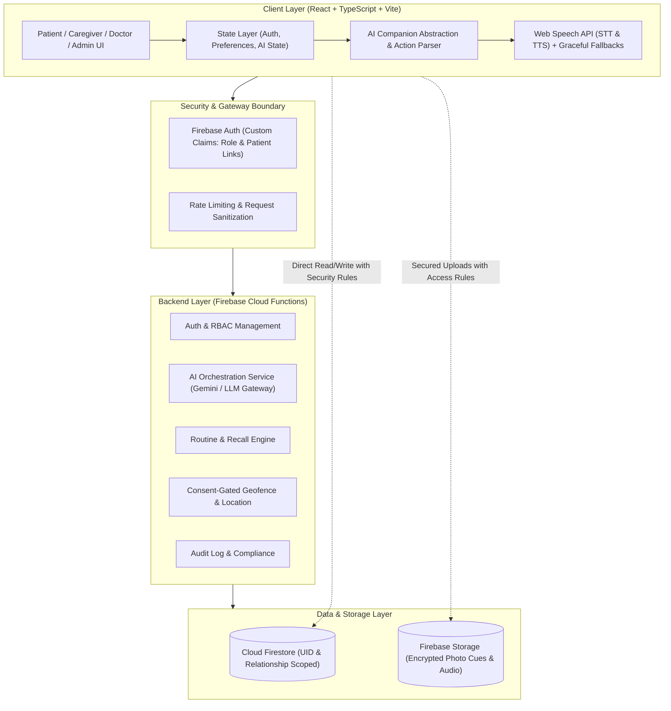
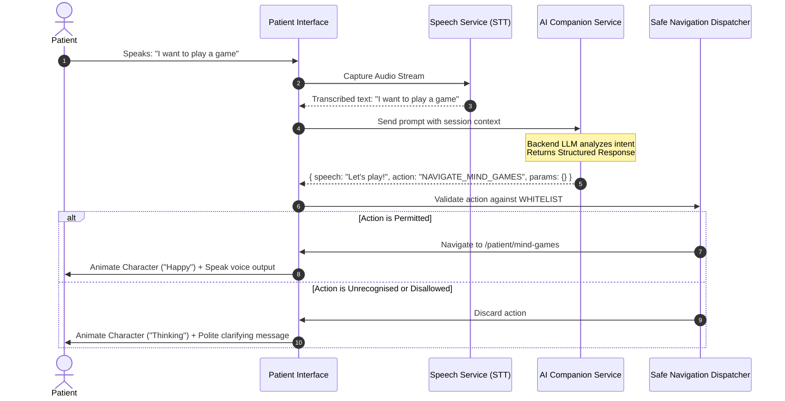

# Saksham — System Architecture Specification

## 1. Architectural Vision & Core Principles

Saksham is architected as an **empathetic, resilient, and privacy-first neuro-care platform**. Its primary users are individuals managing memory challenges, early-to-moderate dementia, or neurological rehabilitation. Consequently, the architecture prioritises:

1. **Zero Confusion & Predictable State**: State transitions must be deterministic, transparent, and forgiving.
2. **Graceful Degradation**: If AI models, Web Speech APIs, or network connections fail, the core user interface remains 100% operable via standard tactile controls.
3. **Defense-in-Depth Security**: All authorization boundaries are enforced at the database and serverless function layers using verified Firebase Authentication Custom Claims.
4. **Sandboxed AI Interactions**: Natural language interactions cannot execute arbitrary commands; they map deterministically to a controlled whitelist of UI intents.
5. **No Hallucinated Clinical Advice**: The AI companion acts strictly as an encouraging facilitator and memory retriever.



---

## 2. Frontend Architectural Modules

The frontend follows a **Domain-Driven Feature Slice** architecture:

```text
frontend/src/
├── assets/
│   └── characters/           # AI Companion Character SVGs & state config
│       ├── girl/             # "Asha" character avatar states
│       ├── boy/              # "Kabir" character avatar states
│       ├── shared/           # Character accessories and decorative cues
│       └── character-config/ # Expression manifests and asset specification
├── components/
│   ├── common/               # Accessible Button, Card, Modal, Input, Badge
│   ├── layout/               # TopBar, BottomNav, DashboardShell, PageHeader
│   └── feedback/             # LoadingScreen, EmptyState, ErrorBoundary, Toast
├── features/
│   ├── ai-companion/         # Character visualizer, speech processor, action runner
│   ├── routines/             # 3-Chance recall widget, checklist, timer
│   ├── loved-ones/           # Family cue gallery, audio clips, relationship cards
│   ├── mind-games/           # Cognitive games catalogue, Room Memory Game
│   └── accessibility/        # Simple mode, Font-scaling, High-contrast provider
├── pages/
│   ├── patient/              # PatientHome, RoutinesView, LovedOnesView, GamesView, Profile
│   ├── caregiver/            # CaregiverDashboard, GeofenceView, PatientLinkView
│   ├── doctor/               # DoctorDashboard, LongitudinalTrends, ActivityAssigner
│   └── admin/                # AdminDashboard, UserVerification, AuditLogs
├── context/
│   ├── AuthContext.tsx       # Auth state, user role, active patient context
│   ├── CharacterContext.tsx  # Active character (Asha/Kabir), emotion state
│   ├── AccessibilityContext.tsx # Font scaling, simple mode, contrast tokens
│   └── LanguageContext.tsx   # i18n locale, translation strings
├── services/
│   ├── firebase.ts           # Initialised Firebase client SDK with env fallbacks
│   ├── aiService.ts          # Safe backend-proxied AI endpoint & intent interpreter
│   └── speechService.ts      # Web Speech Recognition & Speech Synthesis wrapper
└── types/
    ├── user.ts               # User, Role, PatientProfile, CaregiverProfile
    ├── routine.ts            # RoutineItem, RecallAttempt, AssistanceTray
    ├── lovedOnes.ts          # FamilyMember, MemoryCue, AudioRecording
    ├── mindGames.ts          # GameSession, RoomMemoryObject, RoomRecord
    └── ai.ts                 # AIIntent, WhitelistedAction, CharacterState
```

---

## 3. Safe AI Companion Execution Model

To prevent prompt injection, privilege escalation, or unpredictable interface states, the AI Companion is mediated by a strict **Intent-to-Action Whitelist**:



### Whitelisted Actions Catalog:
- `NAVIGATE_HOME`
- `NAVIGATE_ROUTINES`
- `NAVIGATE_LOVED_ONES`
- `NAVIGATE_MIND_GAMES`
- `NAVIGATE_ROOM_MEMORY`
- `TRIGGER_ROUTINE_REMINDER` (opens scheduled task)
- `SHOW_FAMILY_MEMBER` (targets specific verified profile ID)
- `TRIGGER_ASSISTANCE_TRAY` (opens 3-chance assisted recall helper)

---

## 4. Backend Cloud Architecture

The backend operates on a serverless, event-driven architecture using **Firebase Cloud Functions (TypeScript)** and **Cloud Firestore**:

1. **Identity & Role Claims**:
   - `onUserCreate`: Sets default pending role and writes to `users/{uid}`.
   - `setRoleClaim`: Cloud Function callable only by authenticated `admin` to assign role claims (`patient`, `caregiver`, `doctor`, `admin`).
2. **AI Intent Gateway (`/api/ai/converse`)**:
   - Accepts user transcript, validates user session.
   - Inject verified patient context (e.g. registered loved ones, upcoming routine times).
   - Generates an empathetic response and structured action code.
   - Secrets (`GEMINI_API_KEY`, etc.) reside strictly inside Cloud Functions environment variables.
3. **Relationship Authorization**:
   - Caregivers can only link to patients via verified two-way invite tokens stored in `relationships/`.
   - Doctors are assigned patients through clinical assignment records in `doctorAssignments/`.
4. **Security & Audit Logs**:
   - Every sensitive read/write (e.g. location update, medical note creation, role elevation) writes an immutable record to `auditLogs/`.

---

## 5. Character State Engine

The AI character component reflects real-time conversational and affective states:

| Character State | Visual Expression | Trigger Condition |
| :--- | :--- | :--- |
| **Idle** | Gentle breathing, soft eye blink | App open, waiting for patient input |
| **Greeting** | Waving hand, warm smile | App launch, morning session, return from subtab |
| **Listening** | Pulsing audio wave aura, focused eyes | Mic activated, voice input recording |
| **Thinking** | Thoughtful tilt, gentle star sparkle | Backend AI intent generation in progress |
| **Speaking** | Animated mouth movement, friendly smile | Text-to-speech audio playing |
| **Happy** | Sparkling eyes, celebration confetti cue | Activity completed, memory game matched |
| **Reminder** | Gentle bell cue, caring nod | Routine time reached (e.g., 11:00 AM) |
| **Encouraging** | Thumbs-up / heart gesture | Patient uses 2nd or 3rd chance in recall |

---

## 6. Accessibility & Inclusivity Standards

Saksham targets **WCAG 2.1 Level AA / AAA** compliance:
- **Color Contrast**: Minimum 4.5:1 for body copy and 7:1 for headers. Primary lavender and purple tokens are balanced with deep slate (`#1E1B4B`) for crystal readability.
- **Dynamic Type**: User can select from 3 sizes: Default (16px base), Large (18px base), Extra Large (20px base).
- **Simple Mode**: Hides secondary summaries, enlarges touch targets to $\ge 56\text{px}\times 56\text{px}$, and simplifies screen layouts.
- **Screen Reader Semantic Hierarchy**: Proper `<main>`, `<nav>`, `<article>`, `<button>`, and `aria-live="polite"` regions for AI speech and reminders.
- **Motor Accessibility**: Ample whitespace between clickable elements, reducing accidental taps for tremors or motor stiffness.
