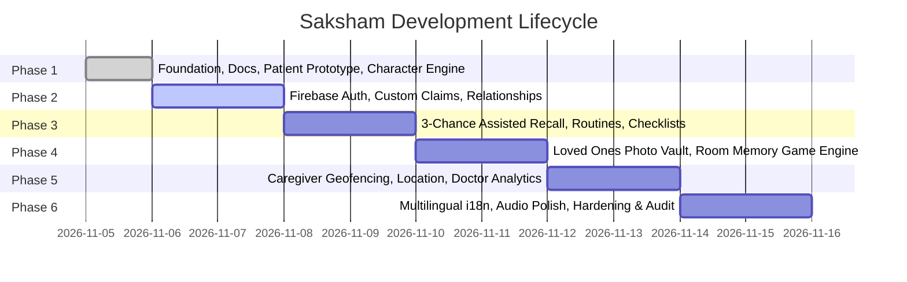

# Saksham — Multi-Phase Development Roadmap

## Phase Overview

The construction of Saksham is organised into **6 distinct, verifiable phases** to ensure architectural integrity, patient safety, and rigorous testing at each milestone.

---

## Phase 1: Foundation & Patient Experience Prototype (Current Phase)

### Objectives:
- [x] Initialise clean root, frontend, backend, and documentation directories.
- [x] Author core documentation (`ARCHITECTURE.md`, `DATABASE_SCHEMA.md`, `ROLE_PERMISSIONS.md`, `UI_GUIDELINES.md`, `DEVELOPMENT_ROADMAP.md`).
- [x] Create React + TypeScript + Vite frontend architecture with Tailwind CSS & Lucide icons.
- [x] Create Firebase Functions backend scaffolding with secure Cloud Functions setup, Firestore rules, and Storage rules.
- [x] Implement the 4 role-based routing structures (`/patient`, `/caregiver`, `/doctor`, `/admin`).
- [x] Build the Patient Home Screen with:
  - Saksham branding and empathetic tone.
  - Interactive AI Character component (supporting 8 states: Idle, Greeting, Listening, Speaking, Thinking, Happy, Reminder, Encouraging).
  - Voice interaction & text input with simulated/Web Speech API integration.
  - Safe whitelisted action dispatcher for natural language navigation.
  - 3 Primary Feature Cards: Daily Routines & Care, Loved Ones, Mind Games.
  - Next Activity Card (11:00 AM) with Assisted Recall trigger.
  - Weekly progress summary and Bottom Navigation.
- [x] Build dedicated sub-screens for:
  - Daily Routines & Care (Assisted recall + direct checklist).
  - Loved Ones (Verified photo cues and relationship directory).
  - Mind Games (Cognitive activities + Room Memory Game).
- [x] Create character asset specifications in `frontend/src/assets/characters/`.
- [x] Build comprehensive automated test suite (Frontend + Backend).
- [x] Verify zero build or test errors.

---

## Phase 2: Live Firebase Auth & Cryptographic Role Governance
- Connect live Firebase project with Web SDK and Admin SDK.
- Cloud Functions for custom claims (`patient`, `caregiver`, `doctor`, `admin`).
- Secure two-way caregiver invitation code exchange (`relationships` collection).
- Real-time user profile persistence and settings sync.

---

## Phase 3: Assisted Recall & Routine Automation Engine
- Full 3-Chance Assisted Recall engine:
  - Level 1: Subtle contextual clue.
  - Level 2: Visual card & sensory memory clue.
  - Level 3: Concrete direct instruction with caregiver contact option.
- Assistance tray persistent state management (timer and attempt counts preserved).
- Caregiver routine editing and permission enforcement.
- Gentle streak counter without shame mechanics.

---

## 4: Loved Ones Media Vault & Room Memory Game
- Verified Family Member profile management with photo upload to Firebase Storage.
- Audio recording voice notes ("Hi Dad, it's Ananya!").
- Room Memory Game:
  - Room photo upload and tagging of frequent items (glasses, keys, medication).
  - "Where did I leave my glasses?" search query matching against verified room photos.
  - Explicit distinction between historical photo state and current physical reality.

---

## Phase 5: Location Safety, Geofencing & Clinical Analytics
- Patient-side consent toggle for GPS coordinate sharing.
- Caregiver dashboard with interactive map, circular geofence setting, and boundary breach alerts.
- Doctor dashboard with longitudinal adherence charts, separating measured behavioral metrics from AI suggestions.
- Clinician task assignment and progress notes.

---

## Phase 6: Internationalisation, Voice Maturation & Production Audit
- Multilingual i18n support (English, Hindi, and regional languages).
- Natural text-to-speech voice selection and rate adjustments.
- WCAG 2.1 AA/AAA compliance audit.
- Full Firebase Security Rules audit and load testing.
