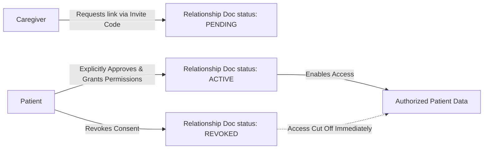

# Saksham — Role-Based Access Control (RBAC) & Security Permissions

## 1. Zero-Trust Authorization Model

In Saksham, **frontend state is never trusted for authorization**. A user cannot merely set `role: "doctor"` in local storage or client state to access privileged routes or data. 

All authorization is anchored in:
1. **Firebase Authentication Custom Claims**: Cryptographically signed JWT tokens issued by backend Firebase Admin SDK.
2. **Server-Side Token Verification**: Cloud Functions check `context.auth.token.role` before processing requests.
3. **Firestore Security Rules**: Database queries evaluate `request.auth.token.role` and record ownership fields.

---

## 2. Core User Personas

| Role | Primary Responsibility | Data Boundary |
| :--- | :--- | :--- |
| `patient` | Uses companion, completes routines, recalls loved ones, plays mind games | Strictly isolated to `patientId === request.auth.uid` |
| `caregiver` | Monitors routines, reviews consent-gated location, manages photo cues | Only accessible for patients with an `active` relationship |
| `doctor` | Reviews longitudinal cognitive metrics, assigns tasks, writes notes | Only accessible for patients explicitly assigned in clinical roster |
| `admin` | Manages accounts, audits platform logs, verifies provider roles | System-wide administrative controls; **no unrestricted access** to raw patient clinical notes |

---

## 3. Comprehensive Permission Matrix

| Feature / Resource | Patient | Caregiver | Doctor | Admin |
| :--- | :---: | :---: | :---: | :---: |
| **Patient Home & AI Companion** | ✅ Full Access | ❌ | ❌ | ❌ |
| **Self Daily Routines (Complete/Recall)** | ✅ Full Access | ❌ (Cannot impersonate) | ❌ | ❌ |
| **Routine Configuration** | ✅ Own | ✅ Linked Patient (if permitted) | ✅ Assign Tasks | ❌ |
| **Loved Ones (View Photo Cues)** | ✅ Own | ✅ Linked Patient | ❌ | ❌ |
| **Loved Ones (Upload / Edit)** | ✅ Own | ✅ Linked Patient | ❌ | ❌ |
| **Room Memory Game (Upload/Play)** | ✅ Own | ✅ Assist Linked Patient | ❌ | ❌ |
| **Mind Games Cognitive Results** | ✅ View Summary | ✅ View Summary | ✅ Longitudinal Analytics | ❌ |
| **Live Location Sharing Status** | ✅ Toggle/Revoke | ✅ View (Active Consent only) | ❌ (Denied by default) | ❌ |
| **Geofence Boundary Configuration** | ❌ | ✅ Linked Patient | ❌ | ❌ |
| **Clinical Notes & Prescriptions** | ❌ (Not a prescription tool)| ❌ | ✅ Author/Edit Notes | ❌ |
| **Caregiver Link Approval/Revocation** | ✅ Grant/Revoke | ❌ (Can request only) | ❌ | ❌ |
| **User Role Assignment** | ❌ | ❌ | ❌ | ✅ Server-mediated |
| **Security Audit Logs** | ❌ | ❌ | ❌ | ✅ Read-only |
| **System Health & User Feedback** | ❌ | ❌ | ❌ | ✅ Manage |

---

## 4. Relationship Authorization Contract



### Granular Caregiver Permission Flags:
- `canViewLocation`: Enables coordinates & geofence alerting. If `false`, caregiver location screen renders an explicit "Permission not granted by patient" notice.
- `canEditRoutines`: Permits schedule adjustments and reminder time setting.
- `canViewCognitiveReports`: Permits access to game completion summaries.
- `canManageLovedOnes`: Permits uploading family pictures and adding voice notes.

---

## 5. Doctor Assignment Contract

1. Doctors receive access only when a clinical assignment record exists: `doctorAssignments/{assignmentId}` with matching `patientId` and `doctorId`.
2. Doctors can view:
   - Routine completion rate over 30/60/90 days.
   - Cognitive session scores, attempts count, and time taken.
   - **Crucial Distinction**: Doctor analytics displays measured physical observations separately from AI-generated suggestions to prevent clinical bias.

---

## 6. Firestore Security Rules Blueprint

```javascript
rules_version = '2';
service cloud.firestore {
  match /databases/{database}/documents {
    
    function isAuthenticated() {
      return request.auth != null;
    }
    
    function isPatient(patientId) {
      return isAuthenticated() && request.auth.uid == patientId;
    }
    
    function hasRole(role) {
      return isAuthenticated() && request.auth.token.role == role;
    }
    
    function isAdmin() {
      return hasRole('admin');
    }
    
    function isAuthorizedCaregiver(patientId) {
      return hasRole('caregiver') && 
        exists(/databases/$(database)/documents/relationships/$(request.auth.uid + '_' + patientId)) &&
        get(/databases/$(database)/documents/relationships/$(request.auth.uid + '_' + patientId)).data.status == 'active';
    }
    
    match /users/{uid} {
      allow read: if isAuthenticated() && (request.auth.uid == uid || isAdmin());
      allow update: if isAuthenticated() && request.auth.uid == uid && 
        !request.resource.data.diff(resource.data).affectedKeys().hasAny(['role', 'isVerified']);
    }
    
    match /patients/{patientId} {
      allow read: if isPatient(patientId) || isAuthorizedCaregiver(patientId) || isAdmin();
      allow write: if isPatient(patientId) || isAuthorizedCaregiver(patientId);
    }
    
    match /routines/{routineId} {
      allow read: if isAuthenticated() && (
        isPatient(resource.data.patientId) || 
        isAuthorizedCaregiver(resource.data.patientId)
      );
      allow write: if isAuthenticated() && (
        isPatient(request.resource.data.patientId) || 
        isAuthorizedCaregiver(request.resource.data.patientId)
      );
    }
    
    match /lovedOnes/{lovedOneId} {
      allow read, write: if isAuthenticated() && (
        isPatient(resource.data.patientId) || 
        isAuthorizedCaregiver(resource.data.patientId)
      );
    }
    
    match /auditLogs/{logId} {
      allow read: if isAdmin();
      allow write: if false; // Only backend Cloud Functions with Admin SDK can write
    }
  }
}
```
