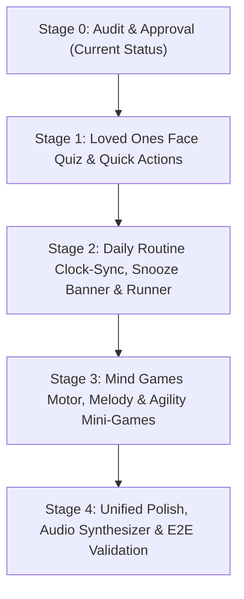

# SAKSHAM (सक्षम) — LEGACY PATIENT EXPERIENCE RESTORATION
## STAGE 0: COMPREHENSIVE READ-ONLY TECHNICAL & DESIGN AUDIT

**Document Reference:** `docs/legacy-restoration/LEGACY_PATIENT_EXPERIENCE_AUDIT.md`  
**Audit Date:** November 7, 2026  
**Audited Repositories:**
- **New Project (Target):** `/Users/trishnabapna/Desktop/Saksham` (Active branch: `phase-2-patient-experience`)
- **Legacy Reference Project (Source):** `/Users/trishnabapna/Downloads/Saksham-Legacy-main`

---

## Executive Overview

The purpose of this audit is to systematically compare the patient-facing experience of the **New Saksham Application** against the **Legacy Saksham Reference Application** across three foundational care domains:
1. **Daily Routine & To-Do List**
2. **Mind Games & Cognitive Agility**
3. **Loved Ones & Family Memory Vault**

The objective is to identify the most engaging, accessible, and clinically valuable features from the legacy application and design a plan to restore them into the modern React/TypeScript/Vite architecture of the new project without destabilizing its unified identity, Cloud Firestore dual-store persistence, Asha AI Companion, or Firebase Spark (free tier) constraints.

---

## 1. Architectural Baseline Comparison

| Architectural Dimension | New Saksham (`Desktop/Saksham`) | Legacy Reference (`Saksham-Legacy-main`) |
| :--- | :--- | :--- |
| **Framework & Build** | React 18, TypeScript 5.5, Vite 5.4, Tailwind CSS | Dual: Root Vanilla JS PWA (`index.html`) + `apps/frontend` (React 18 + Vite) |
| **Component Hierarchy** | Modular React functional components with custom hooks | Vanilla DOM manipulation (`routine.js`, `games.js`, `vault.js`) + React monorepo |
| **Identity & Scoping** | Unified `getEffectivePatientId(user)` with isolated `guest_patient_local` | Global `state.activeUid`, `localStorage` key prefixes |
| **Data Persistence** | Dual-Store: Synchronous local cache + Cloud Firestore (`/routines`, `/lovedOnes`, `/gameSessions`) | LocalStorage (`saksham_tasks_*`, `saksham_familiar_people`) with optional Firestore adapter |
| **AI Companion** | Integrated **Asha AI Companion** (8 SVG states, contextual intent engine, voice TTS) | Miko Robot / Dadi / Priya SVG illustrations (`illustrations.js`, `pixel-character.js`) |
| **Design Language** | Calm Lavender, Royal Purple, Pastel Rose, Emerald accents | Forest Green (`#234E35`), Cream (`#FAF7F0`), Amber, Teal |
| **Audio Feedback** | Web Speech API (`SpeechService.ts`) with English & Hindi support | Web Speech API (`speech.js`) + Web Audio API synthesizer (`audio.js`) |
| **Hosting & Cloud Tier**| Firebase Spark Plan (100% free tier: 0 Cloud Functions, 0 paid APIs) | Vercel deployment with Node Express backend (`server.js`) & SimpleWebAuthn |

---

## 2. Domain Audit 1: Daily Routine & To-Do List

### 2.1 Current Implementation (New Project)
- **Primary View (`DailyRoutines.tsx`):**
  - Two-tab switcher: `Direct Schedule Checklist` vs `3-Chance Assisted Recall`.
  - Dynamic daily progress card showing `X of Y Completed`, percentage, and gentle consecutive day streak.
- **Task Checklist (`RoutineChecklist.tsx`):**
  - Organizes tasks by time of day: Morning, Afternoon, Evening.
  - Highlights next due incomplete routine with an `Up Next` gradient pill.
  - Basic Snooze menu allowing 5-minute or 15-minute postponement (`routine.snoozedUntil`).
  - Read Aloud button for each routine using Web Speech API.
  - One-tap buttons for `3-Chance Assisted Recall` and `Start Guided Step-by-Step`.
- **Three-Chance Assisted Recall (`AssistedRecallEngine.tsx`):**
  - Progressive 3-stage hint progression: Hint 1 (general context) $\rightarrow$ Hint 2 (location cue) $\rightarrow$ Hint 3 (direct answer reveal).
  - Visual Hearts badge (`❤️❤️❤️`).
  - Strict non-punitive feedback recording attempts in Cloud Firestore without penalizing patient.
- **Guided Activity Runner (`GuidedTaskRunner.tsx`):**
  - Modal displaying one step at a time with Previous/Next controls.
  - Integrated countdown timer with play/pause/reset.
  - Basic "Stuck?" assistance button providing reassurance.

### 2.2 Legacy Implementation (Reference Project)
- **Clock-Aware Dynamic Task Sync (`syncLiveTimeTaskIndex` in `routine.js`):**
  - Automatically identifies the current task based on real clock time:
    1. Exact minute match with scheduled time.
    2. Active time slot window: $[-45\text{ mins}, +30\text{ mins}]$ relative to `Date.now()`.
    3. Next pending upcoming task.
    4. Automatically scrolls or defaults the view to the patient's immediate live task.
- **Companion Mascot Snooze Reminder Banner (`#companionMascotReminderBanner` in `index.html`):**
  - High-contrast alert banner sliding in when a task is due or snoozed.
  - Displays mascot character, time pill (`Due Now`), and direct actionable buttons:
    - `Let's Do It! 🌟` (Launches guided runner)
    - `Remind me in 3 mins ⏰` (Immediate 3-minute snooze)
    - `✓` (One-tap completion)
    - Dismiss control.
- **Multi-Step Guided Activity Runner (`modalTaskRunner` in `index.html`):**
  - Full scrollable checklist displaying **all steps simultaneously** with interactive checkboxes.
  - 10m / 15m preset duration buttons.
  - `+5m` timer extension button (adds 300 seconds on the fly with zero penalty).
  - Ticking all step checkboxes automatically marks the routine complete with confetti celebration (`confetti({ particleCount: 60 })`) and fanfare chime.
- **Diagnostic Checkpoints Modal (`openTaskHelpModal` in `routine.js`):**
  - When patient taps "Stuck?", opens a diagnostic questionnaire:
    1. *"Just starting / What items do I need?"*
    2. *"Looking for items in the room"*
    3. *"Halfway through and lost my place"*
    4. *"Need a caregiver to assist me"*
  - Provides pinpoint auditory guidance for each checkpoint.
- **SVG Circular Progress Ring (`index.html`):**
  - SVG circle with `stroke-dashoffset` animation showing exact adherence percentage in the center.
- **Proactive Browser Notifications & Quiet Hours (`notifications.js`):**
  - System Web Notification with action buttons (`Start Activity`, `Mark Done`).
  - Screen wake-lock (`navigator.wakeLock`) preventing mobile screens from turning off during active tasks.
  - Quiet hours suppression (e.g., 22:00 to 07:00) so patients are never disturbed while resting.
- **Evening Cognitive Guard (`toggleEveningGuard` in `routine.js`):**
  - Specialized Sundowning Mode: Dims background distractions, simplifies typography, and displays a dedicated evening wind-down checklist.

### 2.3 Gap Analysis: What is Missing in the New App
1. **Clock-Aware Auto-Highlighting:** The new app does not dynamically compute the $[-45\text{m}, +30\text{m}]$ active time window on load.
2. **Interactive Multi-Step Checklist in Runner:** The new runner shows only one step at a time; the legacy runner provides an overview checklist where patients can tick off completed sub-steps.
3. **Timer Preset Quick Controls:** Missing 10m/15m quick presets and `+5m` snooze extension inside the runner.
4. **Diagnostic Checkpoints:** The new "Stuck?" modal is minimal; the legacy system had 4 structured checkpoints with contextual speech guidance.
5. **Companion Snooze Reminder Banner:** Missing the top floating nudge banner with quick 3-minute snooze.
6. **Harmonic Audio Chimes:** The new app has voice speech synthesis but lacks pleasant Web Audio chimes for button taps and task completion.
7. **Circular Progress Ring:** The new app uses a linear bar; the legacy circular ring provided strong visual prominence.
8. **Quiet Hours & Browser Notification Integration:** Missing permission request UI and quiet hours rest window suppression.

---

## 3. Domain Audit 2: Mind Games & Cognitive Agility

### 3.1 Current Implementation (New Project)
- **Catalogue (`gamesService.ts`):**
  - 13 cognitive game definitions spanning 4 categories: `memory`, `attention`, `sequencing`, and `language`.
- **Implemented Game Runners (`features/games/components/runners/`):**
  - `CardMatchingGame.tsx` (Nature card pairs)
  - `DailySequenceGame.tsx` (Tea prep, gardening step sequencing)
  - `LovedOnesMemoryGame.tsx` (Matching phrases to loved ones)
  - `PatternMatchGame.tsx` (Geometric and color sequence completion)
  - `VisualSearchGame.tsx` (Garden visual item discovery)
  - `WordGardenGame.tsx` (Calm word association and unscrambling)
  - `RoomMemoryActivity.tsx` (Object anchors in living room scenes)
- **Difficulty & Adaptive Recommender:**
  - 3 difficulty levels (`Gentle`, `Moderate`, `Engaged`).
  - Automatically recommends difficulty based on completion history.
- **Session History & Feedback:**
  - Saves completed game sessions to Cloud Firestore (`/gameSessions`).
  - Feedback modal recording patient's self-reported comfort (`peaceful`, `enjoyed`, `tiring`).

### 3.2 Legacy Implementation (Reference Project)
- **8 Dedicated Mini-Games (`games.js`):**
  1. **Color Sequence Recall (`mg-view-1`):** Simon-style visual memory game with 4 vibrant colors (Rose Red, Sky Blue, Emerald Green, Amber Yellow) pulsing with chime audio.
  2. **Consecutive Shape/Color Focus (`mg-view-2`):** Rapid N-back style match comparing current shape against previous shape (Star, Diamond, Circle, Square).
  3. **Bimanual Tap Rhythm (`mg-view-3`):** Alternating left/right button tap exercise designed specifically for Parkinson's motor agility and tremor regulation.
  4. **Target Catch Reflex (`mg-view-4`):** Timed coordinate target catching on a canvas area for eye-hand coordination.
  5. **Calm Maze Navigation (`mg-view-5`):** 3x3 grid runner guiding a character 🏃 back to their safe home 🏡 using directional pads.
  6. **Word Scramble Anchor (`mg-view-6`):** Word unscrambler with positive cognitive anchors (SMILE, HEALTH, HARMONY).
  7. **Melody Ear Training (`mg-view-7`):** Pure Web Audio synthesizer playing musical note sequences (C, E, G, C2) that the patient reproduces on musical pads.
  8. **Mental Math Sprint (`mg-view-8`):** Non-punitive arithmetic sprint with paced difficulty tiers.
- **Dynamic Gamification HUD (`updateGamificationHud`):**
  - Prominent XP counter (`Level 2 Mind Titan`, `350 XP`).
  - Active Streak Counter with flame icon (`4-Day Streak 🔥`).
  - `+50 XP Neuro-Boost` quick action button with confetti and fanfare chime.
- **Pacing Selector:**
  - Dedicated 3-way toggle: `Calm` (longer intervals, smaller goals), `Balanced`, `Agile` (shorter intervals, higher goals).
- **Audio Synthesizer Engine (`audio.js`):**
  - Standalone Web Audio API oscillator synthesis generating custom pitches (261.6Hz to 523.2Hz) without external audio file dependencies.

### 3.3 Gap Analysis: What is Missing in the New App
1. **Motor & Auditory Game Types:** The new app has strong visual memory and sequencing games, but is missing:
   - **Bimanual Alternating Tap Rhythm** (vital for Parkinson's patients).
   - **Melody Ear Training with Web Audio synthesizer**.
   - **Calm 3x3 Grid Maze Navigation**.
   - **Mental Arithmetic Sprint**.
2. **Interactive Runners for 6 Catalog Games:** Games 2, 5, 7, 9, 11, and 12 in the new catalog currently lack dedicated runner components.
3. **Dynamic Pacing Toggle:** Legacy allowed switching between Calm, Balanced, and Agile pacing directly inside the game header.
4. **XP & Positive Neuro-Score Gamification:** The legacy project had an exciting yet gentle XP scoring system with confetti celebrations that boosted patient motivation.

---

## 4. Domain Audit 3: Loved Ones & Family Memory Vault

### 4.1 Current Implementation (New Project)
- **Directory & Gallery (`LovedOnes.tsx`, `FamilyMemberCard.tsx`):**
  - Card gallery showing member photo (with UI avatar fallback), name, relationship, nickname, description, and familiar phrase.
  - Search filter supporting names, nicknames, and relationships.
  - Direct audio playback of recorded voice notes or Web Speech API synthesis of memory cues.
- **Detailed Profile Modal (`LovedOneProfileModal.tsx`):**
  - Displays high-resolution photo, relationship tag, familiar phrase, important memories, favourite shared activities, voice note transcript, and personal patient notes.
  - Delete contact confirmation modal.
- **Assisted Memory Cues Modal (`AssistedMemoryCueModal.tsx`):**
  - 3-step progressive hints to help the patient recall who the person is.
- **Add/Edit Modal (`AddEditLovedOneModal.tsx`):**
  - Clean form allowing creation and editing of family members, persisted directly to Cloud Firestore.

### 4.2 Legacy Implementation (Reference Project)
- **Face Recall Quiz Flashcard (`#view-vault` & `loadFaceQuizCard` in `vault.js`):**
  - Prominent quiz card at the top of the Loved Ones tab.
  - Displays member photo, voice clue in quotes, `🔊 Read Clue Aloud` button.
  - `Need a hint? Tap for relation` button that reveals relationship without giving away the full answer.
  - 4 multiple-choice name buttons with immediate auditory bell/chime feedback.
  - `Next Face ➔` button cycling through the family album.
- **Direct Communication Action Buttons (`lovedOnesContainer` in `vault.js`):**
  - Dedicated **`📞 Call`** button triggering native phone dialer (`tel:+91...`).
  - Dedicated **`💬 WhatsApp`** button opening WhatsApp conversation (`https://wa.me/...`).
- **Flexible Photo Ingestion Options:**
  - File selector (`<input type="file">`).
  - Direct Clipboard Paste button (`navigator.clipboard.read()` or paste event).
  - Live Webcam Photo Capture modal (`getUserMedia` snapshot).

### 4.3 Gap Analysis: What is Missing in the New App
1. **Interactive Face Recall Quiz Card:** The new app only has family memory lookup as a mini-game inside Mind Games; it lacks the loved ones flashcard quiz directly on the family page.
2. **Direct Call & WhatsApp Quick-Dial Buttons:** The new app's family member cards do not have one-touch phone dialer or WhatsApp links, which are vital for dementia/Alzheimer's patients who need instant connection.
3. **Inline Relationship Reveal Hint:** The quick "Need a hint? Tap for relation" toggle on the card.
4. **Clipboard & Camera Photo Ingestion:** The new add/edit modal only accepts photo URLs or basic file uploads.

---

## 5. Architectural Preservation & Rules of Engagement

The following existing architectures in the new project **must be preserved without regression**:

```
+-----------------------------------------------------------------------------------+
|                            NEW SAKSHAM PRESERVED FOUNDATION                       |
+-----------------------------------------------------------------------------------+
| 1. Asha AI Companion       | 8 SVG states, calm voice, real-time contextual intent|
| 2. Unified Identity        | getEffectivePatientId(user) with guest_patient_local |
| 3. Cloud Firestore Rules   | Strict tenant isolation, owner field immutability    |
| 4. Spark Tier Safety       | Zero paid APIs, zero Cloud Functions, 100% free plan |
| 5. Calming Visual Identity | Lavender, soft purple, pastel rose aesthetic         |
| 6. Multilingual Core       | English & Hindi localization with SpeechService      |
| 7. Accessibility Engine    | WCAG 2.1 AA large touch targets, font scaling (A-/A+)|
+-----------------------------------------------------------------------------------+
```

---

## 6. Proposed UI & Functional Restoration Plan

### 6.1 Daily Routine Restoration
1. **Clock-Aware Header & Live Task Highlighter:**
   - Integrate `syncLiveTimeTaskIndex` logic into `DailyRoutines.tsx` and `PatientDashboard.tsx` to automatically identify whether the patient is within an active $[-45\text{m}, +30\text{m}]$ task window.
2. **Companion Mascot Snooze & Reminder Banner:**
   - Create `CompanionReminderBanner.tsx` displayed at the top of the Daily Routines page when a task is due or snoozed.
   - Features Asha with a gentle waving emotion, task title, `Let's Do It!` button, `Remind me in 3 mins ⏰` button, and direct completion checkmark.
3. **Enhanced Multi-Step Guided Activity Runner (`GuidedTaskRunner.tsx`):**
   - Add a full-view scrollable checklist with individual checkboxes alongside the single-step navigator.
   - Add preset buttons for 10m and 15m duration, plus a `+5m` timer extension button.
   - Enhance the "Stuck?" modal with the 4 diagnostic checkpoints and supportive audio readouts.
4. **SVG Circular Adherence Ring:**
   - Add an accessible, calm SVG circular progress ring option to the dashboard / routines header (`stroke-dashoffset` animation).
5. **Harmonic Web Audio Chime Service:**
   - Create `audioSynthesizerService.ts` using the Web Audio API to play gentle, low-frequency bell, chime, and fanfare sounds without loading external mp3 files.

### 6.2 Mind Games Restoration
1. **Restore Key Legacy Motor & Agility Games:**
   - **Bimanual Tap Rhythm Runner (`BimanualTapGame.tsx`):** Alternating bilateral motor taps designed for Parkinson's motor fluency.
   - **Melody Ear Training Runner (`MelodySequenceGame.tsx`):** Musical note ear training powered by Web Audio API synthesizers.
   - **Color Pulse Sequence Runner (`ColorSequenceGame.tsx`):** Simon-style visual working memory game.
   - **Gentle Mental Arithmetic Sprint (`MathSprintGame.tsx`):** Calming, non-punitive number exercises.
   - **Calm 3x3 Maze Navigation (`MazeRunnerGame.tsx`):** Step-by-step spatial orientation game.
2. **Mind Games Pacing Selector:**
   - Add the `Calm | Balanced | Agile` pacing toggle into `GameHeader.tsx`.
3. **Gentle Neuro-Score & Celebration:**
   - Integrate XP badges, streak highlights, and optional non-intrusive particle confetti for milestones.

### 6.3 Loved Ones & Family Memory Restoration
1. **Dedicated Face Recall Flashcard Quiz (`FaceRecallQuizCard.tsx`):**
   - Place a gentle memory flashcard quiz at the top of `LovedOnes.tsx`.
   - Displays photo, clue, `Read Clue Aloud` button, `Need a hint? Tap for relation` toggle, 4 multiple choice buttons with audio chimes, and `Next Face ➔`.
2. **Direct Quick-Contact Actions on Family Cards:**
   - Add high-contrast `📞 Call` (`tel:...`) and `💬 WhatsApp` (`https://wa.me/...`) buttons to `FamilyMemberCard.tsx` and `LovedOneProfileModal.tsx`.
3. **Enhanced Contact Photo Ingestion:**
   - Add support for clipboard image pasting (`navigator.clipboard`) and optional live webcam photo capture into `AddEditLovedOneModal.tsx`.

---

## 7. Required Data & Schema Changes

To maintain 100% backward compatibility with Cloud Firestore rules and existing stored data, **no breaking schema changes will be made**. Minor optional fields will be added to existing TypeScript interfaces:

### 7.1 Routine Item Extension (`types/index.ts`)
```typescript
export interface RoutineItem {
  // Existing fields preserved
  id: string;
  title: string;
  description?: string;
  scheduledTime: string;
  category: RoutineCategory;
  period?: 'morning' | 'afternoon' | 'evening';
  isCompleted: boolean;
  completedAt?: string;
  snoozedUntil?: string;
  streakCount: number;
  enableAssistedRecall?: boolean;
  timerMinutes?: number;
  steps?: string[];
  recallQuestion?: string;
  recallOptions?: string[];
  correctOptionIndex?: number;
  recallCues?: RoutineCues;

  // Optional extensions for legacy parity:
  subStepsCompleted?: number[]; // Indices of checked-off runner steps
  photoProofUrl?: string;       // Optional attached memory photo
}
```

### 7.2 Loved One Contact Extension (`types/index.ts`)
```typescript
export interface LovedOne {
  // Existing fields preserved
  id: string;
  name: string;
  relationship: string;
  nickname?: string;
  photoUrl: string;
  description: string;
  familiarPhrase?: string;
  cues: string[];
  importantMemories?: string[];
  favouriteActivities?: string[];
  audioNote?: string;
  voiceRecording?: VoiceRecording;
  patientNotes?: string;

  // Optional extensions for legacy parity:
  phoneNumber?: string;   // For tel: action (e.g. +91 98765 43210)
  whatsappNumber?: string;// For WhatsApp action (digits only)
  quizOptions?: string[]; // Custom multiple choice options for face recall quiz
}
```

---

## 8. Security, Privacy & Cloud Free-Tier Compliance

1. **Firestore Security Rules:**
   - Zero modifications to `backend/firestore.rules` are required.
   - All restored features use existing patient-scoped document collections (`/routines`, `/lovedOnes`, `/gameSessions`).
2. **Input Sanitization:**
   - Phone numbers and WhatsApp numbers will be strictly sanitized to remove non-numeric/URL-injection characters (`value.replace(/[^0-9+]/g, '')`).
3. **No External Paid APIs (100% Spark Plan Compliant):**
   - Web Audio API is completely browser-native and offline (0 server costs).
   - Audio synthesis and speech recognition run entirely on-device via Web Speech API.
   - Zero Cloud Functions or external AI vendor APIs (OpenAI/Anthropic) are introduced.

---

## 9. Comprehensive Testing Strategy

1. **Unit & Component Testing (Vitest + Testing Library):**
   - `RoutineSnoozeBanner.test.tsx`: Verifies banner appearance, 3m snooze, guided activity launch, and completion.
   - `GuidedTaskRunnerChecklist.test.tsx`: Verifies step completion, `+5m` timer extension, and diagnostic help modal.
   - `FaceRecallQuiz.test.tsx`: Verifies quiz rendering, clue audio, relationship hint reveal, correct/incorrect guess feedback.
   - `NewMiniGames.test.tsx`: Verifies Bimanual Tap Rhythm, Melody Sequence synthesis, and Color Pulse game logic.
2. **Security & Role Isolation Testing:**
   - Verify unauthenticated guest mode remains fully isolated under `guest_patient_local`.
   - Verify telephone links and WhatsApp links sanitize inputs against XSS and protocol exploits.
3. **Accessibility Audit (WCAG 2.1 AA):**
   - Tap targets $\ge 48\times 48\text{px}$.
   - High contrast mode and font-scaling compatibility.
   - Screen reader ARIA live regions for audio chimes, timer ticks, and quiz feedback.

---

## 10. Recommended Implementation Order

To maintain stability and enable incremental review, the restoration should be executed in 4 controlled stages:



- **Stage 1 — Loved Ones Restoration:**
  - Add `FaceRecallQuizCard` component to `LovedOnes.tsx`.
  - Add direct `📞 Call` and `💬 WhatsApp` buttons to family cards and profile modals.
  - Add optional phone number fields and clipboard/camera photo ingestion to `AddEditLovedOneModal`.
- **Stage 2 — Daily Routines Restoration:**
  - Add `CompanionReminderBanner` with 3-minute snooze and Asha companion mascot.
  - Upgrade `GuidedTaskRunner` with full checklist view, `+5m` timer extension, and 4-checkpoint diagnostic modal.
  - Add clock-aware active time window auto-selection.
- **Stage 3 — Mind Games Restoration:**
  - Build runners for Bimanual Tap Rhythm, Melody Sequence, Color Pulse, and Mental Math.
  - Add `Calm | Balanced | Agile` pacing toggle.
  - Add gentle XP gamification HUD and celebratory chimes.
- **Stage 4 — Final Polish & End-to-End Verification:**
  - Add `audioSynthesizerService.ts` for Web Audio API chimes across all modules.
  - Full automated test suite verification (Vitest frontend + backend, typechecks, and production Vite builds).

---

## 11. Conclusion & Next Steps

This audit establishes a safe, non-destructive path to bring the most cherished and clinically effective patient-facing features from legacy Saksham into the modern new application.

**Status:** Audit complete. In strict accordance with the instructions, all work is paused and awaiting user approval before beginning Stage 1.
