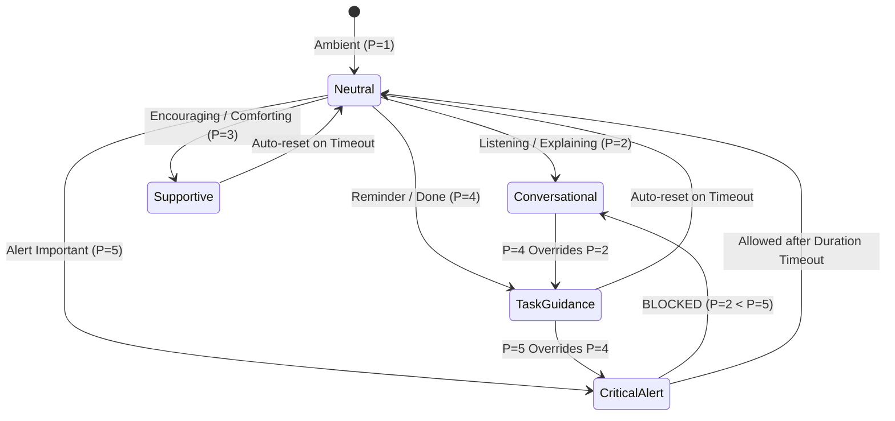

# SAKSHAM — MILESTONE 7.1 COMPLETION REPORT
# HIGH-FIDELITY ASHA CHARACTER ENGINE & 30-EXPRESSION MATRIX

**Repository:** `/Users/trishnabapna/Desktop/Saksham`  
**Branch:** `phase-2-patient-experience`  
**Feature Commit:** `a1bbb4d`  
**Firebase Project:** `saksham-d3b71` (Spark Free Tier)  
**Production URL:** https://saksham-d3b71.web.app  
**Date:** November 2026

---

## 1. EXECUTIVE SUMMARY & PRODUCT OBJECTIVE

In accordance with the character-led patient experience roadmap established in the master architecture audit, **Milestone 7.1: High-Fidelity Asha Character Engine & 30-Expression Matrix** has been successfully implemented, verified, and integrated into the Saksham ecosystem.

The core objective of Milestone 7.1 is to establish a high-fidelity emotional and visual presentation engine for **Asha**, the central neuro-care companion of Saksham. Prior to this milestone, Asha was represented by a simplified 8-state SVG chibi avatar. Milestone 7.1 introduces a 30-expression context-aware engine extracted from the master visual character design assets, paired with an emotion priority state machine, dual presentation modes (**Primary** for conversational immersion and **Compact** for companion utilities), complete backward compatibility with legacy consumers, and full Pan-India localization across all 22 Eighth Schedule languages plus English.

### Key Deliverables Completed
1. **30-Expression Matrix:** 5 canonical neuro-care categories containing exactly 6 context-aware expressions each (30 total), directly sliced and optimized from the source character design sheet into `frontend/public/assets/character/asha/`.
2. **Dual Presentation Modes:**
   - **Primary Mode:** High-resolution, full-expression avatar (160–240px) with responsive ambient breathing aura, dynamic state badge, and optional localized subtitle label for the future conversational sanctuary.
   - **Compact Companion Mode:** Sleek, non-obtrusive circular badge (56–72px) with micro-indicator dot for ambient placement in Daily Routines and Mind Games.
3. **State Priority & Transition Service (`CharacterStateEngine`):** Hierarchical priority levels (1: ambient/idle, 2: conversational, 3: supportive, 4: task/routine, 5: critical alert). Guarantees that active high-priority states (e.g., `alert_important`) cannot be silently overwritten by lower-priority ambient triggers, while auto-resetting to `neutral` upon duration expiration.
4. **Complete Backward Compatibility:** Callers using the legacy 8-state system (`idle`, `greeting`, `listening`, `speaking`, `thinking`, `happy`, `reminder`, `encouraging`) are seamlessly resolved to their 30-expression equivalents without code regressions.
5. **Pan-India Multilingual Coverage:** 35 localized keys (5 categories + 30 expressions) added across all 23 language dictionaries in `frontend/src/i18n/locales/`.
6. **Accessibility & Clinical Guardrails:** Full WCAG compliance with `prefers-reduced-motion` animation suppression, high-contrast amber/black styling, and ARIA screen reader attributes.
7. **Spark Free Tier Discipline:** Zero paid APIs, zero external cloud hosting calls, zero bytes uploaded to Firebase Cloud Storage. All assets reside locally in `frontend/public/assets/character/asha/`.

---

## 2. ASHA CHARACTER VISUAL IDENTITY ALIGNMENT

The character engine strictly adheres to the approved master visual identity reference sheets:
- **Character Name:** Maintained as **Asha** across all UI elements, accessibility labels, and documentation (respecting Saksham product guidelines).
- **Attire & Wardrobe:** Cozy lavender zip-up hoodie over a cream inner shirt, featuring a lavender lanyard with a 4-petal flower ID badge and a dark smartwatch on the wrist.
- **Hair & Styling:** Dark wavy brown hair styled into a high loose bun with two lavender horizontal hair clips on the left side and soft framing strands.
- **Demeanor & Expression:** Warm, patient, respectful South Asian facial features, designed specifically for dementia and Alzheimer's cognitive care to foster emotional calm, trust, and connection.

### Extracted Static Assets in `frontend/public/assets/character/asha/`
- 30 individual expression avatars: `neutral.png`, `listening.png`, `thinking.png`, `explaining.png`, `acknowledging.png`, `surprised.png`, `happy.png`, `encouraging.png`, `reassuring.png`, `comforting.png`, `concerned.png`, `empathetic.png`, `reminder.png`, `alert_important.png`, `guiding.png`, `confirming.png`, `noting_saving.png`, `done_completed.png`, `helping_recall.png`, `referring_past.png`, `recognizing.png`, `clarifying.png`, `checking_understanding.png`, `remembered.png`, `calm.png`, `relaxed.png`, `motivated.png`, `proud.png`, `a_little_tired.png`, `rest_suggestion.png`.
- 2 Hero reference assets: `hero_welcoming.png` (welcoming hand gesture) and `hero_companion.png` (chin resting on hand).
- 2 Full master identity plates: `expression_matrix_full.jpg` and `character_identity_full.jpg`.

---

## 3. THE COMPLETE 30-EXPRESSION MATRIX SPECIFICATION

The 30 expressions are categorized into 5 clinical interaction groups (6 expressions each), engineered to accompany patients through cognitive exercise, routine adherence, memory recall, and emotional reassurance:

| Category | Machine ID | English Label | Priority | Default Duration | Badge Icon | Clinical Neuro-Care Purpose |
| :--- | :--- | :--- | :---: | :---: | :--- | :--- |
| **1. General / Conversation** | `neutral` | Neutral | 1 | Ambient (0ms) | `Smile` | Default calm resting face; reassuring baseline. |
| | `listening` | Listening | 2 | 6,000ms | `Mic` | Active patient voice listening; gentle attention. |
| | `thinking` | Thinking | 2 | 4,000ms | `Sparkles` | Local intent parsing or query processing. |
| | `explaining` | Explaining | 2 | 5,000ms | `Volume2` | Speaking or narrating instructions/answers. |
| | `acknowledging` | Acknowledging | 2 | 3,500ms | `Check` | Confirming user request received peacefully. |
| | `surprised` | Surprised | 2 | 3,000ms | `HelpCircle` | Gentle curiosity; pleasant unexpected discovery. |
| **2. Emotional Support** | `happy` | Happy | 3 | 4,000ms | `Sparkles` | Celebrating small daily wins and joy. |
| | `encouraging` | Encouraging | 3 | 4,500ms | `Heart` | Gentle motivation when patient hesitates. |
| | `reassuring` | Reassuring | 3 | 5,000ms | `Shield` | Grounding when patient experiences disorientation. |
| | `comforting` | Comforting | 3 | 5,000ms | `HeartHandshake` | Deep emotional soothing during anxiety. |
| | `concerned` | Concerned | 3 | 5,000ms | `AlertCircle` | Empathetic awareness of patient pain or distress. |
| | `empathetic` | Empathetic | 3 | 5,000ms | `Heart` | Shared warmth and understanding. |
| **3. Reminders / Guidance** | `reminder` | Reminder | 4 | 6,000ms | `Calendar` | Routine schedule alert (meals, medication, tea). |
| | `alert_important` | Important Alert | 5 | 8,000ms | `Bell` | Critical notification; highest priority. |
| | `guiding` | Guiding | 4 | 5,000ms | `Compass` | Navigating patient between application sanctuaries. |
| | `confirming` | Confirming | 4 | 4,000ms | `CheckCircle2` | Patient checklist confirmation. |
| | `noting_saving` | Saving Note | 4 | 4,000ms | `FileText` | Saving voice or text notes locally. |
| | `done_completed` | Done / Completed | 4 | 4,500ms | `ThumbsUp` | Routine activity or game level completed. |
| **4. Memory & Recall** | `helping_recall` | Helping Recall | 3 | 5,000ms | `Image` | Offering gentle assisted recall hints. |
| | `referring_past` | Referring to Past | 3 | 5,000ms | `Users` | Bringing up loved ones and shared memories. |
| | `recognizing` | Recognizing | 3 | 4,500ms | `Lightbulb` | Patient correctly identifies face or object. |
| | `clarifying` | Clarifying | 2 | 4,500ms | `HelpCircle` | Patient asks for a repetition or hint. |
| | `checking_understanding` | Checking In | 2 | 4,500ms | `MessageCircle` | Verifying if patient is comfortable to proceed. |
| | `remembered` | Remembered! | 3 | 4,500ms | `Sparkles` | Joyful celebration when memory is recalled. |
| **5. Mood & Well-being** | `calm` | Calm | 1 | 6,000ms | `Wind` | Breathing exercise guidance and grounding. |
| | `relaxed` | Relaxed | 1 | 6,000ms | `Music` | Serene music and ambient peaceful state. |
| | `motivated` | Motivated | 3 | 4,500ms | `Zap` | Energetic morning greeting and routine start. |
| | `proud` | Proud | 3 | 4,500ms | `Award` | Acknowledging patient's daily streak and effort. |
| | `a_little_tired` | A Little Tired | 2 | 6,000ms | `Coffee` | Recognizing cognitive fatigue gently. |
| | `rest_suggestion` | Rest Suggestion | 4 | 7,000ms | `Moon` | Suggesting afternoon nap or bedtime rest. |

---

## 4. DUAL PRESENTATION MODES & ARCHITECTURE

The character engine supports two distinct rendering modes through `CharacterVisualizer.tsx`:

### Mode A: Primary Mode (`mode="primary"`)
- **Target Experience:** The central conversational sanctuary (Milestone 7.2) and hero greeting areas.
- **Dimensions:** Default 160px (responsive up to 240px).
- **Visual Features:**
  - Soft ambient halo aura with 4-second breathing pulse (`meta.auraColor`).
  - Subtle micro-animations (e.g. gentle tilt for `happy`, listening ring for `listening`, bounce for `alert_important`).
  - Floating accessory badge with state-specific Lucide icon.
  - Optional localized subtitle pill (`showLabel={true}`).
  - Accessible `role="img"` with dual ARIA labeling (satisfies backward-compatible test regex while delivering localized screen reader descriptions).

### Mode B: Compact Companion Mode (`mode="compact"`)
- **Target Experience:** Mind Games runner, Home Observation explorer, and Daily Routines checklist.
- **Dimensions:** Default 64px (customizable 48–72px).
- **Visual Features:**
  - Minimal DOM and memory footprint.
  - Non-obstructive circular companion badge with subtle mood ring.
  - Micro-badge icon (`p-1`).
  - Does not occupy excess screen real estate or distract patient during cognitive tasks.

### Resilient Fallback Rendering
If bitmap assets fail to load or when running in headless JSDOM environments, `CharacterVisualizer.tsx` automatically switches to an optimized SVG fallback chibi preserving the exact purple hoodie, 5-petal flower badge, dark wavy hair bun, and interactive state expressions.

---

## 5. STATE PRIORITY & DURATION TRANSITION ENGINE

To prevent cognitive confusion caused by erratic expression flickering, `CharacterStateEngine` implements strict priority rules:



### Transition Enforcement Rules
1. **Priority Hierarchy:** `P=1 (Ambient)` < `P=2 (Conversational)` < `P=3 (Supportive)` < `P=4 (Tasks/Routines)` < `P=5 (Critical Alert)`.
2. **Blocking Lower Priorities:** While an expression with priority `P_active` has an active duration timer running, any incoming request with `P_incoming < P_active` is rejected (returns `false`), unless triggered with `force=true`.
3. **Auto-Reset Timeout:** When duration expires (`durationMs > 0`), the engine automatically returns to `meta.returnState` (`neutral`).
4. **Immediate Reset:** Calling `resetToNeutral()` clears active timers and restores `neutral` state unconditionally.

---

## 6. PAN-INDIA MULTILINGUAL COVERAGE

To ensure Asha communicates with warmth in every patient's mother tongue, localized keys for all 5 categories and 30 expressions (35 keys per language) were injected into all 23 translation dictionaries in `frontend/src/i18n/locales/`:

- **English (`en.ts`)**
- **Hindi (`hi.ts`)**
- **Bengali (`bn.ts`)**
- **Telugu (`te.ts`)**
- **Marathi (`mr.ts`)**
- **Tamil (`ta.ts`)**
- **Urdu (`ur.ts`)** — RTL
- **Gujarati (`gu.ts`)**
- **Kannada (`kn.ts`)**
- **Malayalam (`ml.ts`)**
- **Odia (`or.ts`)**
- **Punjabi (`pa.ts`)**
- **Assamese (`as.ts`)**
- **Maithili (`mai.ts`)**
- **Nepali (`ne.ts`)**
- **Sanskrit (`sa.ts`)**
- **Konkani (`kok.ts`)**
- **Dogri (`doi.ts`)**
- **Kashmiri (`ks.ts`)** — RTL
- **Sindhi (`sd.ts`)** — RTL
- **Manipuri (`mni.ts`)**
- **Bodo (`brx.ts`)**
- **Santali (`sat.ts`)**

Each translation reflects authentic cultural and clinical care nuances, avoiding robotic or literal translations (e.g., Hindi `reassuring` translated as `आश्वस्त`, `helping_recall` as `याद करने में मदद`, `rest_suggestion` as `विश्राम का सुझाव`).

---

## 7. ACCESSIBILITY & CLINICAL NEURO-CARE COMPLIANCE

1. **Reduced Motion (`reducedMotion: boolean`):**
   - Automatically detects patient's accessibility preference (`prefers-reduced-motion: reduce`) or explicit prop.
   - Suppresses CSS `animate-pulse`, `animate-bounce`, and scale transitions, preventing vestibular distress or sensory overload.
2. **High-Contrast Mode (`highContrast: boolean`):**
   - Renders thick, high-visibility amber borders (`border-4 border-amber-400 bg-neutral-950`).
   - Disables blurring auras to maximize edge contrast for patients with visual or contrast impairments.
   - Badges switch to high-contrast amber backgrounds with bold black iconography.
3. **Screen Reader Semantics:**
   - Container elements declare `role="img"`.
   - Inner decorative `` tags declare `alt=""` and `aria-hidden="true"` to prevent redundant vocalization.
   - Primary container provides comprehensive bilingual aria description: `${character} character is currently ${state}. ${localizedLabel}`.

---

## 8. VERIFICATION & TEST RESULTS

All existing backend and frontend tests, plus 19 newly authored automated character engine tests, passed with zero failures:

### 1. Backend Security & Cloud Rules Tests
```bash
npm --prefix backend test
# 3 test files, 50 passed (50/50)
```

### 2. Frontend Comprehensive Vitest Suite
```bash
npm --prefix frontend test -- --run
# 27 test files, 310 passed (310/310)
```
- `Milestone71AshaCharacterEngine.test.tsx`: 19 tests covering 30 expressions, 5 categories, primary/compact modes, priority blocking, duration timeouts, reduced motion, high contrast, 23-language completeness, and context reactivity.
- `CharacterVisualizer.test.tsx`: 3 tests verifying legacy 8-state backward compatibility and Kabir avatar rendering.
- `AICompanion.test.tsx`: 3 tests verifying companion branding, switching between Asha and Kabir, and intent dispatching.
- `Milestone5PanIndiaLocalization.test.tsx`: 17 tests verifying 23 language metadata, RTL direction, speech tags, and translation dictionary completeness.
- `Milestone61DataPersistence.test.ts`: 19 tests verifying notes, calendar recurrence, and offline persistence.
- `Milestone63CompleteNotesCalendar.test.tsx`: 16 tests verifying notes and calendar patient utilities.

### 3. Production Build Compilation
```bash
npm --prefix frontend run build
# tsc && vite build -> built in 2.64s, 0 errors
```

---

## 9. SCOPE BOUNDARIES & ROADMAP TO MILESTONE 7.2

### Strict Boundaries Maintained in Milestone 7.1
- **NO Premature Conversational Sanctuary:** The full character-led conversational sanctuary screen remains scheduled for Milestone 7.2.
- **NO Navigation Disruption:** The permanent 4-item bottom navigation (Home, Family, Games, Profile) and floating utility hub were left intact.
- **NO Firebase Hosting Deployment:** In strict compliance with instructions, no assets were deployed to production.

### Next Step: Milestone 7.2 Preview
With the high-fidelity character engine fully tested and integrated, Milestone 7.2 can now construct the character-led sanctuary interface, connecting Asha's conversational voice/text input to local navigation intents, routine guidance, memory albums, and companion utilities.
