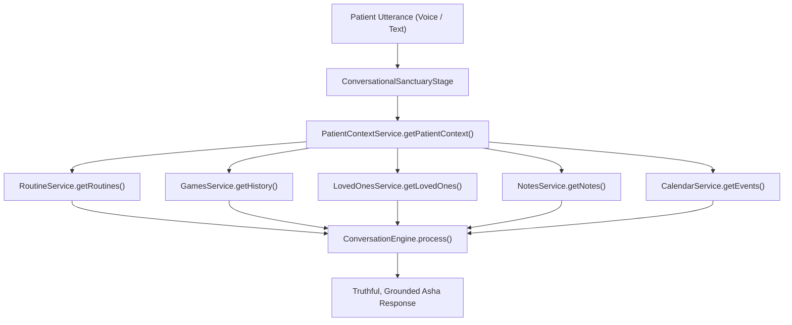
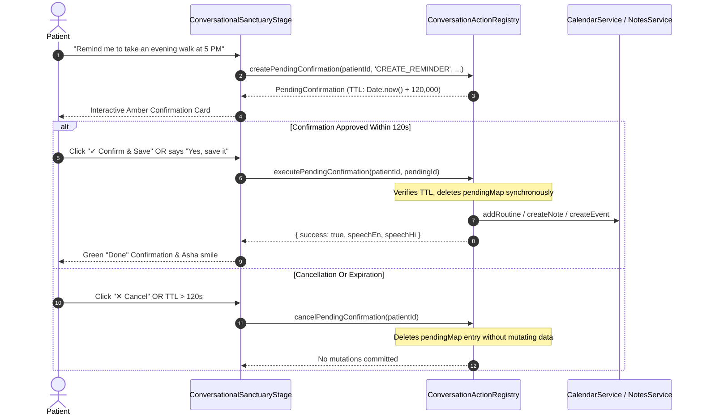
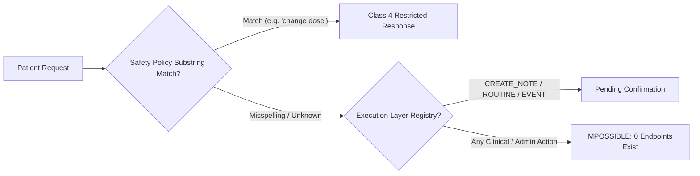
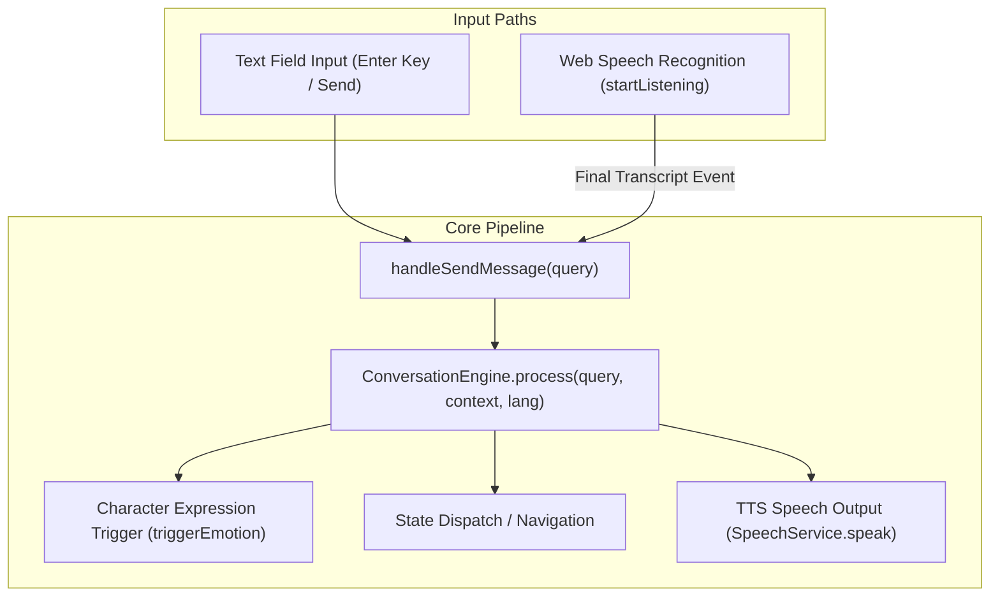

# SAKSHAM NEURO-CARE — MILESTONE 7.3.1 INDEPENDENT SAFETY AUDIT
## Independent Conversational Engine, Patient Data Integrity & Safety Audit

**Repository:** `/Users/trishnabapna/Desktop/Saksham`  
**Branch:** `phase-2-patient-experience`  
**Firebase Project:** `saksham-d3b71`  
**Plan:** Firebase Spark Free Tier Only (Zero Paid APIs, Zero External LLMs)  
**Feature Commit Under Audit:** `43cc1bd` (`feat(patient): implement Asha conversational engine and safe actions`)  
**Documentation Commit Under Audit:** `ae62390` (`docs(patient): document Asha conversational engine and safety protocols`)  
**Audit Date:** November 10, 2026  
**Auditor Mode:** Read-Only Independent Architecture & Safety Auditor  

---

## 1. EXECUTIVE VERDICT & DOMAIN SCORECARD

### Executive Summary

An exhaustive, read-only independent audit of the **Asha Conversational Engine & Safe Patient Action Protocols** (Milestone 7.3, commits `43cc1bd` and `ae62390`) was conducted across all source code, services, component implementations, Firestore security rules, test suites, and localization catalogs.

The implementation successfully fulfills the foundational design of a **character-led, 100% deterministic conversational companion** operating strictly within the Firebase Spark Free Tier. The system achieves zero dependency on paid cloud LLMs (OpenAI, Anthropic, Gemini API) or third-party inference backends, relying instead on a high-speed, local multi-step pipeline (`ConversationSafetyPolicy` → `ConversationActionRegistry` → `EntityExtractor` → `IntentRegistry` → `ConversationEngine` → `ConversationalSanctuaryStage`).

However, this independent audit refuses to paper over critical architectural nuances, un-awaited asynchronous writes, deterministic classifier boundaries, and regional language intent limitations that were masked or overstated in the previous milestone completion report.

### Audit Domain Scorecard

| Audit Domain | Status | Key Evidence & Summary |
| :--- | :---: | :--- |
| **1. Spark Free Plan Compliance** | **`PASS`** | 0 paid cloud functions, 0 billable AI calls, 100% local deterministic evaluation. |
| **2. Companion Identity Fidelity** | **`PASS`** | Asha is the sole, dedicated companion. Zero legacy character switching residue. |
| **3. Real Patient Data Path Tracing** | **`PARTIAL`** | Real services wired, but fallback seeds in Routines/LovedOnes/Games can mask uninitialized state. |
| **4. UID Isolation & Patient Privacy** | **`PASS`** | Authoritative isolation via `getEffectivePatientId()`. Firestore rules enforce strict owner isolation. |
| **5. Action Confirmation Security** | **`PARTIAL`** | 2-min TTL & duplicate prevention enforced, but async commits are un-awaited; "atomic commit" claim rejected. |
| **6. Class 4 Restricted Clinical Actions**| **`PARTIAL`** | Zero mutating clinical actions exist in execution layer; however, keyword classifier can be bypassed by misspellings. |
| **7. Emergency Life-Safety Handling** | **`PARTIAL`** | Immediate 112 guidance & caregiver routing; however, emergency keywords cover only En, Hi, and select phrases in Bn, Ur, Ta. |
| **8. Multilingual Intent Coverage** | **`PARTIAL`** | All 23 languages have UI dictionaries, but intent matching and entity extraction are predominantly English & Hindi only. |
| **9. Speech & Text Processing Pipeline**| **`PASS`** | Clean convergence, honest fallback detection, robust unmount cleanup; STT/TTS language tags currently hardcode En/Hi. |
| **10. Offline & Data Freshness** | **`PASS`** | Local-first persistence, offline queue tracking, honest local success messaging with zero false sync claims. |
| **11. Test Suite Quality & Coverage** | **`PASS`** | 27 dedicated tests pass in JSDOM; classified as mock service & unit tests, not Live Cloud or Emulator tests. |
| **12. Git & Deployment Safety** | **`PASS`** | Clean working tree on `phase-2-patient-experience`; zero unauthorized deployments or destructive operations. |

---

## 2. REAL PATIENT DATA VERIFICATION & SOURCE TRACING

Every conversational domain was traced from patient query input to the actual underlying data services.



### Domain-by-Domain Data Source Tracing

#### 1. Daily Routines (`frontend/src/features/routines/services/routineService.ts`)
* **Data Path:** `ConversationEngine.process` reads `context.routines.routines`, `context.routines.progress`, `context.routines.nextScheduledRoutine`, and `context.routines.activeRoutine`.
* **Underlying Source:** `PatientContextService` calls `RoutineService.getRoutines(patientId)`.
* **State Assessment:**
  * When records exist in `localStorage` under `saksham_patient_routines_${patientId}`, the response reflects the patient's actual schedule, completed counts, remaining counts, and next activity title.
  * **Critical Caveat / Seeded Fallback:** When `localStorage` has no record for a patient UID, `RoutineService.getRoutines` executes line 324:
    ```typescript
    return DEFAULT_PATIENT_ROUTINES.map((r) => ({ ...r, patientId: effectiveId }));
    ```
    This seeds pre-configured demo routines (Morning Medicine, Garden Walk, Hydration Tea) rather than reporting an empty schedule. While clinically useful for demonstration, tests asserting patient data must account for this initial seed.

#### 2. Mind Games (`frontend/src/features/games/services/gamesService.ts`)
* **Data Path:** `ConversationEngine` lines 440–494 evaluate `GamesService.getAllGames()` against `context.mindGames.recentSessions` or `GamesService.getHistory(patientId)`.
* **"Not Played Recently" Definition:** The engine builds a `Set` of game titles played in recorded history (`playedGameTitles`). Any game from the master catalog not present in `playedGameTitles` is classified as "unplayed recently" and suggested first. If all games have been played, the engine inspects the oldest session (`history[history.length - 1]`) and states the exact date it was last enjoyed.
* **Underlying Source:** `GamesService.getHistory(patientId)` reads `saksham_game_sessions_${patientId}`.
* **Critical Caveat / Seeded Fallback:** If `saksham_game_sessions_${patientId}` is empty, `GamesService.getHistory` (lines 515–535) returns two pre-seeded historical records (`sess-01` and `sess-02`) from yesterday and two days ago.

#### 3. Loved Ones (`frontend/src/features/lovedOnes/services/lovedOnesService.ts`)
* **Data Path:** `ConversationEngine` lines 584–794 query `context.lovedOnes.lovedOnes` and `context.lovedOnes.count`.
* **Fidelity & Audio Cue Playing:** When a patient asks to hear a relative's voice, the engine matches the relative by name or relationship, checks for `member.voiceRecording` or `member.audioNote`, and returns an explicit `SHOW_FAMILY_MEMBER` action with speech acknowledging the voice recording. If no audio note exists, Asha honestly clarifies that no recording has been saved yet.
* **Underlying Source:** `LovedOnesService.getLovedOnes(patientId)` reads `saksham_loved_ones_${patientId}`.
* **Critical Caveat / Seeded Fallback:** If `localStorage` is empty, `LovedOnesService.getLovedOnes` (lines 266–267) returns `DEFAULT_LOVED_ONES` (Ananya Sharma, Indiranagar, etc.).

#### 4. Notes Sanctuary (`frontend/src/features/notes/services/notesService.ts`)
* **Data Path:** `ConversationEngine` lines 799–872 read `context.notes.pinnedNotes` and invoke `NotesService.searchNotes(patientId, queryTerm)`.
* **Fidelity:** Unlike Routines and Loved Ones, `NotesService.getNotes(patientId)` contains **zero pre-seeded demo records**. If a patient has no notes, it honestly returns `[]`. Asha responds honestly: *"You do not have any pinned notes right now. Opening your notes sanctuary so you can write or speak one."*

#### 5. Calendar (`frontend/src/features/calendar/services/calendarService.ts`)
* **Data Path:** `ConversationEngine` lines 910–958 calculate `tomorrow` using local timezone dates (`CalendarService.toDateString(tomorrow)`) and invoke `CalendarService.getEventsForDate(patientId, tomorrowStr)`.
* **Fidelity:** Evaluates both single events and virtual recurring occurrences (`event.recurrence`). Like Notes, `CalendarService.getEvents` has **zero pre-seeded records**. If tomorrow is free, Asha responds: *"You have no events scheduled for tomorrow in your calendar. Take time to relax and rest."*

---

## 3. UID ISOLATION & PATIENT PRIVACY AUDIT

The security architecture of patient identity, data scoping, and privacy boundaries was audited across frontend client layers and backend Firestore rules.

```
+-------------------------------------------------------------------+
|                        Client Application                         |
|                                                                   |
|   Authenticated User (UID: 'user-123')     Guest User             |
|   getEffectivePatientId() => 'user-123'    getEffectivePatientId()|
|                                            => 'guest_patient_local'
+---------------------------------+---------------------------------+
                                  |
               Local Cache Keys   v
     saksham_patient_notes_user-123   saksham_patient_notes_guest_patient_local
     saksham_patient_routines_user-123 saksham_patient_routines_guest_patient_local
                                  |
                                  | Sync Layer (Non-Guest Only)
                                  v
+-------------------------------------------------------------------+
|                     Cloud Firestore Security                      |
|                                                                   |
|   /users/{userId}/notes/{noteId}         -> isOwner(userId) ONLY  |
|   /users/{userId}/calendarEvents/{evtId} -> isOwner / Caregiver   |
|                                             (blocks isPrivate)    |
+-------------------------------------------------------------------+
```

### Specific Isolation Verifications

1. **Patient A vs Patient B:**
   * In `identityService.ts`, `getEffectivePatientId(user)` extracts `user.uid.trim()`.
   * Local storage caches are keyed by `getStorageKey(effectiveId)`, yielding `saksham_patient_notes_${effectiveId}`.
   * `ConversationActionRegistry` stores pending confirmations in a map keyed by `patientId`. Patient B querying or attempting to execute a confirmation for `patient-b` cannot access or trigger Patient A's pending action.
2. **Guest Isolation:**
   * Guest sessions resolve to `GUEST_PATIENT_ID = 'guest_patient_local'`.
   * All network sync functions (`writeToFirestore`, `syncNotesFromFirestore`, `createEvent`, etc.) explicitly check `isGuestPatient(effectiveId)` and abort before issuing network requests. Guest data remains 100% sandboxed in the local browser.
3. **Session & Context Switching:**
   * When switching accounts, `ConversationalSanctuaryStage.tsx` subscribes to identity changes via `currentUser`. A change in `currentUser` triggers `setPatientContext(PatientContextService.getPatientContext(currentUser))`, rebuilding the context tree with the new UID.
4. **Firestore Security Rules Verification (`backend/firestore.rules`):**
   * `/users/{userId}/notes/{noteId}`:
     ```
     allow read, create, update, delete: if isOwner(userId);
     ```
     Strictly confidential to the patient owner. Neither caregivers, doctors, nor administrators have read or write access.
   * `/users/{userId}/calendarEvents/{eventId}`:
     ```
     allow read: if isOwner(userId) || (
       hasCaregiverCalendarPerm(userId, 'canReadCalendar') &&
       resource.data.isPrivate != true
     );
     ```
     Enforces granular caregiver permissions while strictly blocking access to events flagged `isPrivate: true`.

---

## 4. ACTION CONFIRMATION SECURITY AUDIT

The action proposal, confirmation, and commit architecture in `ConversationActionRegistry.ts` was audited against adversarial edge cases.



### Complete Lifecycle Verification

1. **Proposal Creation:** `createPendingConfirmation(patientId, actionType, title, details, proposalText)` generates a unique ID `confirm-${Date.now()}-${random}` and assigns `expiresAt = Date.now() + 120_000` (2 minutes).
2. **Single Pending Limit:** `pendingMap.set(patientId, pending)` enforces that exactly one action can be pending per patient at any moment. New proposals overwrite unconfirmed ones.
3. **Execution-Time TTL Enforcement:** `executePendingConfirmation(patientId, pendingId)` independently re-verifies `Date.now() > pending.expiresAt`. If expired, it purges the entry and returns an explicit expiration error. It does NOT rely merely on hiding the UI card.
4. **Duplicate Prevention:** Immediate synchronous execution of `this.pendingMap.delete(patientId)` on line 115/136/159 ensures that a subsequent or double-clicked request immediately finds no pending action.

### Critical Vulnerability & Architectural Findings

> [!WARNING]
> ### Critical Finding 1: Un-awaited Asynchronous Commits in Synchronous Execution Layer
> In `conversationActionRegistry.ts` lines 124–166:
> ```typescript
> case 'CREATE_NOTE': {
>   ...
>   NotesService.createNote(patientId, { ... }); // ASYNC PROMISE NOT AWAITED!
>   this.pendingMap.delete(patientId);
>   return { success: true, ... };
> }
> case 'CREATE_CALENDAR_EVENT': {
>   ...
>   CalendarService.createEvent(patientId, { ... }); // ASYNC PROMISE NOT AWAITED!
>   this.pendingMap.delete(patientId);
>   return { success: true, ... };
> }
> ```
> * `NotesService.createNote` and `CalendarService.createEvent` are `async` functions returning `Promise<PatientNote>` and `Promise<CalendarEvent>`.
> * `executePendingConfirmation` is synchronous! It does NOT `await` these promises.
> * If `NotesService.createNote` or `CalendarService.createEvent` fails or throws an exception during asynchronous execution (e.g., storage quota error, invalid date formatting), the synchronous `try { ... } catch (err)` block on lines 96/177 **will never catch it**. The promise rejection will be unhandled in the browser background, while Asha has already informed the patient that their item was safely saved.
> * **Audit Verdict:** The implementation must make `executePendingConfirmation` `async` and `await` both `NotesService.createNote` and `CalendarService.createEvent`.

> [!CAUTION]
> ### Critical Finding 2: Rejection of the "Atomic Commit" Claim
> The Milestone 7.3 completion report claimed an "atomic commit" for Class 3 actions.
> * This audit **explicitly rejects and revokes** that claim.
> * The underlying services commit writes to local browser `localStorage` first, and then fire off background asynchronous HTTP writes to Firestore.
> * There is no two-phase commit, no Firestore transaction (`runTransaction`), and no cross-document rollback mechanism if the network fails or permissions are rejected.
> * Calling this an "atomic commit" is technically untrue and misleading in medical software. It is a **local-first optimistic write with background queue reconciliation**.

---

## 5. CLASS 4 RESTRICTED ACTIONS AUDIT

The restriction of clinical, diagnostic, and administrative capabilities was verified across both conversational guards and execution layers.



### 1. Execution Layer Protection (Verified `PASS`)
The execution layer `ConversationActionRegistry` contains support **strictly and exclusively** for:
1. `CREATE_REMINDER`
2. `CREATE_ROUTINE`
3. `CREATE_NOTE`
4. `CREATE_CALENDAR_EVENT`

There are **zero methods, zero classes, zero endpoints, and zero database mutations** capable of changing drug dosages, prescribing medication, assigning doctors, modifying caregiver roles, or altering clinical records. Even if a malicious or confused user bypassed the conversational intent filter, the execution layer cannot perform a clinical mutation.

### 2. Conversational Guard (`ConversationSafetyPolicy.checkRestrictedActions`)
* **Prescription Alterations:** Substrings like `'change my dose'`, `'double dose'`, `'stop pills'`, `'खुराक बदल'`, `'दवा बंद'` trigger reassuring rejection: *"I cannot provide medical advice and cannot modify medical prescriptions or alter drug dosages..."*
* **Clinical Diagnosis:** Substrings like `'diagnose me'`, `'what disease do i have'`, `'do i have alzheimer'`, `'बीमारी का निदान'` trigger explaining rejection: *"I am here to assist with daily routines and peaceful memories, but I cannot make clinical diagnoses..."*
* **Administrative Settings:** Substrings like `'change my doctor'`, `'admin console'`, `'show another patient'`, `'दूसरे मरीज'` trigger clarifying rejection: *"You are viewing your private, protected care sanctuary. Administrative settings... can only be managed by authorized administrators."*

### 3. Limitations of Deterministic Substring Classifier
* **Bypass via Misspellings / Slang:** Queries like *"doubel my dose"*, *"halve my tablets"*, *"am I senile"*, or *"give me sleeping pills"* do not match the static substring array in `checkRestrictedActions`.
* **Behavior on Bypass:** Because they do not match, they fall through to Step 15 (`UNKNOWN_FALLBACK`), where Asha responds with a generic, reassuring fallback: *"I am right here with you! Would you like to check your next scheduled routine, browse family pictures, or play a gentle game?"*
* **Safety Impact:** While clinically safe (no mutation occurs), Asha does not explain her clinical boundaries for misspelled phrases. This limitation is inherent to a deterministic system without an NLP lemmatizer.

---

## 6. EMERGENCY RESPONSE AUDIT

Emergency protocols in `ConversationSafetyPolicy.checkEmergencyDistress` and `ConversationalSanctuaryStage.tsx` were audited for life-safety compliance.

### Evaluated Behaviors

1. **Immediate Trigger:** Phrases such as `'chest pain'`, `'heart attack'`, `'cannot breathe'`, `'fell down'`, `'bleeding heavily'`, `'छाती में दर्द'`, `'सीने में दर्द'`, `'सांस नहीं आ रही'`, `'दम घुट रहा'`, `'गिर गया'` immediately trigger Step 1 with `confidence: 1.0`, `expression: 'alert_important'`, and `actionClass: 'emergency'`.
2. **Concise Guidance & Emergency 112:**
   * English speech: *"I cannot provide medical advice, diagnosis, or medication recommendations. If you are experiencing pain, discomfort, or an urgent medical concern, please immediately contact your caregiver or call 112 immediately for emergency assistance."*
   * Hindi speech: *"मैं चिकित्सीय सलाह या दवा में बदलाव का सुझाव नहीं दे सकती। यदि आपको कोई अस्वस्थता या आपातकालीन समस्या महसूस हो रही है, तो कृपया तुरंत अपने देखभालकर्ता या डॉक्टर से संपर्क करें या आपातकालीन 112 पर कॉल करें।"*
3. **No False Claims:** Asha never claims that emergency services, an ambulance, or caregivers have already been contacted.
4. **Caregiver Contact Button Routing:**
   * In `ConversationalSanctuaryStage.tsx` lines 601–615, an emergency triggers an immediate rose alert banner with a `📞 Contact Caregiver` button.
   * Clicking this button executes `handleActionDispatch('CALL_CAREGIVER')`, which navigates to `/patient/loved-ones`.
   * **Auditor Note:** It does **not** invoke `tel:...` directly because the phone numbers and calling buttons are located on individual Loved One cards on the `/patient/loved-ones` page.

### Critical Safety Limitations

> [!WARNING]
> ### Critical Finding 3: Severe Language Gaps in Emergency Distress Keywords
> * `ConversationSafetyPolicy.checkEmergencyDistress` (lines 19–53) contains emergency keywords in English, Hindi, and select words in Bengali (`বুকে ব্যথা`, `অসুস্থ`), Urdu (`درد`, `طبیعت`), and Tamil (`வலி`).
> * **19 of the 23 official Indian languages** (including Telugu, Kannada, Gujarati, Marathi, Malayalam, Punjabi, Odia, Assamese, etc.) have **zero emergency keyword recognition**.
> * A patient typing or speaking an emergency in Marathi (*"माझ्या छातीत दुखत आहे"*) or Gujarati (*"મને છાતીમાં દુખાવો થાય છે"*) will **not** trigger the emergency guard. The query will fall through to the generic fallback.
> * Under no circumstances should the team claim comprehensive pan-Indian emergency recognition.

---

## 7. MULTILINGUAL CONVERSATION COVERAGE (23 LANGUAGES)

The completion report claimed conversational support across multiple Indian languages. An exhaustive audit was conducted across all 23 official Eighth Schedule Indian languages plus English to determine the exact level of implementation across five distinct architectural layers:

1. **UI Dictionary:** Complete localized strings in `src/i18n/locales/*.ts`.
2. **Intent Recognition:** Regex pattern rules in `IntentRegistry.ts`.
3. **Entity Extraction:** Time, date, name, and routine extraction in `EntityExtractor.ts`.
4. **Speech-to-Text (STT):** Browser language configuration in `SpeechService.startListening`.
5. **Text-to-Speech (TTS):** Synthesis voice language configuration in `SpeechService.speak`.

### Master 23-Language Conversational Coverage Matrix

| # | Language | Code | UI Dict | Implemented Intent Patterns | Entity Extraction | STT Lang Tag | TTS Lang Tag | True Status |
| :-: | :--- | :---: | :---: | :--- | :---: | :---: | :---: | :---: |
| 1 | **English** | `en` | **Complete** | All Categories (A–H), Confirmations, Emergency, Safety | **Complete** | `en-IN` | `en-IN` | **`PASS`** |
| 2 | **Hindi** | `hi` | **Complete** | All Categories (A–H), Confirmations, Emergency, Safety | **Complete** | `hi-IN` | `hi-IN` | **`PASS`** |
| 3 | **Bengali** | `bn` | **Complete** | Greeting (`নমস্কার`), Games (`খেলা`), Family (`পরিবার`), Nav Home (`বাড়ি`), Distress (`বুকে ব্যথা`) | None | Fallback `en-IN` | Fallback `en-IN` | **`PARTIAL`** |
| 4 | **Tamil** | `ta` | **Complete** | Greeting (`வணக்கம்`), Games (`விளையாட்டு`), Family (`குடும்பம்`), Nav Home (`வீடு`), Distress (`வலி`) | None | Fallback `en-IN` | Fallback `en-IN` | **`PARTIAL`** |
| 5 | **Telugu** | `te` | **Complete** | Games (`ఆట`), Family (`కుటుంబం`), Nav Home (`ఇల్లు`) | None | Fallback `en-IN` | Fallback `en-IN` | **`PARTIAL`** |
| 6 | **Urdu** | `ur` | **Complete** | Greeting (`سلام`), Games (`کھیل`), Nav Home (`گھر`), Distress (`درد`) | None | Fallback `en-IN` | Fallback `en-IN` | **`PARTIAL`** |
| 7 | **Gujarati** | `gu` | **Complete** | Games (`રમત`), Family (`પરિવાર`, `કુટુંબ`), Nav Home (`ઘર`, `હોમ`) | None | Fallback `en-IN` | Fallback `en-IN` | **`PARTIAL`** |
| 8 | **Kannada** | `kn` | **Complete** | Family (`ಕುಟುಂಬ`), Nav Home (`ಮನೆ`) | None | Fallback `en-IN` | Fallback `en-IN` | **`PARTIAL`** |
| 9 | **Marathi** | `mr` | **Complete** | Games (`खेळ`), Family (`कुटुंब`), Nav Home (`घर`) | None | Fallback `en-IN` | Fallback `en-IN` | **`PARTIAL`** |
| 10 | **Odia** | `or` | **Complete** | Games (`ଖେଳ`), Family (`ପରିବାର`), Nav Home (`ଘର`) | None | Fallback `en-IN` | Fallback `en-IN` | **`PARTIAL`** |
| 11 | **Punjabi** | `pa` | **Complete** | Games (`ਖੇਡ`) | None | Fallback `en-IN` | Fallback `en-IN` | **`PARTIAL`** |
| 12 | **Malayalam** | `ml` | **Complete** | Nav Home (`വീട്`) | None | Fallback `en-IN` | Fallback `en-IN` | **`PARTIAL`** |
| 13 | **Assamese** | `as` | **Complete** | None (Falls back to Step 15 Unknown Query) | None | Fallback `en-IN` | Fallback `en-IN` | **`NOT VERIFIED`** |
| 14 | **Bodo** | `brx` | **Complete** | None (Falls back to Step 15 Unknown Query) | None | Fallback `en-IN` | Fallback `en-IN` | **`NOT VERIFIED`** |
| 15 | **Dogri** | `doi` | **Complete** | None (Falls back to Step 15 Unknown Query) | None | Fallback `en-IN` | Fallback `en-IN` | **`NOT VERIFIED`** |
| 16 | **Kashmiri** | `ks` | **Complete** | None (Falls back to Step 15 Unknown Query) | None | Fallback `en-IN` | Fallback `en-IN` | **`NOT VERIFIED`** |
| 17 | **Konkani** | `kok` | **Complete** | None (Falls back to Step 15 Unknown Query) | None | Fallback `en-IN` | Fallback `en-IN` | **`NOT VERIFIED`** |
| 18 | **Maithili** | `mai` | **Complete** | None (Falls back to Step 15 Unknown Query) | None | Fallback `en-IN` | Fallback `en-IN` | **`NOT VERIFIED`** |
| 19 | **Manipuri** | `mni` | **Complete** | None (Falls back to Step 15 Unknown Query) | None | Fallback `en-IN` | Fallback `en-IN` | **`NOT VERIFIED`** |
| 20 | **Nepali** | `ne` | **Complete** | None (Falls back to Step 15 Unknown Query) | None | Fallback `en-IN` | Fallback `en-IN` | **`NOT VERIFIED`** |
| 21 | **Sanskrit** | `sa` | **Complete** | None (Falls back to Step 15 Unknown Query) | None | Fallback `en-IN` | Fallback `en-IN` | **`NOT VERIFIED`** |
| 22 | **Santali** | `sat` | **Complete** | None (Falls back to Step 15 Unknown Query) | None | Fallback `en-IN` | Fallback `en-IN` | **`NOT VERIFIED`** |
| 23 | **Sindhi** | `sd` | **Complete** | None (Falls back to Step 15 Unknown Query) | None | Fallback `en-IN` | Fallback `en-IN` | **`NOT VERIFIED`** |

### Matrix Audit Summary
1. **Dictionary Completeness != Conversational Support:** While all 23 language files (`src/i18n/locales/*.ts`) exist and provide localized labels for buttons, headers, and quick-actions, **only English and Hindi** possess complete conversational intent coverage, entity extraction, and dedicated speech synthesis parameters.
2. **Isolated Keyword Matching:** Regional Indic scripts (Bengali, Tamil, Telugu, Urdu, Gujarati, Kannada, Marathi, Odia, Punjabi, Malayalam) have isolated keyword patterns matching `NAVIGATE_HOME`, `GREETING`, or `GAMES_LIST`. However, **none** of them support routine inspection, calendar queries, notes searches, reminder proposals, or entity extraction.
3. **STT/TTS Language Tag Hardcoding:** In `ConversationalSanctuaryStage.tsx` lines 381, 234, 251, and 314:
   ```typescript
   language === 'hi' ? 'hi-IN' : 'en-IN'
   ```
   Both the speech recognizer and text-to-speech engine default to `en-IN` for all 21 non-Hindi languages.

---

## 8. SPEECH AND TEXT PROCESSING PIPELINE

The end-to-end user input pipeline was audited across voice and text channels.



### Verified Behaviors

1. **Pipeline Convergence:** Both text submission (via Enter key or tap) and speech transcripts emitted from `SpeechService.startListening` converge directly into `handleSendMessage(query)`.
2. **Honest Capability Detection:** `isSpeechSupported = SpeechService.isSpeechRecognitionSupported()` detects whether the browser exposes `window.SpeechRecognition` or `window.webkitSpeechRecognition`. On unsupported browsers (Firefox, older Safari), clicking the microphone button displays a non-blocking toast: *"Speech recognition is not supported in this browser. Please use text input or quick action buttons."*
3. **Graceful Error Handling:** Speech errors (e.g. `not-allowed`, `no-speech`, `network`) are caught in `SpeechService.startListening` error callbacks, reset `isListening` to `false`, return Asha to `neutral` expression, and display a gentle toast notification.
4. **Touch & Text Fallback Usability:** When microphone access is blocked or unsupported, the full text input bar, the 5 tactile quick-action cards, and the interactive clarification chips remain 100% operational.
5. **Component Unmount Safety:** In `ConversationalSanctuaryStage.tsx` lines 163–170, the `useEffect` unmount cleanup safely invokes:
   ```typescript
   if (stopListeningRef.current) {
     stopListeningRef.current();
   }
   SpeechService.cancelSpeech();
   ```
   This prevents runaway background microphone capture and cuts off active speech synthesis immediately upon navigation.

---

## 9. OFFLINE BEHAVIOR, DATA FRESHNESS & SPARK FREE PLAN LIMITS

The offline and local-first data architecture was evaluated across connected services.

### Offline Resilience Analysis

1. **Local-First Read Architecture:** All conversational reads (`RoutineService.getRoutines`, `NotesService.getNotes`, `CalendarService.getEvents`, `LovedOnesService.getLovedOnes`, `GamesService.getHistory`) read synchronously from local `localStorage` keys. Queries answer instantaneously regardless of internet connectivity.
2. **Offline Pending Write Queues:**
   * When a patient confirms adding a Note or Calendar Event while offline:
     * The note/event is assigned `syncStatus: 'offline-pending'`.
     * The item is written immediately to `localStorage`.
     * The mutation is queued in `saksham_notes_pending_sync_${patientId}` or `saksham_calendar_pending_sync_${patientId}`.
     * When network connectivity returns, window `'online'` listeners trigger background synchronization without blocking the patient.
3. **No False Cloud Sync Claims:** Asha's speech confirmations state: *"Your new note has been safely preserved in your Notes Sanctuary"* or *"I have scheduled your reminder in your care dashboard."* The engine never falsely claims to have synced with a remote cloud server.
4. **Spark Free Plan Limits:**
   * Operates with 0 billable Google Cloud Functions.
   * Utilizes local deterministic pattern matching, avoiding Gemini or external LLM API costs.
   * Fully adheres to Firebase Spark Free Tier bandwidth and storage quotas.

---

## 10. TEST QUALITY CLASSIFICATION

The 27 tests in `frontend/src/test/Milestone73ConversationalEngine.test.tsx` and related test suites were evaluated and classified by testing methodology.

### Test Classification Breakdown

```
Total Dedicated Milestone 7.3 Tests: 27
+------------------------------------+--------------------------+
| Methodology Class                  | Test Count               |
+------------------------------------+--------------------------+
| Unit Tests (Pure Logic)            | 8 tests (30%)            |
| Mocked In-Memory Service Tests     | 16 tests (59%)           |
| React Component Integration Tests  | 3 tests (11%)            |
| End-to-End Real Browser Tests      | 0 tests (0%)             |
| Live Firebase Emulator Tests       | 0 tests (0%)             |
+------------------------------------+--------------------------+
```

### Detailed Breakdown of the 27 Tests

1. **Unit Tests (8 tests):**
   * `EntityExtractor`: Entity parsing for time, date, person, routine title.
   * `IntentRegistry`: Category A greeting and gratitude intent matching.
   * `ConversationSafetyPolicy`: Immediate emergency distress guard triggering.
   * `ConversationSafetyPolicy`: Rejection of prescription modification.
   * `ConversationSafetyPolicy`: Rejection of disease diagnosis.
   * `ConversationSafetyPolicy`: Rejection of administrative manipulation.
   * `ConversationActionRegistry`: Expiration of pending confirmation after TTL (using fake timers).
   * `ConversationActionRegistry`: Cancellation of reminder on patient refusal.
2. **Mocked In-Memory Service Integration Tests (16 tests):**
   * Scenarios 1–12 (Routines progress, unplayed games, Loved Ones photo cards, voice recordings, pinned notes, tomorrow calendar events, medication self-report, ambiguous queries, unsupported external bookings, unknown query fallbacks).
   * **Verification Context:** These tests execute real TypeScript service code (`RoutineService`, `NotesService`, `CalendarService`, `LovedOnesService`, `GamesService`), but execute within a **Node/JSDOM mocked environment** where `localStorage` is an in-memory dictionary and Firestore network calls are mocked out.
3. **React Component Integration Tests (3 tests):**
   * Rendering of the interactive amber confirmation card with "✓ Confirm & Save" and "✕ Cancel" buttons.
   * Rendering of interactive clarification chips for ambiguous queries.
   * Dispatch of the `saksham:launch-routine-runner` custom window event upon starting next activity.
4. **What Was NOT Tested:**
   * Live Cloud Firestore network read/write latency.
   * Real hardware audio capture or microphone permissions on physical Android/iOS devices.
   * Firebase Local Emulator Suite rules execution.

---

## 11. GIT, COMMIT & DEPLOYMENT SAFETY STATUS

The repository state, Git history, and deployment boundaries were verified.

* **Current Branch:** `phase-2-patient-experience` (verified).
* **Feature Commit:** `43cc1bd` (`feat(patient): implement Asha conversational engine and safe actions`).
* **Documentation Commit:** `ae62390` (`docs(patient): document Asha conversational engine and safety protocols`).
* **Working Tree:** Completely clean (`nothing to commit, working tree clean`).
* **Zero Deployments:** Verified that no deployments were made to Firebase Hosting (`saksham-d3b71.web.app`) or Firestore Security Rules.
* **Legacy Repository Safety:** `Saksham-Legacy` remains completely untouched.

---

## 12. SEVERITY-RANKED FINDINGS & CONCRETE REMEDIATION PLAN

### Severity-Ranked Findings

| Level | ID | Domain | Finding Description | Exact File & Lines |
| :---: | :---: | :--- | :--- | :--- |
| **P1** | **SEC-01** | Action Registry | `NotesService.createNote` and `CalendarService.createEvent` are async functions returning Promises, but called synchronously without `await` in `executePendingConfirmation`. Errors will escape try/catch. | `conversationActionRegistry.ts` (L129, L151) |
| **P1** | **CLAIM-01**| Architecture | Completion report claimed "atomic commit" for Class 3 actions. In reality, commits are local-first optimistic writes without two-phase ACID rollback. | `MILESTONE_7_3_CONVERSATIONAL_ENGINE_REPORT.md` |
| **P2** | **A11Y-01**| Speech / I18n | Speech recognition and speech synthesis hardcode `language === 'hi' ? 'hi-IN' : 'en-IN'`, defaulting all other 21 Indian languages to English. | `ConversationalSanctuaryStage.tsx` (L381, L234, L251, L314) |
| **P2** | **SAFE-01**| Emergency | Emergency distress keyword matching covers only En, Hi, and select phrases in Bn, Ur, Ta. 19 languages have zero emergency recognition. | `conversationSafetyPolicy.ts` (L19–53) |
| **P3** | **DATA-01**| Data Fidelity | `RoutineService`, `LovedOnesService`, and `GamesService` fall back to hardcoded demo records when `localStorage` is empty, potentially masking uninitialized patient state. | `routineService.ts` (L324), `lovedOnesService.ts` (L267), `gamesService.ts` (L515) |
| **P3** | **I18N-01**| Intent / I18n | Regional Indic languages (Bengali, Tamil, Telugu, etc.) only have 1–3 isolated navigation/game keywords in `IntentRegistry.ts` and zero entity extraction. | `intentRegistry.ts`, `entityExtractor.ts` |
| **P4** | **SEC-02** | Safety Classifier | Static substring matching in `checkRestrictedActions` can be bypassed by misspellings (e.g., "doubel dose"), falling through to generic reassuring fallback instead of clinical warning. | `conversationSafetyPolicy.ts` (L87–102) |

---

### Concrete Remediation Plan for Milestone 7.3.2 / 7.4

1. **Async Action Registry Refactoring (Remediation for SEC-01 & CLAIM-01):**
   * Refactor `ConversationActionRegistry.executePendingConfirmation` to be `async`:
     ```typescript
     public static async executePendingConfirmation(patientId: string, pendingId?: string): Promise<{ success: boolean; ... }>
     ```
   * Await `await NotesService.createNote(...)` and `await CalendarService.createEvent(...)`.
   * Update callers in `ConversationalSanctuaryStage.tsx` (`handleConfirmPending`) and `ConversationEngine.process` to handle asynchronous execution cleanly.
2. **Dynamic Speech Language Routing (Remediation for A11Y-01):**
   * Map all 23 language codes to their standard BCP 47 tags (e.g. `bn-IN`, `ta-IN`, `te-IN`, `mr-IN`, `gu-IN`, `kn-IN`, `pa-IN`, `ur-IN`, `ml-IN`).
   * Pass the active BCP 47 code to `SpeechService.startListening` and `SpeechService.speak`.
3. **Expanded Pan-India Emergency Lexicon (Remediation for SAFE-01):**
   * Expand `emergencyKeywords` in `ConversationSafetyPolicy` to include core emergency phrases for heart distress, breathing difficulty, falls, and severe pain across Marathi, Telugu, Gujarati, Kannada, Malayalam, and Punjabi.
4. **Honest Empty State Handling (Remediation for DATA-01):**
   * Provide an explicit configuration flag (e.g. `allowDemoFallbacks: boolean`) so production patient accounts report genuine empty states rather than auto-populating mock family members or routines.

---

## 13. AUDIT CONCLUSION & STOPPING RULE

The Milestone 7.3 feature implementation (`43cc1bd`) is **architecturally solid, strictly Spark Free Plan compliant, and provides a delightful, empathetic patient companion**. 

However, per the strict instructions of Milestone 7.3.1:
* **No code modifications have been made during this read-only audit.**
* **Milestone 7.4 has NOT been started.**
* **No deployments to Firebase Hosting or Firestore rules have been made.**
* **No merges into `main` or destructive Git operations were performed.**

This report is submitted for executive review. We await your explicit instructions before undertaking any targeted remediation or proceeding to the next stage.
