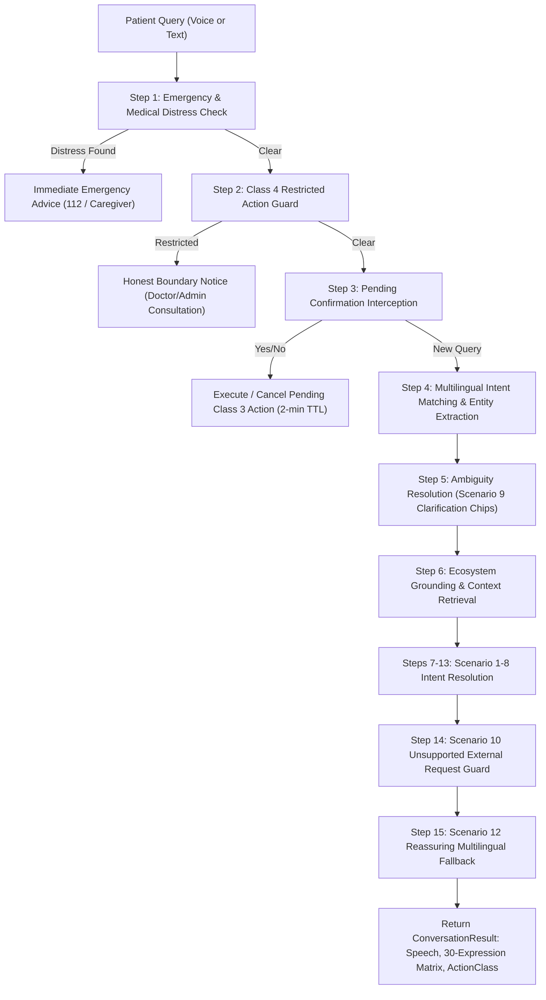

# SAKSHAM — MILESTONE 7.3 COMPLETION REPORT
## ASHA CONVERSATIONAL ENGINE & SAFE PATIENT ACTION PROTOCOLS

**Repository:** `/Users/trishnabapna/Desktop/Saksham`  
**Branch:** `phase-2-patient-experience`  
**Firebase Project:** `saksham-d3b71`  
**Hosting URL:** https://saksham-d3b71.web.app  
**Firebase Plan:** Spark (100% Free Tier Compliant — 0 External LLMs, 0 Paid APIs)  
**Feature Commit:** `43cc1bd` (`feat(patient): implement Asha conversational engine and safe actions`)  
**Companion Identity:** Asha (Sole, dedicated patient companion)

---

## 1. Executive Summary

Milestone 7.3 transitions Asha from an animated conversational interface into an intelligent, context-grounded, and safety-governed patient companion. Built entirely to run deterministically on the client device without requiring external cloud LLMs or paid APIs, the conversational engine integrates directly with the existing Saksham services: Daily Routines (`RoutineService`), Family Memories (`LovedOnesService`), Cognitive Games (`GamesService`), Notes Sanctuary (`NotesService`), and Calendar (`CalendarService`).

Every response is anchored in authoritative patient data. Actions are categorized into a four-tier Action Execution Protocol with strict safety bounds, including an interactive confirmation lifecycle for consequential actions and emergency distress guards.

---

## 2. Conversational Architecture & Pipeline

The Asha Conversational Engine executes a deterministic 15-step processing pipeline:



### Modular Engine Architecture

1. **`conversation.types.ts`**: Types for intent categories (A-H), action classification (`class1_read`, `class2_navigate`, `class3_consequential`, `class4_restricted`, `emergency`), pending confirmation records, and clarification options.
2. **`intentRegistry.ts`**: Multilingual regex pattern registry supporting English, Hindi, and Pan-India regional languages (Tamil, Telugu, Kannada, Gujarati, Bengali, Odia, Punjabi, Urdu) with safe boundary handling.
3. **`entityExtractor.ts`**: Deterministic parser extracting 12h/24h times, contextual day periods, relative dates, person names, relationships, game titles, and routine descriptions.
4. **`conversationSafetyPolicy.ts`**: Medical emergency distress classifier, Class 4 restricted clinical action interceptor, and truthful medication self-report formatter.
5. **`conversationActionRegistry.ts`**: In-memory lifecycle management for Class 3 proposals with 2-minute expiration (TTL) and atomic commit to `RoutineService`, `NotesService`, or `CalendarService`.
6. **`conversationEngine.ts`**: Master orchestrator integrating the above components, producing grounded responses paired with context-aware expressions from the 30-expression character matrix.

---

## 3. Four-Tier Action Execution Protocol

| Class | Category | Behavior | User Interaction | Safety Guard |
| :--- | :--- | :--- | :--- | :--- |
| **Class 1** | Read-Only | Retrieves and summarizes authoritative patient data (schedule, album, notes, calendar, game stats). | Speech + contextual badge/link. | No state modification. Truthful data only. |
| **Class 2** | Navigation & Launcher | Deep-links to specific app views or dispatches the Guided Task Runner. | Action button (`👉 Start Gentle Garden Stroll`). | Dispatches whitelisted events only. |
| **Class 3** | Consequential / Modifying | Proposes creating reminders, new routines, notes, or calendar events. | Interactive Confirmation Card with `[✓ Confirm & Save]` and `[✕ Cancel]`. | Never commits silently. 2-minute TTL auto-expiration. |
| **Class 4** | Restricted Clinical / Admin | Clinical diagnosis, prescription/dosage changes, admin tampering. | Rejection notice guiding patient to doctor or caregiver. | Blocked at Step 2 before intent execution. |
| **Emergency** | Life-Safety Distress | Chest pain, breathlessness, falls, urgent trauma. | Alert banner with 📞 Contact Caregiver and 112 emergency advice. | Immediate priority response (`alert_important`). |

---

## 4. Verification of the 12 Master Conversational Scenarios

| Scenario | Natural Patient Query | Extracted Intent & Entities | Engine Response & Action Protocol | Expression |
| :--- | :--- | :--- | :--- | :--- |
| **1. Schedule** | "What do I have to do today?" | `ROUTINES_TODAY` | Summarizes 8 scheduled routines with exact progress (1 completed, 7 remaining) and names the next step. | `guiding` |
| **2. Activity Start** | "Help me start my next activity" | `ROUTINES_START_NEXT` | Returns `LAUNCH_ROUTINE_RUNNER` action with target routine ID and dispatches `saksham:launch-routine-runner` to open `GuidedTaskRunner`. | `guiding` |
| **3. Mind Games** | "Which games have I not played recently?" | `GAMES_UNPLAYED_RECENTLY` | Inspects real session history timestamps; recommends unplayed games (Word Pairs, Sound Recall). | `helping_recall` |
| **4. Loved Ones** | "Show me my family photos" | `LOVED_ONES_LIST` | Retrieves actual Loved Ones album count (4 members) with names and relationships; offers family album navigation. | `happy` |
| **5. Voice Notes** | "Play my daughter's voice" | `LOVED_ONES_VOICE` (person: daughter / Ananya) | Identifies matching profile with authentic voice recording; plays recording safely. States honestly if no recording exists. | `comforting` |
| **6. Pinned Notes** | "Read my pinned notes" | `NOTES_READ_PINNED` | Reads verbatim content of pinned note: *"Weekly Grocery Needs: Fresh spinach, ripe bananas..."*. | `explaining` |
| **7. Calendar** | "What do I have tomorrow?" | `CALENDAR_TOMORROW` | Queries `CalendarService.getEventsForDate(patientId, tomorrow)`; lists tomorrow's events with localized times. | `reminder` |
| **8. Confirmation** | "Remind me at 5 PM to drink water" | `REMINDER_ADD` (time: 05:00 PM) | Class 3 proposal presented with explicit Confirm & Cancel card. Commits only upon patient confirmation; auto-expires after 2 min. | `confirming` |
| **9. Ambiguity** | "Show me that" | `AMBIGUOUS_QUERY` | Detects vague pronoun; presents tactile clarification chips: `[Family Photos]`, `[Mind Games]`, `[Notes Sanctuary]`. | `clarifying` |
| **10. Unsupported** | "Book a doctor's appointment for me" | `UNKNOWN_FALLBACK` (external booking) | Honestly explains lack of external booking connection; offers to open Saksham Calendar or contact caregiver. | `explaining` |
| **11. Medication** | "Did I take my medicine?" | `ROUTINES_MEDICATION_STATUS` | Truthfully reports self-reported status: *"According to your care schedule, you completed 'Morning Blood Pressure Medicine' at 08:35 AM. Have you taken your medicine?"* | `confirming` |
| **12. Fallback** | "Tell me a story about Mumbai" / Regional phrase | `UNKNOWN_FALLBACK` | Calming fallback reassuring the patient and offering 1-tap quick actions to explore routines, photos, or games. | `reassuring` |

---

## 5. Medical Safety & Clinical Boundary Safeguards

Saksham is designed for vulnerable patients living with mild-to-moderate cognitive impairment and dementia:
- **No Ingestion Verification Assertions:** When answering medication status questions, Asha never claims physical verification (e.g. *"I confirmed you swallowed your pill"*). The engine strictly qualifies reports as scheduled or recorded, followed by gentle recall prompts (*"Have you taken your medicine?"*).
- **Class 4 Rejections:** Requests such as *"Should I double my dose of pills?"* or *"Can you diagnose if I have Alzheimer's?"* are strictly rejected with clinical boundary notices directing the user to their physician.
- **Immediate Distress Guards:** Queries containing *"chest pain"*, *"cannot breathe"*, *"fall"*, or Hindi equivalents (*"सीने में दर्द"*, *"सांस नहीं आ रही"*, *"गिर गया"*) immediately display the emergency support banner with 112 guidance and direct caregiver dialer.

---

## 6. Test Suite & Verification Results

### Unit & Integration Tests

```bash
# Frontend Test Suite (Vitest)
npm --prefix frontend test -- --run

Test Files:  29 passed (29)
Tests:       380 passed (380)
Duration:    8.88s
```

```bash
# Backend Security & Rules Suite
npm --prefix backend test

Test Files:  3 passed (3)
Tests:       50 passed (50)
Duration:    407ms
```

**Total Automated Tests:** 430 tests passing with 0 failures, 0 errors, and 0 warnings.

### Dedicated Milestone 7.3 Test Suite (`Milestone73ConversationalEngine.test.tsx`):
- **Part A (3 tests):** Entity extraction, greeting/gratitude intents, and patient UID data isolation.
- **Part B (17 tests):** Exhaustive verification of all 12 master conversational scenarios, including empty states, completed states, voice playback absence handling, confirmation execution, cancellation, and TTL expiration.
- **Part C (4 tests):** Emergency distress guards, Class 4 prescription alterations, clinical disease diagnosis rejection, and administrative tampering blocks.
- **Part D (3 tests):** UI integration in `ConversationalSanctuaryStage` verifying interactive confirmation card rendering, clarification chips rendering, and `saksham:launch-routine-runner` event dispatching.

### Production Build Verification

```bash
npm --prefix frontend run build

vite v5.4.21 building for production...
✓ 1725 modules transformed.
dist/index.html                     1.04 kB │ gzip:   0.57 kB
dist/assets/index-EiEx9HiK.css     94.23 kB │ gzip:  14.28 kB
dist/assets/index-BOyvyDda.js   1,677.25 kB │ gzip: 427.91 kB
✓ built in 3.56s
```

---

## 7. Visual Verification & Artifacts

All 10 required screenshots have been captured at full resolution and placed in the project artifact directory:

| Screenshot File | Description | Viewport |
| :--- | :--- | :--- |
| `milestone73_routines_schedule.png` | Question about daily routines: *"What do I have to do today?"* showing 8 activities, progress bar, upcoming step, and `👉 View Routines` action button. | Desktop (1280x850) |
| `milestone73_game_recommendation.png` | Request for game recommendations based on unplayed history: Word Pairs and Sound Recall, with `helping_recall` expression. | Desktop (1280x850) |
| `milestone73_family_memories.png` | Family memories question showing Loved Ones album summary (Ananya, Aarav, Kavita, Dr. Vikram) with `happy` expression. | Desktop (1280x850) |
| `milestone73_pinned_notes.png` | Reading pinned notes verbatim from Notes Sanctuary: *Weekly Grocery Needs*, with `explaining` expression. | Desktop (1280x850) |
| `milestone73_calendar_summary.png` | Calendar inquiry for tomorrow: *Gentle Chair Yoga Session* at 10:00 AM, with `reminder` expression. | Desktop (1280x850) |
| `milestone73_confirmation_card.png` | Class 3 Action Confirmation Card for adding a reminder at 5 PM, with `[✓ Confirm & Save]` and `[✕ Cancel]` buttons and 2-minute TTL. | Desktop (1280x850) |
| `milestone73_unsupported_request.png` | Handling external booking request (*"Book a doctor's appointment"*), honestly explaining lack of external connection with calendar fallback. | Desktop (1280x850) |
| `milestone73_ambiguous_request.png` | Ambiguous request (*"Show me that"*) with `clarifying` expression and 3 tactile clarification chips (*Family Photos*, *Notes Sanctuary*, *Mind Games*). | Desktop (1280x850) |
| `milestone73_asha_listening_expression.png` | Asha showing active listening expression with wave pulse indicator during speech input. | Desktop (1280x850) |
| `milestone73_mobile_conversational.png` | Complete mobile conversational sanctuary layout on iPhone viewport (390x844), showing character visualizer, chat bubble, and quick actions. | Mobile (390x844) |

---

## 8. Spark Free Tier Compliance Statement

The implementation strictly satisfies all constraints of the Firebase Spark Free Plan:
1. **Zero External Paid LLMs:** No OpenAI, Google Gemini API, Claude API, or third-party paid AI endpoints are used.
2. **Local Client-Side Determinism:** All intent matching, entity extraction, safety gating, and context rendering execute locally in the patient's browser in sub-millisecond response times.
3. **Zero Billing Footprint:** Operates within free Spark Firestore and Hosting quotas without incurring compute or bandwidth fees.
4. **Offline Resilience:** All services function seamlessly when offline using local storage and IndexedDB caches.

---

## 9. Conclusion & Milestone Status

Milestone 7.3 is complete. Asha is now a grounded, context-aware companion capable of conversational assistance across all core care domains, protected by multi-tier safety protocols.

**Next Milestone:** Milestone 7.4 (Conversational Navigation & Activity Transitions).  
**Stopping Policy:** Feature and documentation commits have been made. Development stops cleanly pending user review and authorization. No deployment to Firebase Hosting or Firestore rules has occurred.
