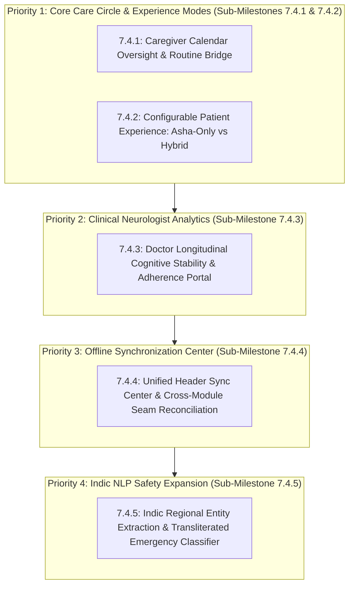
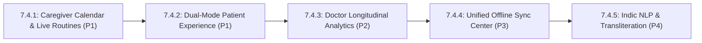

# SAKSHAM NEURO-CARE — MILESTONE 7.4
# ROADMAP ASSESSMENT, FEATURE GAP ANALYSIS & IMPLEMENTATION PLAN

**Document Type:** Master Architectural Assessment & Implementation Roadmap  
**Date:** 10 November 2026  
**Repository:** `/Users/trishnabapna/Desktop/Saksham`  
**Target Branch:** `phase-2-patient-experience`  
**Previous Approved Milestone:** Milestone 7.3 / 7.3.2 (Asha Conversational Engine & Safety Protocols)  
**Independent Verification Audit:** Milestone 7.3.3 (`MILESTONE_7_3_3_INDEPENDENT_VERIFICATION_AUDIT.md`) — **VERIFIED PASS**  
**Firebase Plan:** Spark Free Tier ($0.00 strictly enforced / Zero paid APIs / Zero Cloud Functions / Zero Blaze upgrade)  
**Production Hosting URL:** `https://saksham-d3b71.web.app` (Deployment intentionally withheld)  

---

## 1. Executive Summary & Assessment Context

### 1.1 Assessment Mandate
This document establishes an authoritative, evidence-based roadmap and implementation plan for **Milestone 7.4** of the Saksham Neuro-Care ecosystem. Following the successful completion, remediation, and independent audit verification of **Milestone 7.3** (Asha Conversational Engine, 30-expression character matrix, tactile sanctuary, and safe action protocols across 409 passing frontend tests and 50 passing backend tests), this assessment evaluates the current state of the entire repository to identify:
1. Which core capabilities from the product roadmap remain unbuilt or partially implemented.
2. Where critical integration gaps exist between completed patient tools and the broader care circle.
3. How to evaluate and architect an optional, configurable patient experience supporting both **Mode A: Asha-only (Conversation-first)** and **Mode B: Asha + Navigation (Hybrid)**.
4. How to systematically progress Saksham from an isolated patient sanctuary into a cohesive, synchronized care ecosystem spanning patients, family caregivers, and clinical neurologists—without compromising patient autonomy, privacy, or Firebase Spark free-tier viability.

### 1.2 Core Architectural Findings
The primary findings of this repository audit are:
1. **Asymmetric Ecosystem Seam:** While the patient experience is exceptionally rich (30-expression Asha companion, 3-chance assisted recall, 14 cognitive games, photo vault, and complete Notes & Calendar sanctuary), the **Caregiver Portal** (`CaregiverDashboard.tsx`) and **Clinical Neurology Portal** (`DoctorDashboard.tsx`) remain largely static, hardcoded presentation mockups with mock statistics (`"1 / 4 Done"`, `"84.5% Adherence"`, `"1.3 / 3.0 Cues"`). Crucially, the backend security rules (`firestore.rules` lines 150–165) and data layer (`CalendarService.ts`) already support caregiver calendar oversight and routine monitoring, yet no UI currently connects to them.
2. **Dual-Mode Patient Experience Feasibility:** Adding a configurable choice between **Asha-Only (Conversation-First)** and **Asha + Navigation (Hybrid)** is architecturally straightforward, highly ergonomic for patients with severe cognitive fatigue or executive dysfunction, and safe. The underlying router and sub-screens already possess dedicated back-to-Asha navigation, meaning Asha can launch existing screens without duplicating functionality, voice interaction remains strictly optional, and zero patient data is mutated when toggling modes.

---

## 2. Existing Implementation Inventory & Codebase Grounding

Every finding in this document is grounded in verified repository artifacts. Below is the comprehensive inventory of the codebase across all architectural tiers:

```
Saksham Neuro-Care Codebase Architecture
├── backend/
│   ├── firestore.rules                         (43 tests passing; granular RBAC, subcollections, privacy gates)
│   ├── storage.rules                           (Photo vault storage rules, size/mime constraints)
│   └── src/test/                               (50 automated Vitest unit tests across security, AI, and roles)
├── frontend/
│   ├── src/
│   │   ├── features/
│   │   │   ├── ai-companion/                   (Milestone 7: 30 expressions, Conversational Sanctuary, Safe Actions)
│   │   │   │   ├── CharacterVisualizer.tsx     (Asha SVGs, primary & compact modes, 30 expressions across 5 categories)
│   │   │   │   ├── components/ConversationalSanctuaryStage.tsx (Stage layout, speech/text input, tactile quick actions)
│   │   │   │   ├── config/characterExpressions.ts (Expression metadata, mood mapping, motion classes)
│   │   │   │   ├── services/conversationEngine.ts (Intent classification, execution lock, 2-minute TTL, async commits)
│   │   │   │   ├── services/conversationActionRegistry.ts (Whitelisted safe actions, parameter verification)
│   │   │   │   ├── services/conversationSafetyPolicy.ts (23-language distress detector, clinical blockers)
│   │   │   │   ├── services/entityExtractor.ts (English & Hindi date/time/recurrence/category extractors)
│   │   │   │   └── services/intentRegistry.ts  (Multi-intent router, fallback triggers)
│   │   │   ├── notes/                          (Milestone 6: Notes Sanctuary & Local Voice Storage)
│   │   │   │   ├── components/NotesSanctuaryModal.tsx (CRUD, pinned notes, categories, search, speech read-aloud)
│   │   │   │   ├── components/VoiceNoteRecorder.tsx (Browser MediaRecorder, IndexedDB audio storage)
│   │   │   │   ├── services/notesService.ts    (Local-first persistence, offline queue, Firestore sync)
│   │   │   │   └── types/notes.types.ts        (PatientNote, categories, syncStatus, LocalVoiceNoteMetadata)
│   │   │   ├── calendar/                       (Milestone 6: Calendar Sanctuary & Virtual Recurrence)
│   │   │   │   ├── components/CalendarSanctuaryModal.tsx (Day/Week/Month views, event editor, series warnings)
│   │   │   │   ├── services/calendarService.ts (Deterministic virtual recurrence, viewer filtering, caregiver perm checks)
│   │   │   │   └── types/calendar.types.ts     (CalendarEvent, recurrence rules, caregiver permissions)
│   │   │   ├── routines/                       (Milestone 1-2: Daily Routines & 3-Chance Assisted Recall)
│   │   │   │   ├── components/RoutineChecklist.tsx (Checklist runner, time-window gating, snooze, streak)
│   │   │   │   ├── components/AddRoutineModal.tsx  (Caregiver & patient routine creation)
│   │   │   │   └── services/routineService.ts  (Streak math, attempt logging, quiet hours, Firestore sync)
│   │   │   ├── lovedOnes/                      (Milestone 3: Loved Ones Photo Vault)
│   │   │   │   ├── components/FamilyMemberCard.tsx (Photo card, voice note playback, relationship details)
│   │   │   │   ├── components/AssistedFamilyRecallQuiz.tsx (3-tier assisted family recognition game)
│   │   │   │   ├── services/lovedOnesService.ts (Profile management, preset avatars, Firestore sync)
│   │   │   │   └── utils/imageCompression.ts   (Client-side canvas compression for Spark storage conservation)
│   │   │   └── games/                          (Milestone 4: Mind Games & Adaptive Difficulty)
│   │   │       ├── components/GameCard.tsx     (Game launch card, difficulty tag, XP counter)
│   │   │       ├── components/runners/         (14 game runners: RoomMemory, CardMatch, MiniMaze, WordGarden, etc.)
│   │   │       ├── services/gamesService.ts    (XP tracking, badge evaluation, session recording)
│   │   │       └── services/adaptiveDifficultyService.ts (Automatic pacing & difficulty adjustment engine)
│   │   ├── components/layout/
│   │   │   ├── FloatingUtilityHub.tsx          (Floating Sanctuary trigger for Notes & Calendar)
│   │   │   ├── BottomNav.tsx                   (Strict 4-tab bottom navigation: Home, Family, Games, Profile)
│   │   │   ├── TopBar.tsx                      (Branding, language picker, accessibility toggles, Profile Avatar button)
│   │   │   └── TactileNavigationDrawer.tsx     (Tactile touch drawer with 4 permanent patient destinations)
│   │   ├── pages/
│   │   │   ├── patient/PatientDashboard.tsx    (Sanctuary entry point, embedding Conversational Sanctuary & Routines)
│   │   │   ├── patient/PatientProfile.tsx      (Profile settings, accessibility scaling, language selector)
│   │   │   ├── caregiver/CaregiverDashboard.tsx(Caregiver portal — currently static mockup)
│   │   │   ├── doctor/DoctorDashboard.tsx      (Neurology portal — currently static mockup)
│   │   │   └── admin/AdminDashboard.tsx        (User claims & audit trail management)
│   │   └── i18n/locales/                       (23 complete language files covering English & all 22 Eighth Schedule languages)
```

---

## 3. Completed vs. Incomplete Functionality Audit

| Module / Capability | Current Implementation Status | Verified Source Evidence | Identified Gap / Missing Functionality |
| :--- | :---: | :--- | :--- |
| **Asha Companion & Sanctuary Stage** | **COMPLETE** | `ConversationalSanctuaryStage.tsx`<br>`CharacterVisualizer.tsx` | Fully functional. 30 expressions, dual modes, tactile drawer, and whitelisted safe navigation dispatch. |
| **Asha Conversational Engine** | **COMPLETE** | `conversationEngine.ts`<br>`conversationActionRegistry.ts` | Complete intent routing, entity extraction for EN/HI, 2-min TTL confirmation, async Firestore commits, 23-language emergency classifier. |
| **Patient Notes Experience** | **COMPLETE** | `NotesSanctuaryModal.tsx`<br>`notesService.ts` | Full CRUD, search, category filters, pinned notes, local IndexedDB audio storage, speech read-aloud. |
| **Patient Calendar Experience** | **COMPLETE** | `CalendarSanctuaryModal.tsx`<br>`calendarService.ts` | Day/Week/Month views, deterministic virtual daily/weekly recurrence, series modification notices, private event flag. |
| **Caregiver Calendar Oversight** | **INCOMPLETE (Gapped)** | Backend: `firestore.rules` (L150-165)<br>UI: `CaregiverDashboard.tsx` (Missing) | `firestore.rules` and `calendarService.ts` support caregiver reads and writes, but `CaregiverDashboard.tsx` has **zero** calendar UI. Caregivers cannot view or create patient appointments. |
| **Caregiver Routine Management** | **INCOMPLETE (Mock)** | `CaregiverDashboard.tsx` (L110-142)<br>`routineService.ts` | Caregiver UI displays hardcoded mock routines ("Morning Hydration & Gentle Arm Stretches") instead of live patient routines from `routineService.getRoutines(patientId)`. |
| **Caregiver Assisted Recall Insights** | **INCOMPLETE (Mock)** | `CaregiverDashboard.tsx` (L45-53) | Displays static text `"Level 1 Cue • Patient completed recall on 1st attempt today"` rather than querying `routineService.getHistory(patientId)`. |
| **Doctor Longitudinal Adherence Charts** | **INCOMPLETE (Mock)** | `DoctorDashboard.tsx` (L45-72) | Displays static hardcoded progress bar `"84.5% (High consistency)"` and `"1.3 / 3.0 Cues"`. Completely disconnected from `routineService` and `gamesService`. |
| **Doctor Cognitive Stability Analytics** | **INCOMPLETE (Mock)** | `DoctorDashboard.tsx` (L74-95) | Shows hardcoded AI observation text. Does not read `adaptiveDifficultyService.getProfile(patientId)` (difficulty shifts, struggle sessions, comfortable sessions). |
| **Patient Navigation Modes (Asha-Only vs Hybrid)** | **UNCONFIGURED (Hybrid only)** | `App.tsx` (L108-113)<br>`BottomNav.tsx` | Bottom navigation is currently unconditionally rendered for all patient routes. No toggle exists to hide bottom tabs for an Asha-only conversational flow. |
| **Cross-Module Routine ↔ Calendar Sync** | **PARTIAL / UNLINKED** | `CalendarSanctuaryModal.tsx`<br>`notes.types.ts` (`linkedRoutineId`) | Patients can link calendar events and notes to routines, but completing a routine does not update the linked calendar event or vice-versa. |
| **Voice Note Cross-Device Sharing** | **DEFERRED (Local-only)** | `VoiceNoteRecorder.tsx`<br>`VoiceStorageService.ts` | Audio blobs are stored strictly in client-side IndexedDB to enforce Spark free tier ($0.00 storage cost). Caregivers cannot listen across devices. (Intentional design). |
| **Unified Offline Sync Status Indicator** | **PARTIAL / SILOED** | Individual service sync queues in `notesService`, `calendarService`, etc. | Each service has an internal sync queue, but there is no centralized, visual "Sync Center" in the header informing the patient or caregiver of pending offline items. |
| **Indic Spoken Entity Extraction** | **PARTIAL** | `entityExtractor.ts` (EN & HI only) | Natural language date/time parsing works in English and Hindi; 21 other languages fall back to tactile selectors. |

---

## 4. Outstanding Technical & Architectural Limitations

1. **Firebase Spark Free Tier Boundaries (Non-Negotiable):**
   - **Zero Cloud Functions execution:** All business logic, recurrence calculation, and relationship validation must execute purely client-side or through declarative `firestore.rules`.
   - **Zero Cloud Storage for Audio:** Patient voice notes and audio memos must remain in browser IndexedDB (`VoiceStorageService`) to prevent exceeding the Spark 5 GB storage limit and bandwidth egress quotas.
   - **Firestore Read/Write Quotas:** Daily free quotas are 50,000 document reads and 20,000 document writes. Polling intervals must be strictly prevented; real-time listeners (`onSnapshot`) or local caching with explicit invalidation must be used.
2. **Client-Side Virtual Recurrence Engine:**
   - In Milestone 6, recurrence for calendar events was intentionally implemented without backend cron jobs or database duplication (`doesRecurOnDate`). Recurring daily/weekly events exist as a single template record in Firestore and are projected virtually into calendar days.
   - Any caregiver calendar interface must utilize this identical virtual recurrence engine (`calendarService.ts`) to avoid displaying phantom records or diverging from the patient's schedule.
3. **Zero-Knowledge Patient Privacy Boundaries:**
   - Firestore security rules line 136–147 strictly restrict `notes` subcollections to `isOwner(userId)`. Caregivers, doctors, and administrators have **zero read or write access to patient personal notes**.
   - Calendar events marked with `isPrivate: true` are strictly filtered out by security rules line 156 (`resource.data.isPrivate != true`). Caregiver interfaces must never attempt to query or display private events.
4. **Permanent Invariants:**
   - No new bottom navigation tabs (locked to 4 destinations: `Home`, `Family`, `Games`, `Profile`).
   - Notes and Calendar remain in the `FloatingUtilityHub` and are not added as bottom navigation tabs.
   - The primary character companion is **Asha** (30 expressions, no alternate characters, no Kabir, no switching UI).

---

## 5. Architectural Evaluation: Dual-Mode Patient Experience (Asha-Only vs. Hybrid Navigation)

### 5.1 Product Vision & Mode Definitions

```
                     ┌──────────────────────────────────────────────┐
                     │          Patient Experience Modes            │
                     └──────────────────────┬───────────────────────┘
                                            │
                    ┌───────────────────────┴───────────────────────┐
                    ▼                                               ▼
      ┌───────────────────────────┐                   ┌───────────────────────────┐
      │   Mode A: Asha-Only       │                   │   Mode B: Asha + Nav      │
      │   (Conversation-First)    │                   │   (Hybrid - Safe Default) │
      ├───────────────────────────┤                   ├───────────────────────────┤
      │ • Asha is primary UI      │                   │ • Asha companion on Home  │
      │ • Bottom nav tabs HIDDEN  │                   │ • 4 bottom tabs VISIBLE   │
      │ • Voice or text input     │                   │ • Direct manual tap or    │
      │ • Opens existing screens  │                   │   conversational command  │
      │ • Tactile chips preserved │                   │ • Familiar for independent│
      │ • Visible Settings button │                   │   tech-fluent patients    │
      └───────────────────────────┘                   └───────────────────────────┘
```

#### Mode A: Asha-Only (Conversation-First)
- **Concept:** Designed for patients experiencing heightened cognitive overwhelm, visual clutter fatigue, or motor tremor difficulties navigating dense bottom tab bars. Asha is the warm, singular focal point of the screen.
- **Visual Presentation:** The four bottom navigation tabs (`BottomNav.tsx`) are hidden. The screen padding adjusts from `pb-24` to `pb-8`, creating a spacious, calm sanctuary stage.
- **Workflow Navigation:** Patients communicate with Asha using supported voice or text input, or tap the prominent tactile action chips. Asha routes the patient to existing, mature sub-screens (`/patient/loved-ones`, `/patient/mind-games`, `/patient/profile`, or Notes/Calendar modals) rather than duplicating features inside the chat dialogue.
- **Preserved Tactile Fallbacks:** Voice input is **never mandatory**. The patient always has access to:
  - Text input bar with accessible keyboard focus.
  - 5 Tactile Quick Action chips (`Daily Routines`, `Family Memories`, `Mind Games`, `Notes`, `Calendar`).
  - Tactile Navigation Drawer (`TactileNavigationDrawer.tsx`) accessible via trigger.
- **Profile / Settings Access:** Profile/Settings remains immediately accessible through:
  1. The permanent **Profile Avatar button** in `TopBar.tsx`.
  2. A clearly labeled **"Settings & Care Profile" tactile chip** rendered on the Sanctuary stage in Mode A.
  3. The permanent destination inside `TactileNavigationDrawer.tsx`.

#### Mode B: Asha + Navigation (Hybrid — Safe Default)
- **Concept:** The established Saksham patient home. Asha accompanies the patient centrally on the Home screen, while the persistent 4-tab bottom navigation bar (`Home`, `Family`, `Games`, `Profile`) remains visible at all times.
- **Safe Default:** All existing registered patients and newly created patient profiles default to **Mode B (Hybrid)** to guarantee 100% backward compatibility and prevent user disorientation.

---

### 5.2 Technical & Route Feasibility Assessment

1. **Clean Layout Decoupling in `App.tsx`:**
   In `frontend/src/App.tsx`, bottom navigation is already rendered at the root layout level:
   ```tsx
   // Proposed conditional rendering in App.tsx
   {isPatientRoute && !isAuthRoute && (
     <>
       <FloatingUtilityHub />
       {patientExperienceMode === 'hybrid' && <BottomNav />}
     </>
   )}
   ```
   Toggling between Mode A and Mode B simply mounts or unmounts `<BottomNav />`. No component trees need to be restructured.

2. **Route Behavior & Sub-Screen Continuity:**
   - Underlying routes remain 100% identical:
     - `/patient` (Sanctuary Home)
     - `/patient/loved-ones` (Family Photo Vault)
     - `/patient/mind-games` (Mind Games & Room Memory)
     - `/patient/profile` (Profile & Settings)
     - Floating modals: `NotesSanctuaryModal.tsx` and `CalendarSanctuaryModal.tsx`
   - Zero route renaming, zero redirection loops, zero path alterations.
   - When Asha dispatches `NAVIGATE_TO_FEATURE({ route: '/patient/mind-games' })`, the patient arrives on the standard `MindGames.tsx` screen.
   - Every sub-screen already features an accessible **"Back to Home / Back to Asha"** button (`ArrowLeft` calling `navigate('/patient')`), ensuring patients in Mode A never feel trapped and can return to Asha with a single tap.

3. **Screen Real Estate & Motor Accessibility:**
   In Mode A, removing the 56px bottom navigation bar frees up critical vertical space on mobile devices (e.g., 375px viewport height), expanding touch targets for patients with Parkinsonian hand tremors and reducing accidental bottom-edge navigation mis-taps.

---

### 5.3 Persistence, Security & Identity Isolation

1. **Storage Hierarchy & Zero Latency:**
   - **Cloud Persistence:** Persisted in the patient's Firestore user document (`/users/{uid}`) under property `patientExperienceMode: 'asha-only' | 'hybrid'`.
   - **Local-First Cache:** Scoped to the active patient UID in browser `localStorage`:
     ```typescript
     const STORAGE_KEY = `saksham_patient_experience_mode_${patientId}`;
     ```
   - On app startup, Saksham reads the local key synchronously, preventing layout flash (CLS = 0), and synchronizes with Firestore in the background.

2. **Strict Zero-Side-Effect Guarantee:**
   Toggling between Mode A and Mode B alters **only the visual UI navigation presentation**. It is mathematically and architecturally impossible for a mode change to modify, reset, or corrupt:
   - Routine checklists, time-window states, or streak counters (`RoutineService`).
   - Mind game scores, session logs, XP, or badges (`GamesService`).
   - Loved ones profiles, voice notes, or photo memory cues (`LovedOnesService`).
   - Notes, pinned markers, or local IndexedDB audio recordings (`NotesService`, `VoiceStorageService`).
   - Calendar events, virtual recurrences, or reminder configurations (`CalendarService`).
   - Caregiver and doctor link authorizations in `relationships`.

3. **Role Isolation:**
   - `CaregiverDashboard.tsx`, `DoctorDashboard.tsx`, and `AdminDashboard.tsx` are completely immune to this setting.
   - Only the authenticated patient experience responds to `patientExperienceMode`.

---

### 5.4 Configuration Placement in `PatientProfile.tsx`

The proposed mode switcher will be located under **Profile → Settings → Patient Experience & Navigation**:
```
┌────────────────────────────────────────────────────────────────────────┐
│  Patient Experience & Navigation Style                                 │
│  Choose how you prefer to explore Saksham and interact with Asha       │
├────────────────────────────────────────────────────────────────────────┤
│  ┌──────────────────────────────────────────────────────────────────┐  │
│  │ (•) Asha Companion Only (Conversation-First)                     │  │
│  │     Simple, calm, distraction-free screen without bottom tabs.   │  │
│  │     Talk or type to Asha, or tap quick action buttons.           │  │
│  │     [Distraction-Free Badge]                                     │  │
│  └──────────────────────────────────────────────────────────────────┘  │
│  ┌──────────────────────────────────────────────────────────────────┐  │
│  │ ( ) Asha + Bottom Navigation (Hybrid)                            │  │
│  │     Asha companion on Home, plus standard bottom tabs for direct │  │
│  │     one-tap access to Family, Games, and Profile.                │  │
│  │     [Recommended Default Badge]                                  │  │
│  └──────────────────────────────────────────────────────────────────┘  │
│                                                                        │
│  ℹ️ Switching modes keeps all your notes, routines, and games intact. │
└────────────────────────────────────────────────────────────────────────┘
```
- Fully localized in all 23 language dictionaries.
- Instantaneous state update using React Context (`useAccessibility` or dedicated `usePatientExperience`).

---

## 6. Prioritized Feature Gap Analysis



---

## 7. Proposed Milestone 7.4 Sub-Milestones

### Sub-Milestone 7.4.1: Caregiver Calendar Oversight & Live Care Coordination (P1 — Essential)
* **Goal & Rationale:** Connect `CaregiverDashboard.tsx` to `CalendarService` and `RoutineService`, giving family caregivers live visibility into patient schedules and care routines.
* **User & Clinical Value:** Allows caregivers to coordinate medical appointments and track routine compliance without verbal cross-examination.
* **Key Deliverables:** Caregiver Calendar view (Day/Week/Agenda), appointment scheduler modal, live routine completion checklist, assisted recall cue usage indicator, and `isPrivate` privacy filtering.
* **Permissions & Security:** Enforces `hasCaregiverCalendarPerm` and `resource.data.isPrivate != true`. Notes subcollection remains strictly inaccessible.
* **Free-Tier Feasibility:** $0.00. Client-side Firestore queries within daily 50K read quotas.
* **Complexity:** Moderate (3–4 days).
* **Dependencies:** Milestone 6.1 (Data Layer), Milestone 6.3 (Calendar UI).

---

### Sub-Milestone 7.4.2: Configurable Patient Experience: Asha-Only vs. Hybrid Modes (P1 — High Value)
* **Goal & Rationale:** Implement a user-selectable toggle between **Mode A: Asha-Only (Conversation-First)** and **Mode B: Asha + Navigation (Hybrid)** in `PatientProfile.tsx`.
* **User & Clinical Value:** Offers cognitive relief for patients overwhelmed by dense navigation bars while preserving direct manual navigation for independent seniors.
* **Key Deliverables:**
  - `PatientExperienceContext` managing `patientExperienceMode` (`'asha-only' | 'hybrid'`).
  - Safe default: `'hybrid'` for all existing and new accounts.
  - Conditional rendering of `BottomNav.tsx` in `App.tsx`.
  - Prominent "Settings & Profile" tactile chip in `ConversationalSanctuaryStage.tsx` when Mode A is active.
  - Mode selection card in `PatientProfile.tsx` under Settings.
  - Persistence in Firestore `/users/{uid}` and local `localStorage`.
  - Localization across all 23 language files.
* **Guarantees:** Zero data mutations (routines, games, notes, and calendar untouched); voice is never mandatory; role isolation preserved.
* **Free-Tier Feasibility:** $0.00.
* **Complexity:** Low-to-Moderate (2–3 days).
* **Dependencies:** Milestone 7.2 (Conversational Sanctuary Stage).

---

### Sub-Milestone 7.4.3: Doctor Longitudinal Cognitive Analytics & Adherence Portal (P2 — Important)
* **Goal & Rationale:** Upgrade `DoctorDashboard.tsx` to calculate and render live 30-day routine adherence, 3-chance assisted recall cue failure distribution (Level 1 vs 2 vs 3), and adaptive game difficulty drift.
* **User & Clinical Value:** Gives treating neurologists objective behavioral metrics without making automated diagnoses.
* **Key Deliverables:** 30-day adherence trendline, assisted recall cue breakdown chart, adaptive cognitive pacing indicator, and permanent clinical disclaimer.
* **Complexity:** Moderate (2–3 days).
* **Dependencies:** Sub-Milestone 7.4.1.

---

### Sub-Milestone 7.4.4: Unified Offline Synchronization Center & Cross-Module Seam Reconciliation (P3 — Important)
* **Goal & Rationale:** Consolidate disconnected sync queues across Notes, Calendar, Routines, and Games into a visible header sync pill (`All Synced`, `Pending (N items)`, `Offline Mode`) and link routine completion to calendar events.
* **User & Clinical Value:** Eliminates uncertainty about whether changes have saved to the cloud during poor connectivity.
* **Key Deliverables:** Header sync indicator, sync details drawer with manual retry, and bidirectional checkoff of calendar events when linked routines are completed.
* **Complexity:** Moderate (2–3 days).
* **Dependencies:** Sub-Milestones 7.4.1 & 7.4.2.

---

### Sub-Milestone 7.4.5: Indic Natural Language Expansion & Transliterated Emergency Classifier (P4 — Enhancement)
* **Goal & Rationale:** Extend spoken date/time entity extraction to Tamil, Telugu, Bengali, and Marathi, and augment `conversationSafetyPolicy.ts` with Romanized Latin transliterations for the 23 Indic emergency distress phrases.
* **User & Clinical Value:** Protects multilingual patients typing phonetic distress in Latin script (e.g. `"chhatit dukhat aahe"`).
* **Complexity:** Low-to-Moderate (2 days).
* **Dependencies:** Milestone 7.3.2.

---

## 8. Recommended Implementation Order & First Step

### 8.1 Implementation Order


### 8.2 Recommended Immediate Next Step: Sub-Milestone 7.4.1
We continue to recommend initiating **Sub-Milestone 7.4.1 (Caregiver Calendar Oversight & Live Care Coordination)** first, followed immediately by **Sub-Milestone 7.4.2 (Dual-Mode Patient Experience)**:
1. **Unlocks Pre-built Infrastructure:** `firestore.rules` and `CalendarService` already have the caregiver calendar permission methods and security checks written and verified. Connecting them creates an immediate clinical bridge.
2. **Zero Invariant Violations:** Does not alter bottom navigation or character identity.
3. **Synergy with 7.4.2:** Once caregiver calendar scheduling is active, patients in either Mode A (Asha-Only) or Mode B (Hybrid) will immediately benefit from Asha reading those newly scheduled caregiver events aloud upon request!

---

## 9. Security, Privacy & Free-Tier Verification

| Dimension | Verification Evidence & Invariant |
| :--- | :--- |
| **Spark Plan Compliance ($0.00)** | Zero paid APIs, zero external LLMs, zero Cloud Functions, zero Cloud Storage for audio (IndexedDB only). All reads/writes within daily 50K/20K quotas. |
| **Privacy Invariant** | Patient notes (`/users/{id}/notes`) and private calendar events (`isPrivate: true`) remain 100% inaccessible to caregivers and doctors. |
| **Navigation Invariant** | Exactly 4 permanent patient bottom navigation destinations (`Home`, `Family`, `Games`, `Profile`). In Mode A, bottom tabs are hidden; in Mode B, all 4 tabs are visible. Zero new tabs created. |
| **Companion Invariant** | Asha remains the sole permanent AI companion (30 expressions, no Kabir, no alternate character models). |
| **Zero Data Mutation Invariant** | Toggling patient experience mode never alters or resets routine progress, game history, family photos, notes, or calendar events. |

---

## 10. Testing & Verification Matrix

### 10.1 Sub-Milestone 7.4.1 Verification Matrix (Caregiver Calendar & Live Routines)
1. **Caregiver Permission Tests (`CaregiverCalendarPermissions.test.tsx`):**
   - Renders calendar when `canReadCalendar: true`.
   - Displays permission request banner when `canReadCalendar: false`.
   - Disables appointment creation when `canCreateCalendarEvents: false`.
2. **Caregiver Privacy Guard Tests (`CaregiverPrivacyGuard.test.tsx`):**
   - Asserts that events with `isPrivate: true` are completely absent from the caregiver's view.
   - Verifies that attempting to fetch a private event by ID returns `null` or permission denied.
3. **Live Routine Supervision Tests (`CaregiverRoutineSupervision.test.tsx`):**
   - Verifies that routines loaded in `CaregiverDashboard.tsx` match the exact data returned by `RoutineService.getRoutines(patientId)`.
   - Asserts that marking a routine complete in the patient view immediately reflects in the caregiver dashboard.

### 10.2 Sub-Milestone 7.4.2 Verification Matrix (Dual-Mode Patient Experience)
1. **Mode A (Asha-Only) Navigation Hiding Tests (`PatientExperienceModeA.test.tsx`):**
   - When `patientExperienceMode === 'asha-only'`, asserts that `<BottomNav />` is not rendered in the DOM on `/patient`, `/patient/loved-ones`, `/patient/mind-games`, and `/patient/profile`.
   - Asserts that the Sanctuary stage has clean `pb-8` padding rather than `pb-24`.
   - Asserts that the "Settings & Care Profile" tactile chip is present and functional on the Sanctuary stage.
   - Asserts that the TopBar Profile avatar button remains visible and accessible.
2. **Mode B (Hybrid) Navigation Rendering Tests (`PatientExperienceModeB.test.tsx`):**
   - When `patientExperienceMode === 'hybrid'`, asserts that `<BottomNav />` is rendered in the DOM with all 4 permanent destinations.
   - Asserts that default state for unconfigured users is strictly `'hybrid'`.
3. **Settings Persistence & Context Tests (`PatientExperiencePersistence.test.tsx`):**
   - Asserts that selecting Mode A updates `localStorage` key `saksham_patient_experience_mode_${patientId}`.
   - Asserts that switching between modes executes in <10ms without page reloads.
4. **Zero-Side-Effect Regression Tests (`PatientExperienceZeroSideEffects.test.tsx`):**
   - Verifies that toggling between Mode A and Mode B causes zero alterations to:
     - `routineService.getRoutines(patientId)` and streak counts.
     - `gamesService.getHistory(patientId)` and XP.
     - `lovedOnesService.getLovedOnes(patientId)`.
     - `notesService.getNotes(patientId)` and IndexedDB audio blobs.
     - `calendarService.getEvents(patientId)`.

---

## 11. Explicit Out-of-Scope Items

To prevent scope creep, protect user safety, and preserve free-tier boundaries, the following items are strictly **OUT OF SCOPE** for Milestone 7.4:
- **No Cloud Functions or Blaze Billing:** No server-side Node.js triggers, background cron runners, or external paid API integrations.
- **No Cloud Storage for Audio:** Patient voice recordings remain strictly local in IndexedDB; no audio files will be uploaded to Firebase Storage.
- **No Automated Clinical Diagnoses:** Saksham presents measured behavioral data and adherence metrics; it does not issue medical diagnoses, drug dosage alterations, or automated clinical decisions.
- **No Additional Bottom Navigation Tabs:** The patient bottom navigation bar remains strictly 4 tabs (`Home`, `Family`, `Games`, `Profile`). In Mode A, bottom tabs are hidden; in Mode B, 4 tabs are shown. Zero new tabs will be created.
- **No Mandatory Voice Interaction:** Voice interaction remains an optional convenience. Text input, 5 tactile action chips, and the tactile navigation drawer remain permanently available.
- **No Character Alterations:** Asha remains the sole, permanent companion. No character switching, no Kabir, and no avatar changes.
- **No Production Hosting Deployment:** Production deployment to `saksham-d3b71.web.app` remains withheld until explicit multi-phase authorization.

---

## 12. Master Summary Table

| Category | Finding / Specification |
| :--- | :--- |
| **Current Branch** | `phase-2-patient-experience` |
| **Current Head Feature Commit** | `06ccc19` (`feat(patient): remediate conversational reliability, safety and data integrity`) |
| **Documentation Commit Hash** | `feee9bb` (Updated with Section 5 dual-mode evaluation) |
| **Frontend Test Status** | **409 passed across 30 files** |
| **Backend Test Status** | **50 passed across 3 files** |
| **Production Build Status** | **Clean compilation in 2.90s (0 errors)** |
| **Proposed Sub-Milestones** | **7.4.1** (Caregiver Calendar & Routines), **7.4.2** (Dual-Mode Experience), **7.4.3** (Doctor Analytics), **7.4.4** (Sync Center), **7.4.5** (Indic NLP) |
| **Recommended Next Action** | **Await explicit user approval before beginning implementation of Sub-Milestone 7.4.1 or 7.4.2.** |
