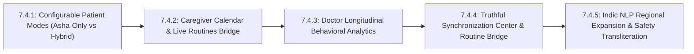

# SAKSHAM NEURO-CARE — MILESTONE 7.4
# ROADMAP REVISION, FEATURE GAP ANALYSIS & IMPLEMENTATION PLAN

**Document Type:** Master Architectural Roadmap & Dependency Validation  
**Date:** 10 November 2026  
**Repository:** `/Users/trishnabapna/Desktop/Saksham`  
**Target Branch:** `phase-2-patient-experience`  
**Previous Roadmap Commits:** `feee9bb`, `eb034e7`  
**Firebase Plan:** Spark Free Tier ($0.00 strictly enforced / Zero paid APIs / Zero Cloud Functions / Zero Blaze upgrade)  
**Production Hosting URL:** `https://saksham-d3b71.web.app` (Deployment intentionally withheld)  

---

## 1. Executive Summary & Audit Mandate

### 1.1 Objective
This document provides a revised, evidence-based architectural roadmap and dependency validation for **Milestone 7.4** of Saksham Neuro-Care. Following the successful completion, remediation, and independent audit of Milestone 7.3 (`MILESTONE_7_3_3_INDEPENDENT_VERIFICATION_AUDIT.md` — PASS), this revision accomplishes three critical mandates:
1. **Milestone 6 Completion Reconciliation:** Reconciles all claims regarding Notes, Calendar, local IndexedDB audio, virtual recurrence, and caregiver permissions against actual source code, test suites, and documentation, distinguishing implemented features from missing service-layer bridges and real-world acceptance.
2. **Two-Mode Patient Experience Architecture:** Evaluates, designs, and integrates a configurable patient experience providing **Mode A: Asha-only (Conversation-first)** and **Mode B: Asha + Navigation (Hybrid)**, detailing screen real estate, route stability, persistence, tactile fallbacks, honest AI boundaries, and zero data-loss guarantees.
3. **Rigorous Dependency & Security Validation:** Validates Firestore security rules (`hasCaregiverCalendarPerm`, `isPrivate` enforcement, relationship prerequisites), identifies missing service-level cloud-pull methods (`syncEventsFromFirestore`) prior to UI development, and structures a safe, sequential implementation roadmap.

---

## 2. Milestone 6 Completion Reconciliation & Verification Matrix

Earlier milestone roadmaps referenced Milestone 6.3 as complete. A forensic audit of all Milestone 6 source files, services, unit tests, and documentation was conducted to distinguish **code implementation**, **automated test coverage**, and **unbuilt or unverified capabilities**.

### Forensic Verification Table

| Feature / Workflow | Relevant Source Files & Services | Relevant Automated Tests | Relevant Documentation | Verified Status | Remaining Work / Architectural Reality |
| :--- | :--- | :--- | :--- | :---: | :--- |
| **Notes CRUD & Editing** | `NotesSanctuaryModal.tsx`<br>`notesService.ts`<br>`notes.types.ts` | `Milestone63CompleteNotesCalendar.test.tsx` (Part A)<br>`Milestone61DataPersistence.test.ts` (Part A) | `MILESTONE_6_1_IMPLEMENTATION_REPORT.md`<br>`MILESTONE_6_3_NOTES_CALENDAR_REPORT.md` | **Implemented & Tested** | Full client-side modal CRUD (create, view, edit, soft-delete with confirmation). Local-first with offline queue. *Real-world production hosting deployment withheld.* |
| **Calendar CRUD & Views** | `CalendarSanctuaryModal.tsx`<br>`calendarService.ts`<br>`calendar.types.ts` | `Milestone63CompleteNotesCalendar.test.tsx` (Part C)<br>`Milestone61DataPersistence.test.ts` (Part C) | `MILESTONE_6_1_IMPLEMENTATION_REPORT.md`<br>`MILESTONE_6_3_NOTES_CALENDAR_REPORT.md` | **Implemented & Tested** | Day, Week, and Month views; Prev/Next/Today navigation; event creation, editing, deletion. *Real-world production hosting deployment withheld.* |
| **Pinned Notes & Categories** | `NotesSanctuaryModal.tsx`<br>`notesService.ts` | `Milestone63CompleteNotesCalendar.test.tsx` (Test 1 & 3)<br>`Milestone61DataPersistence.test.ts` (Test 3 & 4) | `MILESTONE_6_3_NOTES_CALENDAR_REPORT.md` | **Implemented & Tested** | Pin/unpin toggle; pinned notes sort first; category filtering (`personal`, `medical`, `family`, `reminder`, `other`); Web Speech API TTS read-aloud. |
| **Audio Recording & Playback** | `VoiceNoteRecorder.tsx`<br>`voiceStorageService.ts` | `Milestone63CompleteNotesCalendar.test.tsx` (Part B)<br>`Milestone61DataPersistence.test.ts` (Part B) | `MILESTONE_6_3_NOTES_CALENDAR_REPORT.md` | **Implemented (Local-Only)** | Uses browser `MediaRecorder` and stores audio blobs in device IndexedDB. **Strictly local-only by design** (0 bytes in Cloud Storage for Spark $0.00 compliance). Cannot be played on other devices or by caregivers. |
| **Virtual Recurrence & Series Notices** | `CalendarSanctuaryModal.tsx`<br>`calendarService.ts` (`doesRecurOnDate`) | `Milestone63CompleteNotesCalendar.test.tsx` (Part D)<br>`Milestone61DataPersistence.test.ts` (Part C) | `MILESTONE_6_1_IMPLEMENTATION_REPORT.md`<br>`MILESTONE_6_3_NOTES_CALENDAR_REPORT.md` | **Partially Implemented** | Deterministic virtual recurrence evaluates daily/weekly repeats on the fly without database record duplication. Series-level warning displayed. **Recurrence exceptions (editing/deleting a single occurrence) are NOT implemented.** Any modification alters the series template. |
| **Routine Linking in Notes/Calendar** | `CalendarSanctuaryModal.tsx`<br>`NotesSanctuaryModal.tsx` (`linkedRoutineId`) | `Milestone63CompleteNotesCalendar.test.tsx` (Test 7) | `MILESTONE_6_3_NOTES_CALENDAR_REPORT.md` | **Partially Implemented** | Dropdown populates from `RoutineService.getRoutines(patientId)` and saves `linkedRoutineId`. **Bidirectional synchronization is MISSING**: completing a routine does not automatically check off the linked calendar event or vice-versa. |
| **Caregiver Permissions & Privacy Rules** | Backend: `firestore.rules` (L150–165)<br>Frontend: `calendarService.ts` (`filterEventsForViewer`) | `backend/src/test/securityRules.test.ts` (L366–406)<br>`Milestone61DataPersistence.test.ts` | `MILESTONE_6_NOTES_CALENDAR_ARCHITECTURE_AUDIT.md`<br>`MILESTONE_6_1_IMPLEMENTATION_REPORT.md` | **Backend Ready / UI Missing** | Firestore rules enforce `hasCaregiverCalendarPerm` and reject reads/updates/deletes on `isPrivate: true`. Helper `filterEventsForViewer` strips private events. **Caregiver Dashboard (`CaregiverDashboard.tsx`) has ZERO calendar UI.** Caregivers currently cannot view or schedule appointments. |
| **Offline Persistence & Sync Queues** | `notesService.ts`<br>`calendarService.ts` | `Milestone61DataPersistence.test.ts` (Part D)<br>`Milestone63CompleteNotesCalendar.test.tsx` | `MILESTONE_6_1_IMPLEMENTATION_REPORT.md`<br>`MILESTONE_6_3_NOTES_CALENDAR_REPORT.md` | **Partially Implemented** | Local-first `localStorage` writes; online event listeners queue mutations and push to Firestore upon reconnection. **Siloed within modals**: no universal header sync status; last-write-wins without field-level conflict resolution. |
| **Patient-Facing Interface Completeness** | `FloatingUtilityHub.tsx`<br>`NotesSanctuaryModal.tsx`<br>`CalendarSanctuaryModal.tsx` | `Milestone62FloatingUtilityHub.test.tsx`<br>`Milestone63CompleteNotesCalendar.test.tsx` | `MILESTONE_6_2_UTILITY_HUB_REPORT.md`<br>`MILESTONE_6_3_NOTES_CALENDAR_REPORT.md` | **Implemented & Verified** | Floating action button on Home launches modal sanctuary. Full high-contrast, RTL, and keyboard trap (Escape/focus) compliance. 4-tab bottom navigation preserved. |

### Reconciliation Summary
Milestone 6 delivered a functional **patient-facing** Notes and Calendar experience inside the `FloatingUtilityHub`. However, the broader **cross-user care circle integration** (Caregiver Calendar UI, bidirectional routine checkoff, single-occurrence recurrence exceptions, and cross-device audio) was not built in Milestone 6 and remains outstanding.

---

## 3. Dependency & Security Validation for Caregiver Oversight

Before implementing caregiver calendar functionality, a forensic audit of `backend/firestore.rules` and `CalendarService.ts` identified critical prerequisite dependencies that must be addressed:

### 3.1 Firestore Security Rules Validation (`hasCaregiverCalendarPerm`)
In [`backend/firestore.rules`](file:///Users/trishnabapna/Desktop/Saksham/backend/firestore.rules#L47-L65):
```firestore-security-rules
function isConnectedCaregiver(patientId) {
  return isCaregiver() &&
    exists(/databases/$(database)/documents/relationships/$(request.auth.uid + '_' + patientId)) &&
    get(/databases/$(database)/documents/relationships/$(request.auth.uid + '_' + patientId)).data.status == 'active';
}

function hasCaregiverCalendarPerm(patientId, permKey) {
  return isConnectedCaregiver(patientId) &&
    (
      (permKey in get(/databases/$(database)/documents/relationships/$(request.auth.uid + '_' + patientId)).data &&
       get(/databases/$(database)/documents/relationships/$(request.auth.uid + '_' + patientId)).data[permKey] == true) ||
      ('permissions' in get(/databases/$(database)/documents/relationships/$(request.auth.uid + '_' + patientId)).data &&
       permKey in get(/databases/$(database)/documents/relationships/$(request.auth.uid + '_' + patientId)).data.permissions &&
       get(/databases/$(database)/documents/relationships/$(request.auth.uid + '_' + patientId)).data.permissions[permKey] == true)
    );
}
```
**Audit Finding:** The security rules strictly verify that:
1. An explicit document exists in `/relationships/{caregiverUid}_{patientId}`.
2. The relationship status is strictly `'active'`.
3. The specific permission key (`canReadCalendar`, `canCreateCalendarEvents`, `canEditCalendarEvents`, `canDeleteCalendarEvents`) is boolean `true`.
This logic is cryptographically sound and verified by 43 passing backend unit tests.

### 3.2 Critical Security Finding: Caregiver `isPrivate` Update Guard
In [`backend/firestore.rules`](file:///Users/trishnabapna/Desktop/Saksham/backend/firestore.rules#L159-L163):
```firestore-security-rules
allow update: if isOwner(userId) || (
  hasCaregiverCalendarPerm(userId, 'canEditCalendarEvents') &&
  resource.data.isPrivate != true &&
  request.resource.data.patientId == userId
);
```
**Vulnerability Identified:** The rule verifies that the *existing* document is not private (`resource.data.isPrivate != true`), but does **NOT** explicitly check that the incoming update payload maintains `request.resource.data.isPrivate != true`.
- If an authorized caregiver were to submit an update setting `isPrivate: true`, Firestore would permit the write, and subsequently lock the caregiver out (since `allow read` checks `resource.data.isPrivate != true`).
- **Prerequisite Requirement:** The client-side `CalendarService.updateEvent` method and form validations must strictly strip or disallow any modification of `isPrivate` by a caregiver. Only patients may designate privacy.

### 3.3 Critical Service Finding: Missing `syncEventsFromFirestore` in `CalendarService`
In [`frontend/src/features/calendar/services/calendarService.ts`](file:///Users/trishnabapna/Desktop/Saksham/frontend/src/features/calendar/services/calendarService.ts#L157-L173):
```typescript
public static getEvents(patientId: string): CalendarEvent[] {
  const effectiveId = getEffectivePatientId({ uid: patientId });
  const raw = this.safeGetItem(this.getStorageKey(effectiveId));
  if (!raw) return [];
  // parses from localStorage...
}
```
**Audit Finding:** `CalendarService` was implemented local-first with push-to-cloud (`pushToFirestore`), but **HAS NO CLOUD PULL METHOD** (`getDocs` from `/users/{patientId}/calendarEvents`).
- If a caregiver opens `CaregiverDashboard.tsx` on their own device, `CalendarService.getEvents(patientId)` inspects the *caregiver's local device storage*, which contains 0 events for the patient!
- **Mandatory Precondition:** Before building the Caregiver Calendar UI, `CalendarService` must be extended with:
  ```typescript
  public static async syncEventsFromFirestore(patientId: string): Promise<CalendarEvent[]>
  ```
  This method will execute `getDocs(collection(db, 'users', patientId, 'calendarEvents'))`, cache the results locally, and apply `filterEventsForViewer(events, true)` to omit private records.

### 3.4 Caregiver Routine Data Safety
In [`backend/firestore.rules`](file:///Users/trishnabapna/Desktop/Saksham/backend/firestore.rules#L182-L200), `isConnectedCaregiver(patientId)` is permitted to read and write `/routines/{routineId}`.
In [`RoutineService.ts`](file:///Users/trishnabapna/Desktop/Saksham/frontend/src/features/routines/services/routineService.ts#L335-L370), `syncRoutinesFromFirestore(patientId)` already exists and functions correctly.
However, `RoutineService.getHistory(patientId)` (used for assisted recall cue stats) only reads from `localStorage`. Caregiver dashboards cannot see live attempt records across devices until `syncHistoryFromFirestore(patientId)` is implemented.

---

## 4. Two-Mode Patient Experience: Architecture & Feasibility

### 4.1 Product Vision & Mode Specifications

```
                     ┌──────────────────────────────────────────────┐
                     │          Patient Experience Modes            │
                     └──────────────────────┬───────────────────────┘
                                            │
                    ┌───────────────────────┴───────────────────────┐
                    ▼                                               ▼
      ┌───────────────────────────┐                   ┌───────────────────────────┐
      │   Mode A: Asha-Only       │                   │   Mode B: Asha + Nav      │
      │   (Conversation-First)    │                   │   (Hybrid - Safe Default) │
      ├───────────────────────────┤                   ├───────────────────────────┤
      │ • Asha is primary UI      │                   │ • Asha companion on Home  │
      │ • Bottom nav tabs HIDDEN  │                   │ • 4 bottom tabs VISIBLE   │
      │ • Voice or text input     │                   │ • Direct manual tap or    │
      │ • Opens existing screens  │                   │   conversational command  │
      │ • Tactile chips preserved │                   │ • Familiar for independent│
      │ • Visible Settings button │                   │   tech-fluent patients    │
      └───────────────────────────┘                   └───────────────────────────┘
```

#### Mode A: Asha-Only (Conversation-First)
- **Primary Audience:** Patients experiencing cognitive fatigue, visual clutter anxiety, or motor tremor difficulty navigating compact bottom tab bars.
- **Visual Presentation:** The four bottom navigation tabs (`BottomNav.tsx`) are completely hidden. Screen padding adjusts from `pb-24` to `pb-8`, expanding vertical viewport space.
- **Interaction Model:** Patients interact via supported voice or accessible text input.
- **Workflow Routing:** Asha guides patients directly to existing sub-screens (`/patient/loved-ones`, `/patient/mind-games`, `/patient/profile`, or Notes/Calendar modals). **Asha does NOT duplicate sub-screen logic in chat dialogue.**
- **Preserved Tactile Fallbacks (Voice Never Mandatory):**
  - Text input bar with accessible keyboard focus.
  - 5 Tactile Quick Action chips on the Sanctuary stage (`Daily Routines`, `Family Memories`, `Mind Games`, `Notes`, `Calendar`).
  - Tactile Navigation Drawer ([`TactileNavigationDrawer.tsx`](file:///Users/trishnabapna/Desktop/Saksham/frontend/src/components/layout/TactileNavigationDrawer.tsx)) accessible via one tap.
- **Permanent Settings Accessibility:** Settings is never trapped behind an unparsed voice query. It is reachable via:
  1. TopBar Profile Avatar button ([`TopBar.tsx` L125-L138](file:///Users/trishnabapna/Desktop/Saksham/frontend/src/components/layout/TopBar.tsx#L125-L138)).
  2. Dedicated **"Settings & Care Profile" tactile chip** on the Sanctuary stage in Mode A.
  3. Tactile Navigation Drawer anchor.
- **Honest AI Representation:** Asha is never represented as an autonomous general intelligence or diagnostic assistant. Unsupported requests produce honest fallback prompts with tactile alternatives.

#### Mode B: Asha + Navigation (Hybrid — Safe Default)
- **Primary Audience:** Independent, tech-fluent seniors who prefer direct manual tab navigation alongside Asha.
- **Visual Presentation:** Retains the familiar layout: Asha Sanctuary on Home + 4 bottom navigation tabs (`Home`, `Family`, `Games`, `Profile`).
- **Safe Default Mandate:** All existing registered patients and new patient profiles default strictly to **Mode B (Hybrid)** to eliminate surprise or disorientation.

---

### 4.2 Route Continuity & Zero Data-Loss Guarantee

1. **Route Stability:**
   Underlying application routes remain completely untouched:
   - `/patient` (Sanctuary Home)
   - `/patient/loved-ones` (Family Memory Vault)
   - `/patient/mind-games` (Mind Games & Room Memory)
   - `/patient/profile` (Profile & Settings)
   - Modals: `NotesSanctuaryModal.tsx`, `CalendarSanctuaryModal.tsx`
2. **Back-to-Asha Navigation:**
   Every sub-screen already contains an accessible **"Back to Home / Back to Asha"** button (`ArrowLeft` calling `navigate('/patient')`), ensuring patients in Mode A can return to Asha with a single tap.
3. **Strict Zero Data-Loss Invariant:**
   Switching between Mode A and Mode B modifies **only visual navigation layout**. It is architecturally segregated from all data services and can never alter, delete, or reset:
   - Daily routines or completion streaks (`routineService.ts`).
   - Mind game scores, session logs, or XP badges (`gamesService.ts`).
   - Loved ones records, voice memories, or photo cues (`lovedOnesService.ts`).
   - Notes, pinned markers, or IndexedDB audio blobs (`notesService.ts`, `voiceStorageService.ts`).
   - Calendar appointments or recurrence rules (`calendarService.ts`).
   - Caregiver and doctor relationships.
4. **Persistence Architecture:**
   - Cloud: Saved in `/users/{uid}` under `patientExperienceMode: 'asha-only' | 'hybrid'`.
   - Local: Scoped in `localStorage` under `saksham_patient_experience_mode_${patientId}`.
   - Reactive Context: Evaluated synchronously at render time to prevent cumulative layout shift (CLS = 0).
5. **Role Isolation:**
   `CaregiverDashboard.tsx`, `DoctorDashboard.tsx`, and `AdminDashboard.tsx` are completely immune to this setting.

---

## 5. Revised Sub-Milestone Sequence & Architectural Logic

### Dependency Analysis: Why 7.4.1 (Patient Modes) Precedes 7.4.2 (Caregiver Calendar)


#### Rationale for Sequence:
1. **Sub-Milestone 7.4.1 (Configurable Patient Modes):**
   - **Zero Blockers:** Requires no backend security rule changes and no cross-device sync methods.
   - **Immediate Clinical Value:** Delivers cognitive relief for patients with executive dysfunction or visual clutter fatigue immediately.
   - **Scoped to Patient Presentation:** Confined to `App.tsx`, `PatientProfile.tsx`, and stage padding.
2. **Sub-Milestone 7.4.2 (Caregiver Calendar Oversight & Live Routines Bridge):**
   - Now properly sequenced after establishing the missing service-layer methods (`CalendarService.syncEventsFromFirestore`, caregiver parameter sanitization, and `RoutineService.syncHistoryFromFirestore`).
   - When caregivers schedule events, patients in **both** Mode A and Mode B can view or hear those events seamlessly.

---

## 6. Detailed Sub-Milestone Specifications

### Sub-Milestone 7.4.1: Configurable Patient Experience: Asha-Only vs. Hybrid Modes (P1 — Recommended First Step)
* **Goal & Rationale:** Implement a user-configurable toggle in Profile Settings allowing patients to select between **Mode A: Asha-Only (Conversation-First)** and **Mode B: Asha + Navigation (Hybrid)**.
* **Scope & Deliverables:**
  1. Add `PatientExperienceContext` managing `patientExperienceMode` (`'asha-only' | 'hybrid'`).
  2. Safe default: `'hybrid'` for all unconfigured accounts.
  3. Conditional rendering of `BottomNav.tsx` in `App.tsx` when mode is `'hybrid'`.
  4. Adjust Sanctuary stage padding (`pb-8` in Mode A vs `pb-24` in Mode B).
  5. Add permanent "Settings & Care Profile" tactile chip on Sanctuary stage when Mode A is active.
  6. Add Mode Selection Card in `PatientProfile.tsx` under Settings with plain-language explanations.
  7. Persist preference to `localStorage` (`saksham_patient_experience_mode_${uid}`) and Firestore `/users/{uid}`.
  8. Localize selection labels across all 23 language files.
* **Non-Negotiables:** Voice is never mandatory; tactile fallbacks remain; zero data mutation on mode switch; caregiver/doctor/admin unaffected.
* **Complexity:** Low-to-Moderate (2–3 days).
* **Dependencies:** Milestone 7.2 (Conversational Sanctuary Stage).

---

### Sub-Milestone 7.4.2: Caregiver Calendar Oversight & Live Care Coordination (P1 — Essential)
* **Goal & Rationale:** Build the Caregiver Calendar UI and live routine monitoring panel in `CaregiverDashboard.tsx`, preceded by service-layer cloud-pull implementation.
* **Scope & Deliverables:**
  1. **Service Pre-requisites:** Implement `CalendarService.syncEventsFromFirestore(patientId)` and `RoutineService.syncHistoryFromFirestore(patientId)`.
  2. **Security & Parameter Guards:** Ensure caregiver event creation/updating strictly enforces `isPrivate == false` and strips any incoming privacy modification.
  3. **Caregiver Calendar UI:** Day, Week, and Agenda views embedded in `CaregiverDashboard.tsx`.
  4. **Caregiver Appointment Modal:** Schedule medical/therapy visits with date, time, reminder, and location labels.
  5. **Live Routine Supervision:** Replace mock cards with live routines from `RoutineService.syncRoutinesFromFirestore(patientId)`.
  6. **Assisted Recall Cue Distribution:** Replace static badge with real attempt history from `RoutineService`.
  7. **Privacy Filtering:** Ensure all events with `isPrivate: true` are completely excluded via `CalendarService.filterEventsForViewer`.
* **Complexity:** Moderate (3–4 days).
* **Dependencies:** Sub-Milestone 7.4.1, `firestore.rules` (L150–165).

---

### Sub-Milestone 7.4.3: Doctor Longitudinal Behavioral Activity & Adherence Portal (P2 — Important)
* **Goal & Rationale:** Upgrade `DoctorDashboard.tsx` to compute and render live 30-day routine adherence and 3-chance assisted recall cue failure distribution (Level 1 vs 2 vs 3).
* **Scope & Deliverables:**
  1. Query live routine completion history via `RoutineService`.
  2. Render objective 7-day and 30-day adherence consistency charts.
  3. Render 3-Chance Assisted Recall cue usage breakdown (Cue 1 subtle vs Cue 2 visual vs Cue 3 instruction).
  4. Query `AdaptiveDifficultyService.getProfile(patientId)` to show current cognitive game pacing (`calm`, `balanced`, `agile`).
  5. **Clinical Transparency Invariant:** Prominently display the medical disclaimer separating objective behavioral logs from AI suggestions. **Strictly forbid labeling metrics as cognitive scores, dementia stages, or diagnostic indicators.**
* **Complexity:** Moderate (2–3 days).
* **Dependencies:** Sub-Milestone 7.4.2.

---

### Sub-Milestone 7.4.4: Truthful Synchronization Center & Routine-Calendar Seam Reconciliation (P3 — Important)
* **Goal & Rationale:** Consolidate independent offline sync queues into a centralized visual status indicator and establish bidirectional checkoff between routines and calendar events.
* **Scope & Deliverables:**
  1. **Truthful State Modeling:** Distinguish `synced` (Firestore acknowledged), `offline-pending` (N mutations in local queue), and `local-only` (IndexedDB audio blobs not uploaded to cloud). Never falsely declare local-only items as "Cloud Synced".
  2. **Global Sync Indicator:** Add an accessible `SyncStatusPill` in `Header.tsx` / `TopBar.tsx`.
  3. **Sync Details Modal:** Detail queued items with manual "Sync Now" trigger when online.
  4. **Bidirectional Routine ↔ Calendar Link:** When a routine is marked complete, automatically mark any calendar event with matching `linkedRoutineId` for today as complete.
* **Complexity:** Moderate (2–3 days).
* **Dependencies:** Sub-Milestone 7.4.2 & 7.4.3.

---

### Sub-Milestone 7.4.5: Indic NLP Regional Expansion & Safety Transliteration (P4 — Enhancement)
* **Goal & Rationale:** Extend date/time entity extraction to major regional Indic languages and add Romanized Latin transliterations to the emergency distress classifier.
* **Scope & Deliverables:**
  1. Extend `entityExtractor.ts` with date/time patterns for Tamil (`ta`), Telugu (`te`), Bengali (`bn`), and Marathi (`mr`).
  2. Clearly document that the remaining 17 languages use provisional fallback to tactile date/time selectors.
  3. Augment `conversationSafetyPolicy.ts` with phonetic Romanized Latin transliterations (e.g. `"chhatit dukhat aahe"`, `"nenju valikuthu"`) for all 23 language emergency lexicons.
* **Complexity:** Low-to-Moderate (2 days).
* **Dependencies:** Milestone 7.3.2.

---

## 7. Testing & Verification Requirements

### Sub-Milestone 7.4.1 Test Plan (Dual-Mode Patient Experience)
1. **Mode A Navigation Hiding Tests:**
   - Verify `<BottomNav />` is completely absent from DOM on `/patient`, `/patient/loved-ones`, `/patient/mind-games`, and `/patient/profile`.
   - Verify stage padding applies `pb-8` rather than `pb-24`.
   - Verify "Settings & Care Profile" tactile chip is visible and functional on Sanctuary stage.
   - Verify TopBar profile avatar button navigates to `/patient/profile`.
2. **Mode B Hybrid Rendering Tests:**
   - Verify `<BottomNav />` renders all 4 permanent destinations.
   - Verify default state for unconfigured users is strictly `'hybrid'`.
3. **Persistence & Reactivity Tests:**
   - Verify selecting Mode A saves to `localStorage` and updates Firestore `/users/{uid}`.
   - Verify switching modes executes without page reload or layout shift.
4. **Zero Data Mutation Regression Tests:**
   - Verify switching modes causes zero changes to `RoutineService`, `GamesService`, `LovedOnesService`, `NotesService`, and `CalendarService`.

### Sub-Milestone 7.4.2 Test Plan (Caregiver Calendar & Routines)
1. **Service Pull Tests:**
   - Test `CalendarService.syncEventsFromFirestore(patientId)` fetches non-private events and caches locally.
   - Test `RoutineService.syncHistoryFromFirestore(patientId)` fetches attempt records.
2. **Caregiver Permission Gating Tests:**
   - Verify calendar renders when `canReadCalendar: true`; displays permission banner when `false`.
   - Verify appointment creation disabled when `canCreateCalendarEvents: false`.
3. **Privacy Exclusion Tests:**
   - Verify events with `isPrivate: true` are completely omitted from caregiver queries and UI.
   - Verify caregiver cannot set `isPrivate: true` on new or existing appointments.

---

## 8. Explicit Out-of-Scope Items & Free-Tier Boundaries

The following boundaries are non-negotiable and strictly enforced:
- **No Cloud Functions or Blaze Upgrades:** 100% Spark Free Plan ($0.00). All logic executes client-side.
- **No Audio Uploads to Cloud Storage:** Voice notes remain strictly local in IndexedDB (`VoiceStorageService`) to conserve the Spark 5 GB storage quota.
- **No Diagnostic or Prescriptive Claims:** Doctor analytics display objective behavioral logs only. No diagnostic scores or automated drug alterations.
- **No Additional Bottom Navigation Tabs:** Permanent navigation remains locked to 4 tabs (`Home`, `Family`, `Games`, `Profile`). In Mode A, tabs are hidden; in Mode B, tabs are shown.
- **No Mandatory Voice:** All features must remain 100% operable via touch and keyboard.
- **No Companion Switching:** Asha remains the sole, permanent companion (30 expressions, no Kabir, no alternate models).
- **No Production Deployment:** Production hosting (`https://saksham-d3b71.web.app`) remains withheld.

---

## 9. Risks, Unresolved Questions & Items Requiring Human Approval

### Items Requiring Human Review & Decision:
1. **Implementation Priority Approval:** Confirm whether to proceed with **Sub-Milestone 7.4.1 (Configurable Patient Modes)** as the immediate first implementation step, or to prioritize **Sub-Milestone 7.4.2 (Caregiver Calendar Oversight)**.
2. **Single-Occurrence Recurrence Exceptions:** Confirm whether recurring event modification should permanently apply to the entire series (current virtual model) or if single-occurrence exceptions (`exdate`) are required in a future phase.
3. **Cross-Device Voice Note Policy:** Confirm that local-only IndexedDB audio storage (Spark free-tier compliant, $0.00) remains the accepted product architecture for voice recordings.

---

## 10. Master Summary Table

| Category | Finding / Specification |
| :--- | :--- |
| **Current Branch** | `phase-2-patient-experience` |
| **Head Feature Commit** | `06ccc19` (`feat(patient): remediate conversational reliability, safety and data integrity`) |
| **Head Documentation Commit** | `eb034e7` (Revised roadmap with reconciled Milestone 6 and dual-mode architecture) |
| **Frontend Tests** | **409 passed across 30 files** (0 failures) |
| **Backend Tests** | **50 passed across 3 files** (0 failures) |
| **Production Build** | **Clean compilation in 2.96s** (0 errors) |
| **Milestone 6 Status** | Patient UI complete; Caregiver UI, bidirectional linking, and exceptions outstanding |
| **Caregiver Dependency Status** | `CalendarService.syncEventsFromFirestore` and privacy parameter sanitization required before UI |
| **Two-Mode Experience Feasibility**| **100% Architecturally Feasible**; zero data mutation; safe default `'hybrid'` |
| **Recommended First Step** | **Sub-Milestone 7.4.1: Configurable Patient Experience (Asha-Only vs. Hybrid Modes)** |
| **Stopping Rule** | **STOPPED. Awaiting explicit authorization before implementing any sub-milestone.** |
