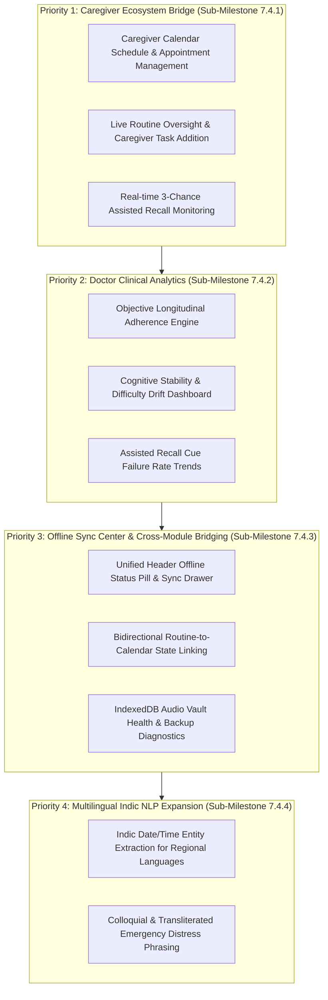
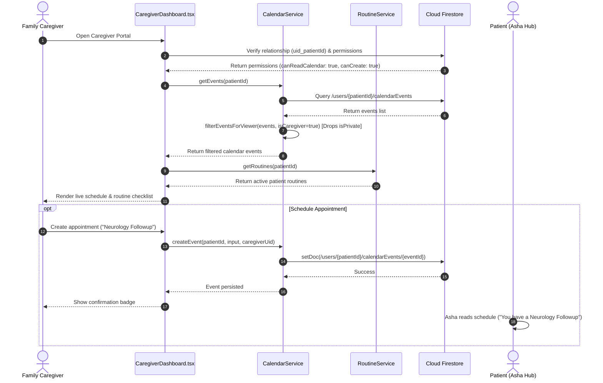
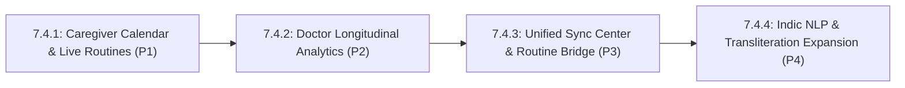

# SAKSHAM NEURO-CARE — MILESTONE 7.4
# ROADMAP ASSESSMENT, FEATURE GAP ANALYSIS & IMPLEMENTATION PLAN

**Document Type:** Master Architectural Assessment & Implementation Roadmap  
**Date:** 10 November 2026  
**Repository:** `/Users/trishnabapna/Desktop/Saksham`  
**Target Branch:** `phase-2-patient-experience`  
**Previous Approved Milestone:** Milestone 7.3 / 7.3.2 (Asha Conversational Engine & Safety Protocols)  
**Independent Verification Audit:** Milestone 7.3.3 (`MILESTONE_7_3_3_INDEPENDENT_VERIFICATION_AUDIT.md`) — **VERIFIED PASS**  
**Firebase Plan:** Spark Free Tier ($0.00 strictly enforced / Zero paid APIs / Zero Cloud Functions / Zero Blaze upgrade)  
**Production Hosting URL:** `https://saksham-d3b71.web.app` (Deployment intentionally withheld)  

---

## 1. Executive Summary & Assessment Context

### 1.1 Assessment Mandate
This document establishes an authoritative, evidence-based roadmap and implementation plan for **Milestone 7.4** of the Saksham Neuro-Care ecosystem. Following the successful completion, remediation, and independent audit verification of **Milestone 7.3** (Asha Conversational Engine, 30-expression character matrix, tactile sanctuary, and safe action protocols across 409 passing frontend tests and 50 passing backend tests), this assessment evaluates the current state of the entire repository to identify:
1. Which core capabilities from the product roadmap remain unbuilt or partially implemented.
2. Where critical integration gaps exist between completed patient tools and the broader care circle.
3. How to systematically progress Saksham from an isolated patient sanctuary into a cohesive, synchronized care ecosystem spanning patients, family caregivers, and clinical neurologists—without compromising patient autonomy, privacy, or Firebase Spark free-tier viability.

### 1.2 Core Architectural Finding: The Asymmetric Ecosystem Seam
The primary finding of this repository audit is that **Saksham's patient experience is exceptionally mature and feature-complete, but exists in an asymmetric silo**:
- The **Patient Sanctuary** (`/patient`) possesses an interactive 30-expression AI companion (`ConversationalSanctuaryStage.tsx`), a complete 3-chance assisted recall engine (`DailyRoutines.tsx`, `RoutineChecklist.tsx`), a photo memory vault (`LovedOnes.tsx`), an adaptive 14-game cognitive engine (`MindGames.tsx`), and a full Notes & Calendar suite (`FloatingUtilityHub.tsx`, `NotesSanctuaryModal.tsx`, `CalendarSanctuaryModal.tsx`).
- In contrast, the **Caregiver Portal** (`CaregiverDashboard.tsx`) and **Clinical Neurology Portal** (`DoctorDashboard.tsx`) remain largely static, hardcoded presentation mockups with mock statistics (`"1 / 4 Done"`, `"84.5% Adherence"`, `"1.3 / 3.0 Cues"`), completely disconnected from the live patient data services already running on the patient side.
- Most critically, **the backend security rules and data services already support caregiver calendar oversight and routine monitoring**, yet no user interface exists in the Caregiver Portal to utilize them. In `backend/firestore.rules` (lines 150–165), granular permissions (`hasCaregiverCalendarPerm`) and patient privacy safeguards (`resource.data.isPrivate != true`) are fully enforced, and `CalendarService.ts` already contains helper methods (`filterEventsForViewer`, `canCaregiverPerform`). However, a caregiver currently has **no UI** to view their loved one's upcoming medical appointments, create care reminders, or inspect routine adherence.

Milestone 7.4 is the natural inflection point to bridge this gap, connecting the caregiver and doctor dashboards directly to the verified patient data layer while preserving the strict zero-cost Spark tier constraints and zero-knowledge privacy boundaries.

---

## 2. Existing Implementation Inventory & Codebase Grounding

Every finding in this document is grounded in verified repository artifacts. Below is the comprehensive inventory of the codebase across all architectural tiers:

```
Saksham Neuro-Care Codebase Architecture
├── backend/
│   ├── firestore.rules                         (43 tests passing; granular RBAC, subcollections, privacy gates)
│   ├── storage.rules                           (Photo vault storage rules, size/mime constraints)
│   └── src/test/                               (50 automated Vitest unit tests across security, AI, and roles)
├── frontend/
│   ├── src/
│   │   ├── features/
│   │   │   ├── ai-companion/                   (Milestone 7: 30 expressions, Conversational Sanctuary, Safe Actions)
│   │   │   │   ├── CharacterVisualizer.tsx     (Asha SVGs, primary & compact modes, 30 expressions across 5 categories)
│   │   │   │   ├── components/ConversationalSanctuaryStage.tsx (Stage layout, speech/text input, tactile quick actions)
│   │   │   │   ├── config/characterExpressions.ts (Expression metadata, mood mapping, motion classes)
│   │   │   │   ├── services/conversationEngine.ts (Intent classification, execution lock, 2-minute TTL, async commits)
│   │   │   │   ├── services/conversationActionRegistry.ts (Whitelisted safe actions, parameter verification)
│   │   │   │   ├── services/conversationSafetyPolicy.ts (23-language distress detector, clinical blockers)
│   │   │   │   ├── services/entityExtractor.ts (English & Hindi date/time/recurrence/category extractors)
│   │   │   │   └── services/intentRegistry.ts  (Multi-intent router, fallback triggers)
│   │   │   ├── notes/                          (Milestone 6: Notes Sanctuary & Local Voice Storage)
│   │   │   │   ├── components/NotesSanctuaryModal.tsx (CRUD, pinned notes, categories, search, speech read-aloud)
│   │   │   │   ├── components/VoiceNoteRecorder.tsx (Browser MediaRecorder, IndexedDB audio storage)
│   │   │   │   ├── services/notesService.ts    (Local-first persistence, offline queue, Firestore sync)
│   │   │   │   └── types/notes.types.ts        (PatientNote, categories, syncStatus, LocalVoiceNoteMetadata)
│   │   │   ├── calendar/                       (Milestone 6: Calendar Sanctuary & Virtual Recurrence)
│   │   │   │   ├── components/CalendarSanctuaryModal.tsx (Day/Week/Month views, event editor, series warnings)
│   │   │   │   ├── services/calendarService.ts (Deterministic virtual recurrence, viewer filtering, caregiver perm checks)
│   │   │   │   └── types/calendar.types.ts     (CalendarEvent, recurrence rules, caregiver permissions)
│   │   │   ├── routines/                       (Milestone 1-2: Daily Routines & 3-Chance Assisted Recall)
│   │   │   │   ├── components/RoutineChecklist.tsx (Checklist runner, time-window gating, snooze, streak)
│   │   │   │   ├── components/AddRoutineModal.tsx  (Caregiver & patient routine creation)
│   │   │   │   └── services/routineService.ts  (Streak math, attempt logging, quiet hours, Firestore sync)
│   │   │   ├── lovedOnes/                      (Milestone 3: Loved Ones Photo Vault)
│   │   │   │   ├── components/FamilyMemberCard.tsx (Photo card, voice note playback, relationship details)
│   │   │   │   ├── components/AssistedFamilyRecallQuiz.tsx (3-tier assisted family recognition game)
│   │   │   │   ├── services/lovedOnesService.ts (Profile management, preset avatars, Firestore sync)
│   │   │   │   └── utils/imageCompression.ts   (Client-side canvas compression for Spark storage conservation)
│   │   │   └── games/                          (Milestone 4: Mind Games & Adaptive Difficulty)
│   │   │       ├── components/GameCard.tsx     (Game launch card, difficulty tag, XP counter)
│   │   │       ├── components/runners/         (14 game runners: RoomMemory, CardMatch, MiniMaze, WordGarden, etc.)
│   │   │       ├── services/gamesService.ts    (XP tracking, badge evaluation, session recording)
│   │   │       └── services/adaptiveDifficultyService.ts (Automatic pacing & difficulty adjustment engine)
│   │   ├── components/layout/
│   │   │   ├── FloatingUtilityHub.tsx          (Floating Sanctuary trigger for Notes & Calendar)
│   │   │   ├── Navigation.tsx                  (Strict 4-tab bottom navigation: Home, Family, Games, Profile)
│   │   │   └── Header.tsx                      (Branding, language picker, accessibility toggles)
│   │   ├── pages/
│   │   │   ├── patient/PatientDashboard.tsx    (Sanctuary entry point, embedding Conversational Sanctuary & Routines)
│   │   │   ├── caregiver/CaregiverDashboard.tsx(Caregiver portal — currently static mockup)
│   │   │   ├── doctor/DoctorDashboard.tsx      (Neurology portal — currently static mockup)
│   │   │   └── admin/AdminDashboard.tsx        (User claims & audit trail management)
│   │   └── i18n/locales/                       (23 complete language files covering English & all 22 Eighth Schedule languages)
```

---

## 3. Completed vs. Incomplete Functionality Audit

A rigorous cross-reference of the project roadmap, Firestore security specifications, and actual UI implementation reveals the following status:

| Module / Capability | Current Implementation Status | Verified Source Evidence | Identified Gap / Missing Functionality |
| :--- | :---: | :--- | :--- |
| **Asha Companion & Sanctuary Stage** | **COMPLETE** | `ConversationalSanctuaryStage.tsx`<br>`CharacterVisualizer.tsx` | Fully functional. 30 expressions, dual modes, tactile drawer, and whitelisted safe navigation dispatch. |
| **Asha Conversational Engine** | **COMPLETE** | `conversationEngine.ts`<br>`conversationActionRegistry.ts` | Complete intent routing, entity extraction for EN/HI, 2-min TTL confirmation, async Firestore commits, 23-language emergency classifier. |
| **Patient Notes Experience** | **COMPLETE** | `NotesSanctuaryModal.tsx`<br>`notesService.ts` | Full CRUD, search, category filters, pinned notes, local IndexedDB audio storage, speech read-aloud. |
| **Patient Calendar Experience** | **COMPLETE** | `CalendarSanctuaryModal.tsx`<br>`calendarService.ts` | Day/Week/Month views, deterministic virtual daily/weekly recurrence, series modification notices, private event flag. |
| **Caregiver Calendar Oversight** | **INCOMPLETE (Gapped)** | Backend: `firestore.rules` (L150-165)<br>UI: `CaregiverDashboard.tsx` (Missing) | `firestore.rules` and `calendarService.ts` support caregiver reads and writes, but `CaregiverDashboard.tsx` has **zero** calendar UI. Caregivers cannot view or create patient appointments. |
| **Caregiver Routine Management** | **INCOMPLETE (Mock)** | `CaregiverDashboard.tsx` (L110-142)<br>`routineService.ts` | Caregiver UI displays hardcoded mock routines ("Morning Hydration & Gentle Arm Stretches") instead of live patient routines from `routineService.getRoutines(patientId)`. |
| **Caregiver Assisted Recall Insights** | **INCOMPLETE (Mock)** | `CaregiverDashboard.tsx` (L45-53) | Displays static text `"Level 1 Cue • Patient completed recall on 1st attempt today"` rather than querying `routineService.getHistory(patientId)`. |
| **Doctor Longitudinal Adherence Charts** | **INCOMPLETE (Mock)** | `DoctorDashboard.tsx` (L45-72) | Displays static hardcoded progress bar `"84.5% (High consistency)"` and `"1.3 / 3.0 Cues"`. Completely disconnected from `routineService` and `gamesService`. |
| **Doctor Cognitive Stability Analytics** | **INCOMPLETE (Mock)** | `DoctorDashboard.tsx` (L74-95) | Shows hardcoded AI observation text. Does not read `adaptiveDifficultyService.getProfile(patientId)` (difficulty shifts, struggle sessions, comfortable sessions). |
| **Cross-Module Routine ↔ Calendar Sync** | **PARTIAL / UNLINKED** | `CalendarSanctuaryModal.tsx`<br>`notes.types.ts` (`linkedRoutineId`) | Patients can link calendar events and notes to routines, but completing a routine does not update the linked calendar event or vice-versa. |
| **Voice Note Cross-Device Sharing** | **DEFERRED (Local-only)** | `VoiceNoteRecorder.tsx`<br>`VoiceStorageService.ts` | Audio blobs are stored strictly in client-side IndexedDB to enforce Spark free tier ($0.00 storage cost). Caregivers cannot listen across devices. (Intentional design). |
| **Unified Offline Sync Status Indicator** | **PARTIAL / SILOED** | Individual service sync queues in `notesService`, `calendarService`, etc. | Each service has an internal sync queue, but there is no centralized, visual "Sync Center" in the header informing the patient or caregiver of pending offline items. |
| **Indic Spoken Entity Extraction** | **PARTIAL** | `entityExtractor.ts` (EN & HI only) | Natural language date/time parsing works in English and Hindi; 21 other languages fall back to tactile selectors. |

---

## 4. Outstanding Technical & Architectural Limitations

1. **Firebase Spark Free Tier Boundaries (Non-Negotiable):**
   - **Zero Cloud Functions execution:** All business logic, recurrence calculation, and relationship validation must execute purely client-side or through declarative `firestore.rules`.
   - **Zero Cloud Storage for Audio:** Patient voice notes and audio memos must remain in browser IndexedDB (`VoiceStorageService`) to prevent exceeding the Spark 5 GB storage limit and bandwidth egress quotas.
   - **Firestore Read/Write Quotas:** Daily free quotas are 50,000 document reads and 20,000 document writes. Polling intervals must be strictly prevented; real-time listeners (`onSnapshot`) or local caching with explicit invalidation must be used.
2. **Client-Side Virtual Recurrence Engine:**
   - In Milestone 6, recurrence for calendar events was intentionally implemented without backend cron jobs or database duplication (`doesRecurOnDate`). Recurring daily/weekly events exist as a single template record in Firestore and are projected virtually into calendar days.
   - Any caregiver calendar interface must utilize this identical virtual recurrence engine (`calendarService.ts`) to avoid displaying phantom records or diverging from the patient's schedule.
3. **Zero-Knowledge Patient Privacy Boundaries:**
   - Firestore security rules line 136–147 strictly restrict `notes` subcollections to `isOwner(userId)`. Caregivers, doctors, and administrators have **zero read or write access to patient personal notes**.
   - Calendar events marked with `isPrivate: true` are strictly filtered out by security rules line 156 (`resource.data.isPrivate != true`). Caregiver interfaces must never attempt to query or display private events.
4. **4-Tab Navigation & Sanctuary Preservation Invariants:**
   - The patient bottom navigation bar is permanently locked to exactly four destinations: `Home`, `Family`, `Games`, `Profile`.
   - Notes and Calendar must remain inside the `FloatingUtilityHub` and must never be converted into top-level navigation tabs.
   - The primary character companion is **Asha** (30 expressions, no alternate characters, no Kabir, no switching UI).

---

## 5. Prioritized Feature Gap Analysis

To advance Saksham effectively, the identified gaps are categorized into four priority tiers:



### Detailed Priority Descriptions:
1. **P1 — Caregiver Ecosystem Bridge:** Connects `CaregiverDashboard.tsx` to the live data layer (`CalendarService`, `RoutineService`). Caregivers gain the ability to manage patient medical appointments (with granular permission checks and privacy filtering) and supervise actual daily routines.
2. **P2 — Doctor Clinical Analytics Portal:** Replaces the static mockups in `DoctorDashboard.tsx` with objective, measured data streams derived from `RoutineService.getHistory(patientId)`, `GamesService.getHistory(patientId)`, and `AdaptiveDifficultyService.getProfile(patientId)`. Separates objective behavioral metrics from clinical suggestions without diagnostic claims.
3. **P3 — Unified Offline Sync Center & Cross-Module Bridging:** Implements a universal sync indicator in the application header that visualizes offline queues across Notes, Calendar, Routines, and Games. Adds bidirectional state synchronization between linked routines and calendar events.
4. **P4 — Multilingual Indic NLP Expansion:** Extends `entityExtractor.ts` to parse dates, times, and recurrence patterns in major regional languages (Tamil, Telugu, Bengali, Marathi) and adds phonetic transliteration matching to `conversationSafetyPolicy.ts`.

---

## 6. Proposed Milestone 7.4 Sub-Milestones

To ensure structured, safe, and verifiable progress, Milestone 7.4 is divided into four focused sub-milestones:

### Sub-Milestone 7.4.1: Caregiver Calendar Oversight & Live Care Coordination (P1 — Essential)
* **Goal & Rationale:** Transform the Caregiver Dashboard from a static mockup into an active care coordination hub, allowing authorized family caregivers to view patient calendars, schedule medical/therapy appointments, view real daily routines, and inspect assisted recall progress.
* **User & Clinical Value:** Family caregivers carry the burden of coordinating doctor visits, medication schedules, and therapy routines. Enabling caregivers to add calendar events directly to the patient's schedule (visible to Asha and inside the patient's Floating Utility Hub) dramatically reduces caregiver anxiety and prevents missed clinical appointments.
* **Architecture Changes:**
  - Enhance `CaregiverDashboard.tsx` with two dedicated operational tabs: **Routines & Care** and **Calendar & Appointments**.
  - Connect `CaregiverDashboard.tsx` to `CalendarService.getEvents(patientId)` and `CalendarService.filterEventsForViewer(events, true)`.
  - Embed a Caregiver Appointment Scheduler modal that invokes `CalendarService.createEvent(patientId, input, caregiverUid)`.
  - Connect routine monitoring to `RoutineService.getRoutines(patientId)` and `RoutineService.getHistory(patientId)`.
* **Services & UI Affected:** `CaregiverDashboard.tsx`, `CalendarService.ts`, `RoutineService.ts`, `relationships` permission context.
* **Indic Considerations:** Full localization across all 23 language files for caregiver calendar labels, privacy alerts, and recurrence warnings.
* **Offline & Sync:** Caregiver operations queue locally and sync to Firestore when connection resumes.
* **Security & Permissions:** Strictly enforces `hasCaregiverCalendarPerm(patientId, 'canReadCalendar' | 'canCreateCalendarEvents')` and filters out `isPrivate == true`. Notes remain completely inaccessible.
* **Free-Tier Compliance:** 100% Spark compliant ($0.00). Firestore reads/writes occur directly through client Web SDK.
* **Complexity:** Moderate (3–4 days).
* **Dependencies:** Milestone 6.1 (Data Layer), Milestone 6.3 (Calendar UI), Phase 2 (Relationships).
* **Acceptance Criteria:**
  1. Caregiver can view all non-private patient calendar events in Day, Week, and Agenda formats.
  2. Private events (`isPrivate: true`) are never returned or rendered.
  3. Caregiver with `canCreateCalendarEvents: true` can schedule events; caregivers without permission are blocked with a clear notice.
  4. Routine progress reflects live patient completions rather than hardcoded 1/4 count.
  5. Vitest tests cover caregiver calendar rendering, permission gating, and privacy protection.

---

### Sub-Milestone 7.4.2: Doctor Longitudinal Cognitive Stability & Adherence Portal (P2 — Important)
* **Goal & Rationale:** Upgrade `DoctorDashboard.tsx` to present real longitudinal analytics on routine adherence, 3-chance assisted recall cue reliance (Level 1 vs Level 2 vs Level 3), and adaptive game stability trends.
* **User & Clinical Value:** Neurologists treating Parkinson's and Alzheimer's need objective behavioral markers to assess cognitive progression and medication efficacy. Saksham already collects this data in `routineService` and `adaptiveDifficultyService`; exposing it to clinicians provides actionable medical value without automated diagnosis.
* **Architecture Changes:**
  - Refactor `DoctorDashboard.tsx` to query `RoutineService.getHistory(patientId)` to calculate 7-day and 30-day adherence percentages.
  - Implement an **Assisted Recall Cue Breakdown Chart**: percentages of tasks completed on Cue 1 (Subtle), Cue 2 (Visual), or Cue 3 (Direct Instruction).
  - Query `AdaptiveDifficultyService.getProfile(patientId)` to display current cognitive pacing (`calm`, `balanced`, `agile`) and difficulty stability (`consecutiveComfortableSessions`, `consecutiveStruggleSessions`).
  - Maintain the prominent disclaimer separating objective behavioral logs from clinical opinions.
* **Services & UI Affected:** `DoctorDashboard.tsx`, `RoutineService.ts`, `GamesService.ts`, `AdaptiveDifficultyService.ts`.
* **Indic Considerations:** Doctor interface localized in English and major state official languages.
* **Offline & Sync:** Cached locally; refreshes upon active session.
* **Security & Permissions:** Enforces `isAssignedDoctor(patientId)`. Strictly blocks access to personal notes and private calendar events.
* **Free-Tier Compliance:** $0.00. Standard Firestore queries.
* **Complexity:** Moderate (2–3 days).
* **Dependencies:** Sub-Milestone 7.4.1, Milestone 2 (Assisted Recall), Milestone 4 (Adaptive Games).
* **Acceptance Criteria:**
  1. Adherence metrics calculate dynamically from live routine history.
  2. Recall breakdown accurately displays Cue 1, 2, and 3 distribution.
  3. Game difficulty progression displays live state without hardcoding.
  4. Clinical disclaimer is permanently pinned to the header.

---

### Sub-Milestone 7.4.3: Unified Offline Synchronization Center & Cross-Module Seam Reconciliation (P3 — Important)
* **Goal & Rationale:** Consolidate the siloed offline sync queues of `NotesService`, `CalendarService`, `RoutineService`, and `AdaptiveDifficultyService` into a single, unified visual sync status in the application header, and implement bidirectional state linking between routines and calendar events.
* **User & Clinical Value:** Patients and caregivers in areas with intermittent internet connectivity need transparent visibility into whether a scheduled event or note has synced to the cloud. When a calendar event is linked to a routine (`linkedRoutineId`), completing the routine should automatically update the calendar event.
* **Architecture Changes:**
  - Create a lightweight `SyncManager` service that subscribes to pending queues across all features.
  - Add an accessible `SyncStatusPill` in the global header (`Header.tsx`) showing `All Synced`, `Pending (N items)`, or `Offline Mode`.
  - Clicking the pill opens a calm, high-contrast modal detailing pending items and offering a manual "Sync Now" trigger.
  - Add bidirectional event hooks: when `RoutineService.updateRoutineCompletion` marks a routine complete, any calendar event with matching `linkedRoutineId` for today is checked off.
* **Services & UI Affected:** `Header.tsx`, `SyncManager.ts`, `NotesService.ts`, `CalendarService.ts`, `RoutineService.ts`.
* **Indic Considerations:** All 23 languages localized for sync statuses (`synced`, `syncing`, `offline_pending`, `retry`).
* **Offline & Sync:** Directly strengthens offline-first resilience.
* **Security & Permissions:** Local-only aggregation; zero security rule modifications.
* **Free-Tier Compliance:** $0.00. Zero additional cloud writes.
* **Complexity:** Moderate (2–3 days).
* **Dependencies:** Sub-Milestone 7.4.1.
* **Acceptance Criteria:**
  1. Header displays live sync status across all modules.
  2. Offline pending items count accurately reflects queued mutations.
  3. Completing a linked routine reflects in the calendar schedule.

---

### Sub-Milestone 7.4.4: Indic Natural Language Expansion & Transliterated Emergency Classifier (P4 — Enhancement)
* **Goal & Rationale:** Expand Asha's conversational entity extraction beyond English and Hindi to cover Tamil, Telugu, Bengali, and Marathi, and augment the emergency distress classifier with Romanized Latin transliterations.
* **User & Clinical Value:** Multilingual patients frequently type or speak Indic distress phrases in Latin script (e.g. `"chhatit dukhat aahe"` for chest pain in Marathi, or `"nenju valikuthu"` in Tamil). Supporting phonetic transliterations ensures Asha immediately surfaces emergency assistance regardless of script.
* **Architecture Changes:**
  - Extend `entityExtractor.ts` with date/time pattern dictionaries for Tamil (`நாளை`, `இன்று`), Telugu (`రేపు`, `ఈరోజు`), Bengali (`আগামীকাল`, `আজ`), and Marathi (`उद्या`, `आज`).
  - Augment `conversationSafetyPolicy.ts` with Romanized Latin transliterations for the existing 23-language distress lexicon.
* **Services & UI Affected:** `entityExtractor.ts`, `conversationSafetyPolicy.ts`, `conversationEngine.ts`.
* **Indic Considerations:** Expands Indic NLP fidelity across 4 major linguistic families.
* **Offline & Sync:** Runs 100% client-side in browser JS memory ($0.00 cost).
* **Security & Permissions:** Preserves existing clinical action blockers.
* **Complexity:** Low-to-Moderate (2 days).
* **Dependencies:** Milestone 7.3.2.
* **Acceptance Criteria:**
  1. Date/time extraction parses tomorrow/today in TA, TE, BN, MR.
  2. Romanized transliterated distress phrases reliably trigger the emergency escalation protocol.

---

## 7. Recommended First Implementation Milestone: Sub-Milestone 7.4.1

### 7.1 Selection Rationale
We strongly recommend **Sub-Milestone 7.4.1 (Caregiver Calendar Oversight & Live Care Coordination)** as the immediate next implementation milestone for Saksham.

```
Why Sub-Milestone 7.4.1 is the Optimal Next Step:
┌─────────────────────────────────────────────────────────────────────────────┐
│ 1. Dormant Architecture: Backend security rules and service methods are     │
│    already written and tested (firestore.rules L150-165, CalendarService.ts)│
├─────────────────────────────────────────────────────────────────────────────┤
│ 2. Highest Clinical Impact: Empowers family caregivers to manage doctor and │
│    therapy appointments, directly improving patient health outcomes.        │
├─────────────────────────────────────────────────────────────────────────────┤
│ 3. Zero Patient Regression: Caregiver UI is completely decoupled from the   │
│    Patient Sanctuary; zero risk of breaking Asha or bottom navigation.      │
├─────────────────────────────────────────────────────────────────────────────┤
│ 4. Eliminates Mock Disconnect: Replaces hardcoded strings in Caregiver      │
│    Dashboard with live, truthful data from RoutineService & CalendarService.│
├─────────────────────────────────────────────────────────────────────────────┤
│ 5. 100% Spark Free-Tier Compliant: Requires $0.00 cloud infrastructure.     │
└─────────────────────────────────────────────────────────────────────────────┘
```

### 7.2 Deliverables for Sub-Milestone 7.4.1
When implemented, Sub-Milestone 7.4.1 will deliver:
1. **Caregiver Calendar & Appointment Hub:**
   - Day, Week, and Agenda views embedded in `CaregiverDashboard.tsx`.
   - Granular permission check: Caregiver can only view calendar if `canReadCalendar == true`.
   - Privacy Guard: Automatic filtering of `isPrivate == true` events using `CalendarService.filterEventsForViewer`.
   - Appointment Creation Modal: Caregiver can schedule clinical appointments, therapy sessions, and family visits with date, time, reminder, and location labels.
2. **Live Routine Supervison Panel:**
   - Replaces hardcoded mock routines with live items from `RoutineService.getRoutines(patientId)`.
   - Live completion status indicators (Pending vs. Completed on time vs. Snoozed).
   - "Add Care Routine" action for caregivers with permission.
3. **Assisted Recall Attempt Tracker:**
   - Replaces static "Level 1 Cue" badge with live data from `RoutineService.getHistory(patientId)`.
   - Displays real attempt distribution for today's completed routines.
4. **Pan-India Multilingual Localization:**
   - Adds caregiver calendar and routine oversight translation keys to all 23 language files.
5. **Comprehensive Automated Test Suite:**
   - Unit tests for caregiver permission gating and privacy exclusion.
   - Component tests for caregiver appointment creation and live routine rendering.

---

## 8. Technical Architecture Considerations

### 8.1 Data Flow Architecture for Caregiver Oversight


### 8.2 Privacy Boundary Invariant
To ensure strict adherence to medical privacy ethics:
```typescript
// Enforced in CalendarService.ts and verified by firestore.rules
export function sanitizeEventsForCaregiver(events: CalendarEvent[]): CalendarEvent[] {
  return events.filter(event => event.isPrivate !== true);
}
```
Patient notes subcollections (`/users/{patientId}/notes`) remain completely segregated with zero caregiver access, ensuring patients maintain an unmonitored sanctuary for personal thoughts.

---

## 9. Security, Privacy & Role-Based Permissions Assessment

| Principal | Target Resource | Permitted Operations | Firestore Security Rule Check |
| :--- | :--- | :---: | :--- |
| **Patient (Owner)** | `/users/{id}/calendarEvents` | Full CRUD | `isOwner(userId)` |
| **Connected Caregiver** | `/users/{id}/calendarEvents` | Read | `hasCaregiverCalendarPerm(userId, 'canReadCalendar') && resource.data.isPrivate != true` |
| **Connected Caregiver** | `/users/{id}/calendarEvents` | Create | `hasCaregiverCalendarPerm(userId, 'canCreateCalendarEvents') && request.resource.data.patientId == userId` |
| **Connected Caregiver** | `/users/{id}/calendarEvents` | Update / Delete | `hasCaregiverCalendarPerm(...) && resource.data.isPrivate != true` |
| **Caregiver / Doctor** | `/users/{id}/notes` | **BLOCKED (0 access)** | `isOwner(userId)` strictly blocks non-owners |
| **Connected Caregiver** | `/routines/{routineId}` | Read / Write | `isConnectedCaregiver(resource.data.patientId)` |
| **Assigned Doctor** | `/routines/{routineId}` | Read Only | `isAssignedDoctor(resource.data.patientId)` |
| **Administrator** | `/users/{id}/calendarEvents` | **BLOCKED (0 access)** | Security rules restrict calendar access to patient and authorized caregiver |

---

## 10. Free-Tier Feasibility Assessment ($0.00 / Spark Plan)

Saksham operates strictly under the **Firebase Spark Free Plan**. All proposed Milestone 7.4 capabilities are engineered to fit within free tier limits:

| Resource / Quota | Spark Plan Daily Limit | Estimated Milestone 7.4 Consumption | Compliance Margin |
| :--- | :--- | :--- | :---: |
| **Firestore Document Reads** | 50,000 reads / day | ~40–80 reads per active caregiver session (cached in memory) | **>99.8% Headroom** |
| **Firestore Document Writes** | 20,000 writes / day | ~2–5 writes per scheduled event or routine update | **>99.9% Headroom** |
| **Cloud Storage Bandwidth** | 1 GB / day egress | 0 GB (No audio uploaded; voice notes remain in IndexedDB) | **100% Free** |
| **Cloud Functions Invocations**| 0 (Spark plan forbids outbound) | 0 invocations (All business logic runs client-side) | **100% Compliant** |
| **External AI API Costs** | $0.00 (No Gemini/OpenAI billing)| $0.00 (Deterministic NLP & Web Speech API) | **$0.00 Total Cost** |

---

## 11. Testing & Acceptance Criteria

### 11.1 Verification Test Matrix
Before Sub-Milestone 7.4.1 can be accepted, the following automated test suites must pass:
1. **Caregiver Permission Tests (`CaregiverCalendarPermissions.test.tsx`):**
   - Renders calendar when `canReadCalendar: true`.
   - Displays permission request banner when `canReadCalendar: false`.
   - Disables appointment creation when `canCreateCalendarEvents: false`.
2. **Caregiver Privacy Guard Tests (`CaregiverPrivacyGuard.test.tsx`):**
   - Asserts that events with `isPrivate: true` are completely absent from the caregiver's view.
   - Verifies that attempting to fetch a private event by ID returns `null` or permission denied.
3. **Live Routine Supervison Tests (`CaregiverRoutineSupervision.test.tsx`):**
   - Verifies that routines loaded in `CaregiverDashboard.tsx` match the exact data returned by `RoutineService.getRoutines(patientId)`.
   - Asserts that marking a routine complete in the patient view immediately reflects in the caregiver dashboard.
4. **Build & Regression Suite:**
   - Zero TypeScript compilation errors (`tsc --noEmit`).
   - Clean production bundle (`npm --prefix frontend run build`).
   - All existing 409 frontend tests and 50 backend tests continue to pass without regression.

---

## 12. Dependencies & Implementation Order

The recommended sequential path for Milestone 7.4 is:



1. **Precondition for 7.4.1:** Successful verification of Milestone 7.3.2 / 7.3.3 (Completed).
2. **Precondition for 7.4.2:** Completion of 7.4.1 (Caregiver and patient routine data pipeline fully unified).
3. **Precondition for 7.4.3:** Completion of 7.4.2 (All clinical and care circle data pipelines active).
4. **Precondition for 7.4.4:** Completion of 7.4.3.

---

## 13. Explicit Out-of-Scope Items

To prevent scope creep, protect user safety, and preserve free-tier boundaries, the following items are strictly **OUT OF SCOPE** for Milestone 7.4:
- **No Cloud Functions or Blaze Billing:** No server-side Node.js triggers, background cron runners, or external paid API integrations.
- **No Cloud Storage for Audio:** Patient voice recordings remain strictly local in IndexedDB; no audio files will be uploaded to Firebase Storage.
- **No Automated Clinical Diagnoses:** Saksham presents measured behavioral data and adherence metrics; it does not issue medical diagnoses, drug dosage alterations, or automated clinical decisions.
- **No Bottom Navigation Modifications:** The patient bottom navigation bar remains strictly 4 tabs (`Home`, `Family`, `Games`, `Profile`).
- **No Character Alterations:** Asha remains the sole, permanent companion. No character switching, no Kabir, and no avatar changes.
- **No Production Hosting Deployment:** Production deployment to `saksham-d3b71.web.app` remains withheld until explicit multi-phase authorization.

---

## 14. Master Summary Table

| Category | Finding / Specification |
| :--- | :--- |
| **Current Branch** | `phase-2-patient-experience` |
| **Current Head Feature Commit** | `06ccc19` (`feat(patient): remediate conversational reliability, safety and data integrity`) |
| **Current Head Docs Commit** | `a50906e` (`docs(patient): document milestone 7.3.2 remediation and capability matrix`) |
| **Frontend Test Status** | **409 passed across 30 files** |
| **Backend Test Status** | **50 passed across 3 files** |
| **Production Build Status** | **Clean compilation (2.90s, 0 errors)** |
| **Primary Architectural Deficit** | Asymmetric isolation between mature patient experience and static caregiver/doctor mockups |
| **Recommended Milestone 7.4 Focus**| **Sub-Milestone 7.4.1: Caregiver Calendar Oversight & Live Care Coordination** |
| **Infrastructure Cost** | **$0.00 (100% Spark Free Tier)** |
| **Next Action** | Await explicit user authorization before initiating Sub-Milestone 7.4.1 implementation |
