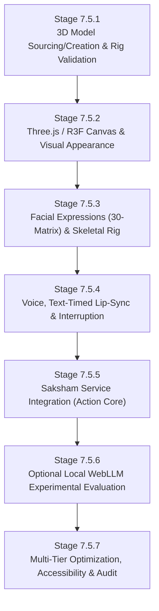

# SAKSHAM NEURO-CARE
# MILESTONE 7.5 — ASHA 3D CONVERSATIONAL AI TRANSFORMATION
## Master Architecture, Feasibility & Phased Development Blueprint

**Document Version:** 1.1.0  
**Date:** 11 November 2026  
**Repository:** `/Users/trishnabapna/Desktop/Saksham`  
**Branch:** `phase-2-patient-experience`  
**Firebase Plan:** Spark Free Tier ($0.00 / Zero Paid Cloud Functions / Zero Paid APIs)  
**Status:** Architectural Blueprint & Feasibility Specification (Incorporating Milestone 7.5.0.1 Feasibility Corrections & Product Decisions; Implementation Paused Awaiting Stage 7.5.1 Authorization)

---

## 0. Revision History

| Version | Date | Milestone | Key Changes & Rationale | Author / Reviewer |
| :--- | :--- | :--- | :--- | :--- |
| **1.0.0** | 11 Nov 2026 | Milestone 7.5 Initial | Initial master architecture blueprint defining Asha 3D vision, VRM recommendation, React Three Fiber pipeline, 30-expression matrix mapping, and dual-core AI concept. | System Architect |
| **1.1.0** | 11 Nov 2026 | Milestone 7.5.0.1 Feasibility Corrections & Decisions | **Independent technical audit corrections and formal recording of Product Owner decisions:**<br>1. *WebLLM Reassessment:* Pinned candidate models to official `@mlc-ai/web-llm` catalog; documented exact download sizes, VRAM requirements, WebGPU/shader-f16 constraints, Hindi/English suitability, and commercial licenses; removed incorrect claims of "unlimited, universally free" AI; documented device resource costs.<br>2. *Lip-Sync Architecture Correction:* Replaced incorrect direct Web Audio connection to `window.speechSynthesis` (browser OS audio boundary) with three distinct options (Text-Timed Visemes, Audio Buffer/Stream Analysis, Heuristic Amplitude Fallback) and explicit interruption/mouth-reset behavior.<br>3. *VRM Acceptance Specification:* Defined strict acceptance criteria for 3D mesh, humanoid bone hierarchy, 5 vowel visemes, gaze tracking, secondary spring-bone physics, explicit 30-expression mapping table, and rig testing checklist.<br>4. *Decomposed Performance & Memory Budget:* Separated 3D geometry, texture VRAM, AI weight memory, browser RAM, download size, GPU load, startup time, and battery usage; established 3 device capability tiers guaranteeing full usability on low-memory devices without local AI download.<br>5. *Product Decisions Recorded:* Formally recorded 8 strategic decisions from the Product Owner.<br>6. *Optimized Staging Sequence:* Reordered stages so a minimal practical 3D character prototype validates rendering, rigging, expressions, and speech *before* any local AI model downloads are introduced. | System Architect & Product Owner |

---

## 1. Executive Summary & Product Decisions

### 1.1 The Vision
Milestone 7.5 establishes the architectural masterplan to transform **Asha** from a 2D illustrated character assistant into a **genuine, interactive, animated 3D companion rendered natively in the browser**.

In neurodegenerative cognitive care (early dementia, Alzheimer's, Parkinson's support), patient engagement hinges upon **relational trust, eye contact, predictable micro-expressions, and multi-sensory reassurance**. Conventional text chatbots and flat talking-head images feel mechanical, disjointed, and cold to elderly individuals.

Under this transformation:
- Asha exists as an authentic **real-time 3D character** standing in the patient's conversational sanctuary.
- She maintains attentive **eye contact**, blinks with natural cadence, smiles, breathes, tilts her head when listening, and expresses empathy.
- When she speaks, her mouth articulates in **synchronized lip movement** driven by speech timing and phonetic cues.
- When the patient speaks or types, she transitions through distinct cognitive-attentive states (*listening*, *thinking*, *explaining*, *reassuring*, *celebrating*).
- She is deeply wired to Saksham's authorized clinical services: guiding daily routines, assisted recall questions, memory games, loved ones photographs, notes, and calendar events.
- **The patient feels they are interacting with Asha herself, rather than operating a chatbot with an attached graphic.**

### 1.2 Formally Recorded Product Decisions (Milestone 7.5.0.1)
The Product Owner has reviewed the initial feasibility findings and formally established the following governing product and technical decisions:

1. **3D Character Identity:** Asha must become a genuine animated 3D humanoid character, preserving her established identity, South Asian heritage, warmth, and recognizable outfit.
2. **Character Asset Creation:** A custom-modeled Asha character is preferred. An existing open-source VRM base avatar may be considered only if its license explicitly permits the required derivative modifications and the resulting character faithfully matches Asha's established visual identity.
3. **AI Architecture:** In-browser local generative AI (`@mlc-ai/web-llm`) is an approved **experimental and strictly optional** direction. It must **not** be described as universally available, unlimited, or free of device costs.
4. **Authoritative Action Engine:** The existing Deterministic Intent & Action Core (Milestone 7.3) remains the **sole authoritative layer** for all clinical, routine, safety, calendar, notes, and patient data interactions. Generative AI may never directly mutate patient records or provide unverified medical advice.
5. **Cloud AI Restriction:** Cloud-hosted generative AI (such as Google Gemini API, OpenAI, or third-party cloud LLMs) is **NOT approved**. Do not integrate, configure, or activate cloud AI services without separate, explicit Product Owner approval.
6. **Primary Patient Experience:** The full-viewport, 3D Asha-Only conversational experience (Milestone 7.4.1) is the **preferred default product direction**.
7. **Hybrid Experience Preservation:** The existing Hybrid Patient Experience with its four bottom navigation destinations (**Home**, **Family**, **Games**, **Profile**) must be fully preserved as a user-configurable mode.
8. **Voice & Tactile Parity:** Voice input and speech synthesis are optional assistive capabilities. Accessible text input drawers, tactile navigation chips, and high-contrast controls must be permanently maintained for patients with speech, hearing, or motor impairments.
9. **Infrastructure Non-Negotiable:** Saksham remains strictly on the **Firebase Spark Free Tier ($0.00)**. No Blaze plan upgrades, Cloud Functions, paid cloud APIs, or paid backend infrastructure may be introduced.

```
+---------------------------------------------------------------------------------------------------+
|                                      PATIENT EXPERIENCE (UI)                                      |
|                                                                                                   |
|  [ 3D WebGL Canvas: Asha ]       [ Conversational Dialogue Bubble ]    [ Tactile Accessible Tray ]|
|  * 3D VRM Humanoid Mesh          * Contextual speech text              * Quick-action chips       |
|  * Eye-tracking gaze             * Visual confirmation cards           * Text input drawer        |
|  * Synchronized lip-sync         * Clarification options               * Settings / Profile       |
|  * 30-expression blend shapes    * Multi-turn dialogue history         * Emergency SOS trigger    |
+---------------------------------------------------------------------------------------------------+
                                                  |
                                                  v
+---------------------------------------------------------------------------------------------------+
|                                  ORCHESTRATION & SAFETY LAYER                                     |
|                                                                                                   |
|  [ Speech Recognition (STT) ]  -->  [ ConversationEngine ]  -->  [ Lip-Sync Articulation Engine ] |
|  * Web Speech API (en/hi)           * Safety & Emergency Guard    * Option A: Text-timed visemes  |
|  * Accessible text drawer           * Clinical Restrictions       * Option B: Buffer analyser     |
|                                     * Consequential Confirmation  * Option C: Heuristic fallback  |
|                                     * Intent & Entity Extractor   * Instant cancel & mouth reset  |
|                                                  |                                                |
|                                                  v                                                |
|                                     [ Hybrid Dual-Core Setup ]                                    |
|                                     * Authoritative Deterministic Action Core (Active 100%)       |
|                                     * Optional In-Browser WebLLM (Tier 1 WebGPU Only, Opt-in)     |
+---------------------------------------------------------------------------------------------------+
                                                  |
                                                  v
+---------------------------------------------------------------------------------------------------+
|                                AUTHORIZED DATA LAYER (SPARK $0.00)                                |
|                                                                                                   |
|  [ RoutineService ]   [ GamesService ]   [ LovedOnesService ]   [ NotesService ]   [ Calendar ]   |
|  * Sync & attempts    * Adaptive pacing  * Voice memories       * Private notes    * Appointments |
+---------------------------------------------------------------------------------------------------+
```

---

## 2. Current Architecture & Codebase Inspection Findings

A comprehensive audit of the Saksham codebase confirms a modular, resilient architecture ready for 3D extension without disruptive rewrites:

### 2.1 The Existing Character Presentation Layer
- **`CharacterVisualizer.tsx` (`frontend/src/features/ai-companion/`):**
  Currently renders a 2D image via `` targeting `/assets/character/asha/${expressionId}.png` with an SVG chibi fallback (`renderAshaSVG()`). It supports two presentation modes:
  - `primary`: Full 160px–240px stage visualizer for Conversational Sanctuary.
  - `compact`: 64px compact icon companion embedded into task runners.
- **`characterExpressions.ts` (`frontend/src/features/ai-companion/config/`):**
  Defines the **30-Expression Matrix** grouped into 5 clinical care categories (Conversation, Emotional Support, Reminders/Guidance, Memory & Recall, Mood & Well-being). Each expression includes metadata, priority levels (1–5), return states, and aura color mappings.
- **`character-spec.json` (`frontend/src/assets/characters/character-config/`):**
  Defines baseline identity palettes (`#7C3AED` outfit, `#C084FC` scarf/hoodie, `#1C1917` hair, `#F7D0B2` skin).

### 2.2 The Existing Conversational & Action Pipeline
- **`conversationEngine.ts` (`frontend/src/features/ai-companion/services/`):**
  A 6-step sequential pipeline:
  1. *Emergency & Distress Guard (`conversationSafetyPolicy.ts`)* — Immediate distress interception.
  2. *Restricted Clinical Actions Guard* — Strictly forbids unverified medical diagnosis, dosage alteration, or simulated clinician messaging.
  3. *Pending Consequential Confirmation* — Two-step verification protocol for writes/deletions.
  4. *Entity Extractor (`entityExtractor.ts`)* — Resolves routine names, family members, times.
  5. *Intent Registry (`intentRegistry.ts`)* — Pattern and keyword matching.
  6. *Context Integration & Action Registry (`conversationActionRegistry.ts`)* — Executes safe actions across services.
- **`speechService.ts` (`frontend/src/services/`):**
  Implements Web Speech API STT and TTS with language BCP-47 mapping across 23 languages, voice matching (`findBestVoice`), and interruption handling (`cancelSpeech`).
- **`patientContextService.ts` (`frontend/src/services/`):**
  Assembles real-time contextual snapshots of today's routines, calendar events, loved ones, and active streaks.

### 2.3 Milestone 7.4.3.2 Protection Invariant
Milestone 7.4.3.2 was successfully committed (`3403b5d`, `2e1d6aa`), remediating doctor analytics privacy, demo doctor isolation, live assignment revocation, and date integrity. This work is fully preserved and remains strictly untouched.

---

## 3. Asha 3D VRM Character Specification & 30-Expression Acceptance Testing

### 3.1 Strict Visual Identity Specification
Asha's established visual identity is deeply familiar to patients and caregivers. She must **not** be transformed into a generic robot, an anime trope, or an uncanny photorealistic avatar.

| Feature | Identity Specification | 3D Asset Implementation Requirement |
| :--- | :--- | :--- |
| **Archetype** | Friendly, approachable, stylized 3D South Asian female companion (early 20s). | Stylized Pixar/Disney-adjacent aesthetic. Soft cel-shading or subtle PBR diffuse lighting. Avoid uncanny photorealism. |
| **Face & Eyes** | Expressive, warm brown irises (`#3E2723`), gentle almond shape, natural corneal highlights. | Morph targets for eyelids, squinting, brows, and look-at eye tracking bones (`leftEye`, `rightEye`). |
| **Hair** | Dark wavy/curly hair (`#1C1917`) tied into a high textured bun with soft front tendrils framing the face. | Optimized mesh with secondary spring-bone physics for natural bounce. |
| **Accessories** | Lavender hair tie with a delicate blush-pink flower ornament. | Attached to head bone rig; subtle movement dynamics. |
| **Outfit** | Oversized warm lavender hoodie (`#9333EA` / `#A855F7`) over a cream inner shirt (`#FAF5FF`). | Modeled folds with skeletal weighting to upper torso, shoulders, and arms. |
| **Lanyard & Tech** | Lilac flower lanyard with Saksham caregiver pass + smartwatch on left wrist. | Lanyard rigged with spring-bone chains; smartwatch geometry on forearm bone. |
| **Expression Tone** | Approachable, patient, reassuring, soothing. | Default resting expression has relaxed eyebrows and 10% mouth smile. |

### 3.2 VRM Humanoid Rig & Technical Requirements
The 3D model must strictly conform to the **VRM 1.0 specification** (built on glTF 2.0):
1. **Humanoid Bone Hierarchy:** Universal standard humanoid bone assignments:
   - Center: `hips` -> `spine` -> `chest` -> `neck` -> `head`
   - Face: `leftEye`, `rightEye`
   - Left Arm: `leftShoulder` -> `leftUpperArm` -> `leftLowerArm` -> `leftHand`
   - Right Arm: `rightShoulder` -> `rightUpperArm` -> `rightLowerArm` -> `rightHand`
   - Legs: `leftUpperLeg` -> `leftLowerLeg` -> `leftFoot`, `rightUpperLeg` -> `rightLowerLeg` -> `rightFoot`
2. **Morph Targets (Blend Shapes):**
   - Vowel visemes: `aa`, `ih`, `ou`, `ee`, `oh` + `jawOpen`
   - Eyelid controls: `blink`, `blinkLeft`, `blinkRight`
   - Brows: `browInnerUp`, `browDownLeft`, `browDownRight`, `browOuterUpLeft`, `browOuterUpRight`
   - Mouth/Cheeks: `mouthSmile`, `mouthFrown`, `mouthDimple`, `cheekSquintLeft`, `cheekSquintRight`
3. **Secondary Animation (Spring Bones):**
   - Dynamic spring-bone collision and damping parameters for:
     - Hair bun and front hair tendrils.
     - Hoodie drawstrings.
     - Flower lanyard and ID badge.
4. **Gaze Tracking:**
   - Standard VRM `lookAt` system configured so eyes and head orient smoothly toward the patient's focus point.

### 3.3 Explicit 30-Expression Mapping Table
Each of the 30 expressions from `frontend/src/features/ai-companion/config/characterExpressions.ts` maps explicitly to blend shape weights, bone rotations, and posturing:

| Expression ID | Category | Priority | Blend Shape Morph Weights | Skeletal Posture & Bone Offsets | Visual Validation Cue |
| :--- | :--- | :--- | :--- | :--- | :--- |
| **neutral** | conversation | 1 | `mouthSmile: 0.1` | Torso breathing loop (Z-axis 0.02m @ 0.2 Hz), head upright | Relaxed, calm baseline |
| **listening** | conversation | 2 | `mouthSmile: 0.2`, `cheekSquint: 0.15` | Head roll +3.5° (tilt), pitch +2° (lean forward), gaze locked | Attentive listening tilt |
| **thinking** | conversation | 2 | `browInnerUp: 0.3`, `mouthSmile: 0.0` | Gaze yaw -14°, pitch +10° (up-left), hand raised near chin | Reflective pondering |
| **explaining** | conversation | 2 | Driven by dynamic speech visemes | Torso upright, open-palm hand gestures, slight head nods | Communicative articulation |
| **acknowledging** | conversation | 2 | `mouthSmile: 0.4`, `blink: 0.2` | Double nod (pitch +6° -> 0° cycle over 600ms) | Understanding nod |
| **surprised** | conversation | 2 | `browInnerUp: 0.8`, `jawOpen: 0.3`, `blink: 0.0` | Head pulled back (pitch -4°), spine upright | Wide-eyed pleasant surprise |
| **happy** | emotional_support | 3 | `mouthSmile: 0.85`, `cheekSquint: 0.65` | Chest lifted, head roll +2°, warm energetic posture | Duchenne smiling warmth |
| **encouraging** | emotional_support | 3 | `mouthSmile: 0.5`, `browInnerUp: 0.3` | Spine pitch +4° (leaning toward patient), single encouraging open hand | Gentle forward encouragement |
| **reassuring** | emotional_support | 3 | `mouthSmile: 0.4`, `cheekSquint: 0.3` | Right hand over heart posture, head gentle roll +2°, slow nod | Hand over heart comfort |
| **comforting** | emotional_support | 3 | `mouthSmile: 0.3`, `browInnerUp: 0.4` | Soft empathetic gaze, head roll +5°, slow calming breathing cycle | Soothing presence |
| **concerned** | emotional_support | 3 | `browInnerUp: 0.6`, `mouthFrown: 0.2` | Forward lean pitch +6°, eyes locked attentively | Empathetic attentiveness |
| **empathetic** | emotional_support | 3 | `browInnerUp: 0.5`, `mouthSmile: 0.2` | Soft eye focus, head tilt +4°, slow synchronized nod | Shared feeling & presence |
| **reminder** | reminders | 4 | `browInnerUp: 0.4`, `mouthSmile: 0.3` | Right hand points toward dialogue/tray area, alert posture | Alert guidance prompt |
| **alert_important**| reminders | 5 | `browInnerUp: 0.7`, `jawOpen: 0.15` | Torso alert upright, amber aura active, direct eye contact | Urgent but calm alert |
| **guiding** | reminders | 4 | `mouthSmile: 0.4` | Left/right arm extends pointing toward task runner | Step-by-step navigation |
| **confirming** | reminders | 4 | `mouthSmile: 0.6`, `cheekSquint: 0.4` | Confident single nod, optional thumbs-up gesture | Consequential action approval |
| **noting_saving** | reminders | 4 | `mouthSmile: 0.3` | Head tilts down toward note card, hands simulate writing | Note persistence visual |
| **done_completed** | reminders | 4 | `mouthSmile: 0.9`, `cheekSquint: 0.7` | Celebratory double thumbs-up or brief clap, bright eyes | Achievement celebration |
| **helping_recall** | memory_recall | 3 | `browInnerUp: 0.4`, `mouthSmile: 0.2` | Gaze soft, head slightly tilted, patient expectant posture | Gentle memory cueing |
| **referring_past** | memory_recall | 3 | `mouthSmile: 0.3` | Gaze drifts sideways 10°, reflective nostalgic head angle | Looking back in time |
| **recognizing** | memory_recall | 3 | `mouthSmile: 0.75`, `cheekSquint: 0.5` | Quick nod of recognition, eyes brighten | Spark of recognition |
| **clarifying** | memory_recall | 2 | `browOuterUpLeft: 0.5`, `mouthSmile: 0.2` | Asymmetric head tilt +5°, quizzical warm gaze | Gentle clarification |
| **checking_understanding**| memory_recall | 2 | `mouthSmile: 0.3`, `browInnerUp: 0.3` | Slight forward lean, slow inquiry nod | Checking comprehension |
| **remembered** | memory_recall | 3 | `mouthSmile: 0.8`, `cheekSquint: 0.6` | Realization nod, joyful beam smile, finger tap gesture | Eureka memory breakthrough |
| **calm** | wellbeing | 1 | `mouthSmile: 0.2`, `blink: 0.1` | Ultra-slow breathing cycle (0.15 Hz), relaxed shoulders | Soothing tranquility |
| **relaxed** | wellbeing | 1 | `mouthSmile: 0.25` | Soft dropped shoulders, subtle ambient sway | Ease and comfort |
| **motivated** | wellbeing | 3 | `mouthSmile: 0.6`, `browInnerUp: 0.2` | High chest, energetic posture, bright focused eyes | Energizing momentum |
| **proud** | wellbeing | 3 | `mouthSmile: 0.75`, `cheekSquint: 0.5` | Torso upright, proud gentle head tilt, warm beaming smile | Affirmation & pride |
| **a_little_tired** | wellbeing | 2 | `blink: 0.4` (partially closed eyelids) | Head tilted gently, softer relaxed posture | Gentle fatigue empathy |
| **rest_suggestion**| wellbeing | 4 | `mouthSmile: 0.3`, `browInnerUp: 0.3` | Open palms resting forward, recommending relaxation | Caring rest prompt |

### 3.4 Rig Validation & Acceptance Checklist
Before the Asha 3D model is accepted into the production pipeline, it must pass this validation checklist in a dedicated testing canvas:
- [ ] **Mesh Topology & Triangle Budget:** Total triangle count $\le 22,000$, vertex count $\le 12,000$. Zero non-manifold geometry.
- [ ] **VRM 1.0 Humanoid Compliance:** Validated via `@pixiv/three-vrm` without missing humanoid bone warnings.
- [ ] **Five Vowel Visemes:** Individual manual triggering of `aa`, `ih`, `ou`, `ee`, `oh` demonstrates distinct, natural mouth apertures without vertex tearing.
- [ ] **Eyelid Articulation:** `blink`, `blinkLeft`, and `blinkRight` close smoothly without eyelid mesh clipping through eyeballs.
- [ ] **Gaze Tracking:** Target tracking rotates eye bones and head within $\pm 25^\circ$ limits without gimbal lock.
- [ ] **30-Expression Matrix Test Suite:** An automated or visual scrubber renders each of the 30 expressions sequentially; transitions interpolate smoothly over 250ms with zero geometry popping.
- [ ] **Spring Bone Stability:** Head movement does not cause hair bun or lanyard physics to explode or clip through torso geometry.
- [ ] **Identity Match:** Comparison with 2D character assets confirms correct hair bun silhouette, hoodie color (`#9333EA`/`#A855F7`), skin tone, and warm South Asian facial aesthetics.

---

## 4. Recommended 3D Technology Stack & Asset Pipeline

### 4.1 Evaluation of 3D Rendering Frameworks

| Framework | Bundle Size Impact | React Integration | Performance & Memory | WebGL/WebGPU Future-proofing | Verdict |
| :--- | :--- | :--- | :--- | :--- | :--- |
| **React Three Fiber (R3F) + Drei** | ~140 KB gzipped (`@react-three/fiber`, `@react-three/drei`, `three`) | **Native React 18 component lifecycle.** Full declarative state & props reactivity. Clean hooks (`useFrame`, `useGraph`). | Excellent. Automated canvas resize, requestAnimationFrame loop, memory disposal on unmount. | Full support for WebGL2 and Three.js WebGPU renderers. | **RECOMMENDED.** Cleanest pairing with Saksham's React architecture. |
| **Vanilla Three.js (`three`)** | ~110 KB gzipped | Imperative `useRef` and `useEffect` wrappers required. Complex state synchronization with React context. | Identical to R3F underneath, but requires manual canvas management and resize listener cleanup. | Full support. | *Viable alternative if bundle size constraint is extreme.* |
| **Babylon.js** | ~480 KB gzipped | React bindings (`react-babylonjs`) are heavy and less maintained. | Heavy initial bundle for lightweight mobile assistive app. | WebGPU native. | *Overkill for character-only rendering; too heavy.* |
| **Spline / Model-Viewer** | Closed ecosystem or restrictive Web Component | Poor programmatic access to skeletal bones and morph target visemes. | Inflexible. | Limited. | *Rejected: Cannot support customized viseme lip-sync and 30-expression rig.* |

### 4.2 Asset Format: VRM 1.0
VRM 1.0 (built upon glTF 2.0) is the definitive format choice because:
- It enforces a standard humanoid bone hierarchy across all tools.
- Standardized expression presets eliminate custom bone naming conflicts.
- Built-in spring bones provide lightweight CPU physics without external physics engines.
- Official loader `@pixiv/three-vrm` (~35 KB gzipped) provides clean Three.js integration.

---

## 5. Technically Accurate Lip-Synchronization & Voice Architecture

### 5.1 The Browser Audio Boundary Reality
In modern web browsers, `window.speechSynthesis` is an **operating system-level service** (AVSpeechSynthesizer on macOS/iOS, Windows SAPI, Android TTS Service). 

> [!IMPORTANT]
> **Technical Reality:**
> Browser security and OS audio architectures do **not** expose an `AudioNode` or direct PCM audio stream from `window.speechSynthesis` to the Web Audio API graph (`AudioContext`). It is technically impossible to connect `window.speechSynthesis` directly to a Web Audio `AnalyserNode`.

To achieve synchronized lip articulation while maintaining 100% browser compatibility, Saksham implements **three distinct, technically viable lip-sync options**:

```
                                  [ Speech Output Initiated ]
                                               |
                     +-------------------------+-------------------------+
                     |                                                   |
         [ Option A: Browser TTS ]                               [ Option B: Audio Buffer / Stream ]
         (window.speechSynthesis)                                (Pre-recorded, Audio File, PCM Stream)
                     |                                                   |
      +--------------+--------------+                         +----------v-----------+
      |                             |                         | Web Audio Analyser   |
 [ Option A: Text-Timed ]   [ Option C: Heuristic ]           | * Instantaneous RMS  |
 * Syllable / phoneme map   * 3.5-4.5 Hz oscillation          | * Formant frequency  |
 * onboundary word sync     * Punctuation pause modulation    +----------+-----------+
      |                             |                                    |
      +--------------+--------------+                                    |
                     |                                                   |
                     v                                                   v
          +-----------------------------------------------------------------+
          | Morph Target Interpolator (Lerp alpha = 0.25)                   |
          | Targets: jawOpen, aa, ih, ou, ee, oh                            |
          | Interruption Guard: Immediate 50ms lerp to 0 on cancel          |
          +-----------------------------------------------------------------+
```

### 5.2 Option A: Text-to-Viseme Generation (Text-Timed Articulation)
- **Mechanism:**
  1. The response text is analyzed into words and phonetic syllables using a lightweight rule-based grapheme-to-viseme parser.
  2. Each syllable is mapped to one of the five primary vowel visemes:
     - `aa`: Open vowels ("ah", "fa", "la", "ma")
     - `ih`: Front vowels ("it", "bit", "see")
     - `ou`: Round back vowels ("to", "you", "go")
     - `ee`: High spread vowels ("key", "feel")
     - `oh`: Mid round vowels ("for", "door")
  3. Viseme timing is coordinated using the `SpeechSynthesisUtterance.onboundary` event (which fires on word and sentence boundaries) scaled by the current speech rate (`utterance.rate`).
  4. Blend shapes smoothly interpolate toward target weights.
- **Accuracy & Limitations:**
  - *Accuracy:* Good synchronization with word boundaries; visually distinct mouth shapes for different words.
  - *Limitations:* `onboundary` event support varies across mobile browsers (some Android WebView versions and older iOS Safari do not reliably dispatch word boundaries).

### 5.3 Option B: Audio-Driven Viseme Analysis (From Accessible Audio Buffer/Stream)
- **Mechanism:**
  1. Utilized whenever audio is available as an accessible PCM stream or `<audio>` buffer (e.g. pre-recorded voice memories in Loved Ones, guided routine audio cues, or optional WebAssembly neural TTS).
  2. Routed through `AudioContext.createMediaElementSource()` or `AudioBufferSourceNode` -> `AnalyserNode`.
  3. Every animation frame (via `useFrame` at 30–60 FPS):
     - **RMS Volume:** Instantaneous amplitude maps directly to `jawOpen` weight.
     - **Formant Frequency Extraction:** FFT bins between 200–600 Hz bias toward `ou`/`oh`; bins between 1500–3000 Hz bias toward `ee`/`ih`.
- **Accuracy & Limitations:**
  - *Accuracy:* Frame-accurate, highly realistic mouth movement tracking real acoustic energy.
  - *Limitations:* Cannot be used with standard `window.speechSynthesis` due to the browser OS audio boundary.

### 5.4 Option C: Browser Speech Synthesis with Heuristic Mouth Movement (Robust Fallback)
- **Mechanism:**
  1. Operates whenever `speechSynthesis` is active (`isSpeaking === true`) but `onboundary` events are unavailable or unsupported.
  2. Uses a procedural sinusoidal oscillator at conversational cadence (3.5–4.5 Hz), modulated by text punctuation:
     - Commas, periods, question marks, and `onpause` events trigger a 150–300ms pause with mouth closed (`jawOpen = 0`).
     - Alternates subtly between `aa` (60%) and `ih` (40%) to prevent unnatural static gaping.
- **Accuracy & Limitations:**
  - *Accuracy:* Coarse approximation of natural speech cadence.
  - *Limitations:* Does not match individual phonemes, but guarantees 100% reliable mouth animation across every browser without desynchronization.

### 5.5 Interruption, Cancellation & Mouth Reset Behavior
A critical patient safety and accessibility requirement is that Asha must never freeze with her mouth open if interrupted:
- When the patient speaks (STT activation), taps the screen, presses a quick-action chip, or navigates away:
  1. `window.speechSynthesis.cancel()` (or audio buffer stop) executes immediately ($\le 10\text{ ms}$).
  2. The active viseme queue or oscillator is terminated immediately.
  3. An automated **Mouth Reset Lerp** smoothly transitions all mouth blend shapes (`jawOpen`, `aa`, `ih`, `ou`, `ee`, `oh`) back to `0.0` over **50–80 milliseconds**.
  4. Asha's gaze and posture immediately snap attentively to the patient, entering the `listening` or `neutral` state.

---

## 6. Generative AI Architecture, WebLLM Feasibility & Device Constraints

### 6.1 Honest WebLLM Feasibility & Model Catalog Assessment
The initial blueprint claimed that in-browser local AI was "unlimited and 100% free forever without device costs." This claim is technically inaccurate and is hereby corrected.

While local in-browser inference incurs **no per-request cloud API charges**, it consumes substantial **device RAM, GPU memory (VRAM), battery power, network bandwidth (initial download), and local storage (IndexedDB)**.

The following candidate models from the official `@mlc-ai/web-llm` catalog have been reassessed:

| Model ID | Quantization | Download Size | Required GPU VRAM | WebGPU Compatibility | Browser Features Required | Expected Load Time (50 Mbps) | Language Suitability | Conversational Limitations | License & Commercial Use |
| :--- | :--- | :--- | :--- | :--- | :--- | :--- | :--- | :--- | :--- |
| **`SmolLM2-1.7B-Instruct-q4f16_1-MLC`** | `q4f16_1` (4-bit weights, fp16 activations) | ~1.0 GB | ~1.8 GB VRAM | Excellent across desktop and modern mobile WebGPU. | WebGPU, IndexedDB | ~20–30 sec (one-time) | Good English conversational fluency; very limited Hindi/Indic capabilities. | Short context window (~2k tokens); simplistic multi-step reasoning. | **Apache-2.0** (Fully permissive, commercial friendly). |
| **`Llama-3.2-1B-Instruct-q4f16_1-MLC`** | `q4f16_1` | ~880 MB | ~1.5 GB VRAM | High compatibility; fast prefill on integrated GPUs. | WebGPU, IndexedDB | ~15–25 sec (one-time) | Good English fluency; handles basic Romanized Hindi (Hinglish) and simple Devanagari. | 1B parameter count limits deep memory context; requires strict guardrail prompting. | **Llama 3.2 Community License** (Free for <700M monthly active users). |
| **`Llama-3.2-3B-Instruct-q4f16_1-MLC`** | `q4f16_1` | ~2.2 GB | ~3.5 GB VRAM | Desktop/flagship only; triggers OOM on mid-tier phones. | WebGPU, IndexedDB | ~45–70 sec (one-time) | Strong English and multilingual/Hinglish reasoning. | Heavy download size and 3.5 GB VRAM make it impractical for mainstream mobile. | **Llama 3.2 Community License**. |
| **`gemma-2-2b-it-q4f16_1-MLC`** | `q4f16_1` | ~1.6 GB | ~2.5 GB VRAM | **Requires `shader-f16` WebGPU feature.** Fails on devices lacking extension. | WebGPU with `shader-f16`, IndexedDB | ~35–50 sec (one-time) | High quality English; modest Hindi comprehension. | Compilation fails completely on GPUs without 16-bit floating point shader support. | **Gemma Terms of Use** (Permissive open weights, specific use restrictions). |
| **`Qwen2.5-1.5B-Instruct-q4f16_1-MLC`** | `q4f16_1` | ~1.1 GB | ~1.8 GB VRAM | Broad WebGPU support. | WebGPU, IndexedDB | ~22–32 sec (one-time) | **Exceptional multilingual and Hindi/Indic script comprehension.** | Slightly slower token generation on mobile compared to 1B models. | **Apache-2.0** (Permissive, commercial friendly). |
| **`Qwen2.5-0.5B-Instruct-q4f16_1-MLC`** | `q4f16_1` | ~380 MB | ~750 MB VRAM | Runs on lower-tier WebGPU configurations. | WebGPU, IndexedDB | ~8–12 sec (one-time) | Moderate multilingual/Hindi; basic coherence. | Very basic reasoning depth; prone to repetition under complex prompts. | **Apache-2.0**. |

### 6.2 Architectural Position: Local AI is Strictly Optional
In accordance with Product Owner Decision 3:
- In-browser generative AI (`@mlc-ai/web-llm`) is **strictly optional and experimental**.
- It is **never required** to operate Saksham or interact with Asha.
- It will **only be evaluated on Tier 1 hardware** (desktop / high-spec devices with confirmed WebGPU support and ample VRAM).
- **No patient will ever be forced or blocked by a 1GB–2GB model download.**
- The application defaults to the **Authoritative Deterministic Action Core (Milestone 7.3)**, ensuring instant startup, zero bandwidth overhead, and complete safety.

### 6.3 Authoritative Deterministic Action Core vs Optional Companion Chitchat
```
                                  [ Patient Utterance ]
                                             |
                                             v
                          +--------------------------------------+
                          | Step 1: Safety & Clinical Intercept  |
                          | (Emergency SOS, Medical, Medication) |
                          +--------------------------------------+
                                      /             \
                    [ Matched Action / Guard ]     [ Open-Ended Chitchat ]
                                    /                 \
                                   v                   v
                     +-----------------------+   +---------------------------+
                     | Core A: Deterministic |   | Core B: Optional WebLLM   |
                     | Clinical Engine       |   | (Tier 1 Devices Only;     |
                     | (Milestone 7.3 Core)  |   | Disabled by Default)      |
                     +-----------------------+   +---------------------------+
                                   |                           |
                                   * Exact service writes      * Empathetic warmth
                                   * Consequential confirm     * Memory reminiscence
                                   * Truthful task telemetry   * Pacing reassurance
                                   \                           /
                                    v                         v
                                 +-------------------------------+
                                 | Asha 3D Viseme & Action Stage |
                                 +-------------------------------+
```

---

## 7. Connecting 3D Asha to Saksham Core Services

Asha is the natural-language companion interface to Saksham's clinical modules. All actions route through validated, permission-controlled services:

| Saksham Feature | Patient Utterance Example | Service Integration & Execution | Asha 3D Expression & Gesture |
| :--- | :--- | :--- | :--- |
| **Daily Routines** | *"What should I do this morning?"* | Calls `RoutineService.getRoutines(uid)` -> determines active morning task -> formats encouraging guidance. | `guiding` -> arm gestures toward routine runner card -> `explaining`. |
| **Assisted Recall** | *"I can't find my keys!"* | Launches `GuidedTaskRunner` with 3-chance progressive cue runner (`hint1` -> `hint2` -> `hint3`). | `helping_recall` -> `clarifying` -> `remembered` on success. |
| **Loved Ones** | *"Show me Ananya's picture."* | Calls `LovedOnesService.getLovedOnes(uid)` -> filters member -> opens photo modal with voice memory audio cue. | `happy` -> warm beam smile -> `comforting`. |
| **Mind Games** | *"I want to play a game."* | Queries `AdaptiveDifficultyService.getProfile(uid)` -> selects game matched to pacing -> navigates to game runner. | `motivated` -> energetic nod -> `guiding`. |
| **Notes & Reminders** | *"Remind me to drink water."* | Prepares `NotesService.createNote()` -> triggers two-step confirmation dialogue card before saving. | `noting_saving` -> `confirming`. |
| **Caregiver Call** | *"I want to talk to my daughter."* | Formats caregiver direct call modal or emergency protocol. | `reassuring` -> hand over heart. |

### Clinical Safety & Privacy Non-Negotiables:
1. **No Unauthorized Reads:** Asha queries only records belonging to `request.auth.uid`. She cannot read another patient's data.
2. **No Diagnostic Assertions:** Asha never states a cognitive score, disease progression stage, or medication dosage modification.
3. **Two-Step Confirmation:** Deleting a note, creating a calendar event, or triggering an SOS alert requires explicit verbal/tactile confirmation.

---

## 8. Patient Experience Redesign & Sanctuary Layout

### 8.1 Primary Viewport: Asha-Only Mode (Preferred Default)
In **Asha-Only Mode** (introduced in Milestone 7.4.1), Asha 3D occupies the central stage of the application with bottom navigation hidden:

```
+---------------------------------------------------------------------------------+
|  [Header: Saksham Heart Logo]                      [Settings / Profile Pill]    |
+---------------------------------------------------------------------------------+
|                                                                                 |
|                                                                                 |
|                             [ ASHA 3D REAL-TIME AVATAR ]                        |
|                                 (Interactive WebGL)                             |
|                                                                                 |
|                        - Attentive head & eye tracking                          |
|                        - Natural breathing & idle dynamics                      |
|                        - Synchronized mouth lip articulation                    |
|                        - Expressive 30-expression morphs                        |
|                                                                                 |
|                                                                                 |
|       +-----------------------------------------------------------------+       |
|       | Asha: "Good morning, Sunita ji! It's 9:00 AM. Would you like to |       |
|       | take your warm herbal tea now?"                                 |       |
|       +-----------------------------------------------------------------+       |
|                                                                                 |
+---------------------------------------------------------------------------------+
|  [ Tactile Quick Action Chips ]                                                 |
|  [ (Tea Routine) ]     [ (Family Photos) ]     [ (Mind Game) ]    [ (Help SOS) ]|
+---------------------------------------------------------------------------------+
|  [ Mic: Tap to Speak (Pulsing) ]         [ Text Input Drawer (Accessible) ]     |
+---------------------------------------------------------------------------------+
```

### 8.2 Preserving Hybrid Mode
In **Hybrid Mode**, the four bottom navigation destinations (**Home**, **Family**, **Games**, **Profile**) are strictly retained. Asha 3D renders in a dedicated hero card at the top of the Home tab (height ~300px), with routine and memory cards displayed below. Tapping Asha expands her into the full Conversational Sanctuary stage.

---

## 9. Decomposed Multi-Tier Performance & Memory Budget

### 9.1 Decomposed Performance & Resource Budgets
The initial blueprint's single "45 MB WebGL budget" is replaced with this comprehensive, decomposed budget across system resources:

| Resource Category | Target Specification | Enforcement Mechanism | Failure / Exceeded Impact |
| :--- | :--- | :--- | :--- |
| **3D Mesh Geometry & Buffers** | $\le 22,000$ triangles ($\le 5\text{ MB}$ uncompressed VRAM). | Strict low-poly retopology in Blender; normal map baking. | Vertex buffer bloat, slow vertex shading on mobile. |
| **Texture VRAM Footprint** | $1 \times 2048 \times 2048$ Atlas ($\le 21.3\text{ MB}$ uncompressed VRAM + mipmaps). | WebP compressed asset ($\le 2.2\text{ MB}$ download); single texture atlas. | WebGL context loss on mobile due to texture memory exhaustion. |
| **Three.js / WebGL Pipeline** | ~15–20 MB internal runtime buffers and shaders. | Proper buffer disposal on component unmount (`geometry.dispose()`, `material.dispose()`). | Browser tab memory leak during navigation. |
| **Total 3D WebGL Footprint** | **$\le 45\text{ MB}$ WebGL VRAM** (without local AI). | Enforced via WebGL memory tracking in `AshaCanvas.tsx`. | Graceful fallback to Tier 3 2D mode if exceeded. |
| **Core App Browser RAM (JS Heap)**| $\le 80\text{–}100\text{ MB}$ total browser process memory. | Lightweight state management; lazy loading of non-critical routes. | Mobile browser background eviction. |
| **AI Model Memory (Optional)** | **0 MB** by default; ~1.5 GB – 1.8 GB VRAM if 1B/1.7B WebLLM model is loaded on Tier 1. | Strictly opt-in; WebGPU memory allocation via `@mlc-ai/web-llm`. | Browser GPU process crash if attempted on low-memory mobile. |
| **Model Download Size** | 3D Asset: $\le 4.5\text{ MB}$; Optional AI: 880 MB – 1.0 GB (Tier 1 only). | DRACO/Meshopt glTF compression; AI model cached once in IndexedDB. | High initial data usage if AI were mandatory (hence strictly optional). |
| **Frame Rate** | $\ge 60\text{ FPS}$ on desktop/flagship; $\ge 30\text{ FPS}$ on standard mobile. | Dynamic pixel ratio scaling (1.0 on mobile, 1.5 on desktop). | Frame drops, stuttering character movement. |
| **Startup / TTI Latency** | Initial 2D UI: $< 500\text{ ms}$; 3D Canvas initialization: $\le 1.5\text{ s}$. | Background canvas initialization with smooth 2D cross-fade. | Elderly patient confusion or perception of app freeze. |
| **Battery Conservation** | Render loop throttles to demand when character is idle (> 10s). | `frameloop="demand"` in React Three Fiber when ambient. | Rapid device heating and battery drain. |

### 9.2 The Three Device Capability Tiers

```
[ Patient Opens Sanctuary ]
             |
             v
+---------------------------------------+
| Hardware & WebGL Capability Detection |
+---------------------------------------+
             |
             +-----------------------+-----------------------+
             |                       |                       |
             v                       v                       v
+-------------------------+ +-------------------------+ +-------------------------+
| Tier 1: Flagship 3D     | | Tier 2: Standard 3D     | | Tier 3: 2D Sanctuary    |
| (Desktop / High-End)    | | (Mainstream Mobile)     | | (Low-RAM / Fallback)    |
| * 3D VRM Asha (60 FPS)  | | * 3D VRM Asha (30+ FPS) | | * 2D CharacterVisualizer|
| * Synchronized lip-sync | | * Text-timed lip-sync   | | * 100% Feature Parity   |
| * Deterministic Core A  | | * Deterministic Core A  | | * Standard Web Speech   |
| * Optional WebLLM opt-in| | * ZERO AI download      | | * Instant startup       |
| * ~45 MB VRAM           | | * ~40 MB VRAM           | | * < 10 MB RAM overhead  |
+-------------------------+ +-------------------------+ +-------------------------+
```

1. **Tier 1 (Flagship Desktop / High-Spec Mobile):**
   - WebGL2 + WebGPU confirmed, $\ge 8\text{ GB}$ system RAM.
   - Renders Asha 3D at 60 FPS with full viseme lip-sync and dynamic spring bones.
   - Eligible for optional/experimental local WebLLM chitchat (user opt-in only).
2. **Tier 2 (Standard Mainstream Mobile — Snapdragon 680/Helio G99, 4–6 GB RAM):**
   - WebGL2 supported, WebGPU absent or constrained.
   - Renders Asha 3D at 30–45 FPS with Option A/C text-timed lip-sync.
   - **Zero local AI model download; zero AI memory overhead.**
   - Powered exclusively by the Authoritative Deterministic Action Core (Milestone 7.3).
3. **Tier 3 (Low-Memory Devices, Battery Saver, Reduced Motion, or WebGL Failure):**
   - < 4 GB RAM, devices with `prefers-reduced-motion`, or devices experiencing WebGL context loss.
   - Automatically renders the battle-tested 2D `CharacterVisualizer` (Milestone 7.1).
   - Full conversational and functional parity for routines, games, memories, and calendar.

---

## 10. Phased Development Roadmap & Reordered Staging Sequence

### 10.1 Dependency Reassessment & Validation Philosophy
To prevent wasted engineering on AI integration before the 3D visual foundation is solid, the development sequence is **reordered so that the smallest practical prototype validates the 3D character (rendering, rigging, expressions, and speech) BEFORE any local AI model downloads are introduced**:



### 10.2 Stage Breakdown

#### Stage 7.5.1: 3D Character Model Sourcing/Creation & Rig Acceptance
- **Core Objective:** Secure and validate a production-ready Asha VRM 1.0 character model meeting the strict visual specification and humanoid rig requirements in isolation.
- **Deliverables:**
  - Complete VRM 1.0 character asset matching Asha's visual identity (brown eyes, wavy bun, lavender hoodie, lanyard).
  - Verify humanoid bone hierarchy and 5 vowel visemes (`aa`, `ih`, `ou`, `ee`, `oh`) in a dedicated 3D inspection harness.
  - Test and verify facial morph targets against the 30-expression mapping table.
  - Validate file size ($\le 4.5\text{ MB}$) and polygon count ($\le 22,000$ triangles).
- **Acceptance Gate:** Rig passes the Section 3.4 Acceptance Checklist before any app integration begins.

#### Stage 7.5.2: Three.js / R3F Canvas & Visual Appearance Validation
- **Core Objective:** Build the rendering foundation inside the Saksham application with proper lighting, camera framing, and capability detection.
- **Deliverables:**
  - Install and configure `@react-three/fiber`, `@react-three/drei`, and `@pixiv/three-vrm`.
  - Build `AshaCanvas.tsx` with soft ambient lighting, contact shadows, and responsive canvas sizing.
  - Implement WebGL capability detection and Tier 3 2D fallback.
  - Implement background lazy-loading with 2D cross-fade.
- **Acceptance Gate:** Asha renders on screen at $\ge 60\text{ FPS}$ on desktop and $\ge 30\text{ FPS}$ on mobile; WebGL failure gracefully defaults to 2D visualizer.

#### Stage 7.5.3: Facial Expressions (30-Matrix) & Skeletal Animation
- **Core Objective:** Bring Asha to life with natural idle dynamics, gaze tracking, and all 30 clinical expressions.
- **Deliverables:**
  - Procedural breathing cycle (0.2 Hz) and random eye-blinking loop (every 3.5s $\pm 1.0\text{s}$).
  - Gaze tracking (`lookAt`) following patient focus or dialogue bubble.
  - Implement the 30-expression blend shape and posture mapper.
  - Spring-bone dynamics for hair bun, hoodie cords, and lanyard.
- **Acceptance Gate:** Toggling through any of the 30 expressions transitions smoothly over 250ms with zero geometry popping or clipping.

#### Stage 7.5.4: Voice, Text-Timed Lip-Sync & Interruption Handling
- **Core Objective:** Enable synchronized mouth articulation and instant speech interruption without violating browser audio boundaries.
- **Deliverables:**
  - Implement `LipSyncEngine.ts` supporting Option A (Text-Timed Visemes) and Option C (Heuristic Oscillator Fallback).
  - Connect `SpeechService` TTS speech events to mouth articulation.
  - Implement instant speech interruption: cancellation halts TTS and smoothly lerps mouth morphs to 0 within 50ms.
  - Accessible visual voice activity indicator.
- **Acceptance Gate:** Mouth articulates naturally during speech; screen tap or STT activation stops speech and closes mouth cleanly within 50ms.

#### Stage 7.5.5: Saksham Service Integration (Authoritative Action Core)
- **Core Objective:** Wire 3D Asha to Saksham's clinical modules via the Deterministic Action Core.
- **Deliverables:**
  - Route daily routines (`RoutineService`), assisted recall, mind games (`GamesService`), loved ones memories, and notes through Asha's conversational stage.
  - Wire visual confirmation cards for consequential actions.
  - Full operational integration in both Asha-Only Mode and Hybrid Mode.
- **Acceptance Gate:** Patient can complete an entire daily routine or view loved ones memories conversationally with Asha 3D.

#### Stage 7.5.6: Optional Local WebLLM Experimental Evaluation (Tier 1 Only)
- **Core Objective:** Evaluate client-side generative chitchat strictly on capable Tier 1 hardware.
- **Deliverables:**
  - Isolate WebLLM integration in an experimental module (`webLlmService.ts`).
  - Test `Llama-3.2-1B-Instruct-q4f16_1-MLC` or `SmolLM2-1.7B-Instruct-q4f16_1-MLC` in WebGPU desktop environments.
  - System prompt enforcing strict clinical guardrails: *"Never give medical diagnoses or alter medication schedules."*
  - Ensure zero impact or model download on Tier 2/3 devices.
- **Acceptance Gate:** Generative chitchat is warm, private, and strictly opt-in; core actions remain 100% deterministic.

#### Stage 7.5.7: Multi-Tier Optimization, Accessibility & Clinical Audit
- **Core Objective:** Comprehensive performance profiling, accessibility verification, and zero-regression testing.
- **Deliverables:**
  - Device profiling across desktop, tablet, and mobile.
  - Screen reader accessibility and WCAG contrast validation.
  - Full regression test run across patient, caregiver, and doctor portals.
- **Acceptance Gate:** All 530 existing tests pass; Spark Free Tier ($0.00) preserved; zero regressions.

---

## 11. Key Risks & Mitigation Strategy

| Risk Category | Specific Risk | Technical Mitigation Strategy |
| :--- | :--- | :--- |
| **Model Fidelity & Uncanny Valley** | Stylized 3D model looks creepy, cold, or disconnected from 2D Asha. | Strict art direction adhering to stylized anime/Pixar aesthetics with large expressive eyes, warm terracotta skin, and soft cel-shading. Avoid photorealistic skin shaders. |
| **Mobile WebGL Crash / OOM** | Low-end mobile devices run out of VRAM and crash the WebGL context. | Keep texture budget $\le 2048 \times 2048$, model triangles $\le 22,000$. Implement WebGL context-loss listener that auto-falls back to Tier 3 2D mode without breaking app execution. |
| **Browser TTS Audio Boundary** | Code attempts to connect `speechSynthesis` to Web Audio `AnalyserNode`, causing silent failure or crash. | Follow the corrected architecture: Use Option A (Text-Timed Visemes) or Option C (Heuristic Fallback) for browser TTS; reserve Option B strictly for accessible PCM audio streams. |
| **Mobile AI Download Fatigue** | Forcing patients to download a 1GB–2GB model causes app abandonment. | Local AI is strictly optional and restricted to Tier 1 devices. The application functions completely with zero AI download using the Deterministic Action Core. |
| **AI Hallucination in Clinical Domain** | Generative LLM gives unverified medical advice or changes medication schedule. | Strict two-tiered gating: All task/medical/routine intents are captured by Core A (Deterministic Policy). Core B prompt contains immutable system boundary: *"Never give medical advice, diagnostic opinions, or dosage instructions."* |
| **API Key Theft / Cloud Costs** | Cloud LLM integration requires secret API key that leaks in frontend Vite build. | Cloud AI is strictly NOT approved (Decision 5). Zero secret keys in client. Firebase Spark Free Tier ($0.00) preserved. |
| **Initial 3D Loading Latency** | Downloading 4MB 3D model delays initial app launch for elderly patients. | Lazy-load 3D canvas asynchronously in the background. While downloading, render the lightweight 2D Asha visualizer with a smooth cross-fade once WebGL initializes. |

---

## 12. Strategic Questions & Product Owner Alignment

### 12.1 Questions Resolved by Milestone 7.5.0.1 Decisions
- [x] **Character Identity:** Asha will be an authentic 3D humanoid character, retaining her visual identity, dark wavy bun, lavender hoodie, and South Asian aesthetics.
- [x] **Model Sourcing:** Custom modeling is preferred; an open-source CC0 VRM base may be adapted only if compatible and faithful.
- [x] **Local AI Role:** Strictly experimental and optional. Authoritative Deterministic Action Core is the permanent foundation.
- [x] **Cloud AI Policy:** Cloud AI is explicitly NOT approved.
- [x] **Default Patient Experience:** Asha-Only full-viewport 3D is the preferred default; Hybrid Mode is preserved.
- [x] **Accessibility & Tactile Parity:** Non-voice tactile controls and text input remain permanently accessible.
- [x] **Infrastructure Budget:** Strictly Firebase Spark Free Tier ($0.00).

### 12.2 Remaining Open Questions for Product Owner Alignment
1. **Model Production Pathway:**
   - *Option A:* Commission or build a bespoke VRM model in Blender matching the exact 2D Asha illustration specifications.
   - *Option B:* Customize an open-source base model (via VRoid Studio + Blender retopology) under compatible licensing to accelerate development.
2. **Target Device Testing Matrix:**
   - Confirm specific physical mobile devices available for on-device testing (e.g. specific Android phone models or iPads) during Stage 7.5.2 and Stage 7.5.7.
3. **Speech Synthesis Boundary Support:**
   - Does the patient user group predominantly use Android Chrome, iOS Safari, or desktop browsers? (Helps determine whether Option A Text-Timed Visemes or Option C Heuristic Fallback should be the primary TTS articulation mode on mobile).

---

## 13. Acceptance Criteria Checklist for Stage 7.5.1 Authorization

- [x] Full architectural blueprint updated in `docs/product-vision/MILESTONE_7_5_ASHA_3D_AI_ARCHITECTURE_BLUEPRINT.md`.
- [x] Technical feasibility corrections applied (pinned WebLLM catalog models, browser audio boundary correction, 3-option lip-sync architecture).
- [x] All 8 Product Owner decisions formally recorded.
- [x] Explicit 30-expression mapping table and rig validation checklist defined.
- [x] Decomposed multi-tier performance and memory budget established.
- [x] Optimized development sequence prioritizing 3D character prototype over AI downloads established.
- [x] 100% Firebase Spark Free Tier compatibility verified ($0.00 budget, zero Cloud Functions).
- [x] Milestone 7.4.3.2 remediation work and existing 530 tests preserved.
- [x] Strict read-only mode observed (zero unauthorized implementation begun).

---

**STOPPING RULE ENFORCED:**  
This revised architectural blueprint is complete. Implementation of Stage 7.5.1 has **not** begun. Awaiting explicit Product Owner authorization before proceeding.
