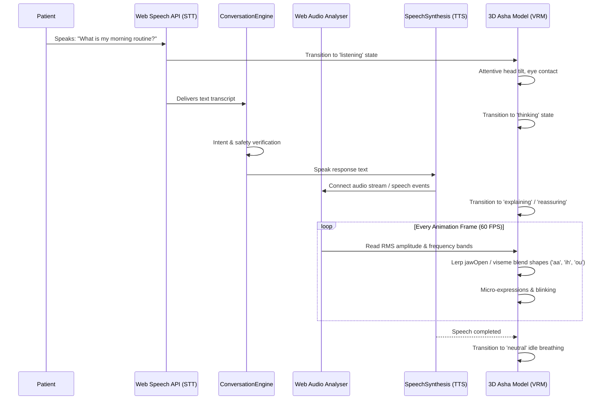
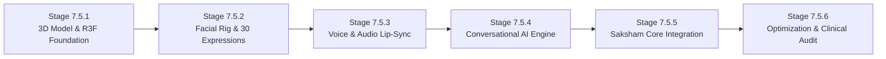

# SAKSHAM NEURO-CARE
# MILESTONE 7.5 — ASHA 3D CONVERSATIONAL AI TRANSFORMATION
## Master Architecture, Feasibility & Phased Development Blueprint

**Document Version:** 1.0.0  
**Date:** 11 November 2026  
**Repository:** `/Users/trishnabapna/Desktop/Saksham`  
**Branch:** `phase-2-patient-experience`  
**Firebase Plan:** Spark Free Tier ($0.00 / Zero Paid Cloud Functions / Zero Paid APIs)  
**Status:** Strictly Architectural Blueprint & Feasibility Assessment (Implementation Paused Awaiting Product Owner Authorization)

---

## 1. Executive Summary

Milestone 7.5 establishes the architectural masterplan to transform **Asha** from a 2D illustrated character assistant into a **fully animated, interactive, human-like 3D AI companion rendered natively in the browser**.

### The Vision
In neurodegenerative cognitive care (early dementia, Alzheimer's, Parkinson's support), patient engagement hinges upon **relational trust, eye contact, predictable micro-expressions, and multi-sensory reassurance**. Conventional text chatbots and flat talking-head images feel mechanical, disjointed, and cold to elderly individuals. 

Under this transformation:
- Asha exists as an authentic **real-time 3D character** standing in the patient's conversational sanctuary.
- She maintains attentive **eye contact**, blinks with natural cadence, smiles, breathes, tilts her head when listening, and expresses empathy.
- When she speaks, her mouth articulates in **real-time synchronized lip movement (visemes)** driven by speech audio amplitude and phonetic frequency.
- When the patient speaks or types, she transitions through distinct cognitive-attentive states (*listening*, *thinking*, *explaining*, *reassuring*, *celebrating*).
- She is deeply wired to Saksham's authorized clinical services: guiding daily routines, assisted recall questions, memory games, loved ones photographs, notes, and calendar events.
- **The patient feels they are interacting with Asha herself, rather than operating a chatbot with an attached graphic.**

```
+---------------------------------------------------------------------------------------------------+
|                                      PATIENT EXPERIENCE (UI)                                      |
|                                                                                                   |
|  [ 3D WebGL Canvas: Asha ]       [ Conversational Dialogue Bubble ]    [ Tactile Accessible Tray ]|
|  * 3D VRM Stylized Mesh          * Contextual speech text              * Quick-action chips       |
|  * Eye-tracking gaze             * Visual confirmation cards           * Text input drawer        |
|  * Lip-sync viseme articulation  * Clarification options               * Settings / Profile       |
|  * 30-expression blend shapes    * Multi-turn dialogue history         * Emergency SOS trigger    |
+---------------------------------------------------------------------------------------------------+
                                                  |
                                                  v
+---------------------------------------------------------------------------------------------------+
|                                  ORCHESTRATION & SAFETY LAYER                                     |
|                                                                                                   |
|  [ Speech Recognition (STT) ]  -->  [ ConversationEngine ]  -->  [ Audio-Driven Lip-Sync Engine ] |
|  * Web Speech API (en/hi)           * Safety & Emergency Guard    * Web Audio API Analyser        |
|  * Client-side Whisper-tiny         * Intent & Entity Extractor   * Morph target viseme lerp      |
|                                     * Consequential Confirmation  * Real-time jaw articulation    |
|                                                  |                                                |
|                                                  v                                                |
|                                     [ Hybrid AI Architecture ]                                    |
|                                     * Deterministic Action Core                                   |
|                                     * In-Browser WebLLM Companion                                 |
+---------------------------------------------------------------------------------------------------+
                                                  |
                                                  v
+---------------------------------------------------------------------------------------------------+
|                                AUTHORIZED DATA LAYER (SPARK $0.00)                                |
|                                                                                                   |
|  [ RoutineService ]   [ GamesService ]   [ LovedOnesService ]   [ NotesService ]   [ Calendar ]   |
|  * Sync & attempts    * Adaptive pacing  * Voice memories       * Private notes    * Appointments |
+---------------------------------------------------------------------------------------------------+
```

---

## 2. Current Architecture & Codebase Inspection Findings

A comprehensive audit of the Saksham repository reveals a mature, modular foundation ready for 3D extension without architectural rewrites:

### 2.1 The Existing Character Presentation Layer
- **`CharacterVisualizer.tsx` (`frontend/src/features/ai-companion/`):**
  Currently renders a 2D image via `` targeting `/assets/character/asha/${expressionId}.png` with an SVG chibi fallback (`renderAshaSVG()`). It supports two presentation modes:
  - `primary`: Full 160px-240px stage visualizer for Conversational Sanctuary.
  - `compact`: 64px compact icon companion embedded into task runners.
- **`characterExpressions.ts` (`frontend/src/features/ai-companion/config/`):**
  Houses the **30-Expression Matrix** grouped into 5 clinical care categories (Conversation, Emotional Support, Reminders/Guidance, Memory & Recall, Mood & Well-being). Each expression includes metadata, priority levels (1–5), return states, and aura color mappings.
- **`character-spec.json` (`frontend/src/assets/characters/character-config/`):**
  Defines baseline identity palettes (`#7C3AED` outfit, `#C084FC` scarf/hoodie, `#1C1917` hair, `#F7D0B2` skin).

### 2.2 The Existing Conversational & Action Pipeline
- **`conversationEngine.ts` (`frontend/src/features/ai-companion/services/`):**
  A 6-step sequential pipeline:
  1. *Emergency & Distress Guard (`conversationSafetyPolicy.ts`)* — Immediate distress interception.
  2. *Restricted Clinical Actions Guard* — Strictly forbids unverified medical diagnosis, dosage alteration, or simulated clinician messaging.
  3. *Pending Consequential Confirmation* — Two-step verification protocol for writes/deletions.
  4. *Entity Extractor (`entityExtractor.ts`)* — Resolves routine names, family members, times.
  5. *Intent Registry (`intentRegistry.ts`)* — Pattern and keyword matching.
  6. *Context Integration & Action Registry (`conversationActionRegistry.ts`)* — Executes safe actions across services.
- **`speechService.ts` (`frontend/src/services/`):**
  Implements Web Speech API STT and TTS with language BCP-47 mapping across 23 languages, voice matching (`findBestVoice`), and interruption handling (`cancelSpeech`).
- **`patientContextService.ts` (`frontend/src/services/`):**
  Assembles real-time contextual snapshots of today's routines, calendar events, loved ones, and active streaks.

### 2.3 Milestone 7.4.3.2 Protection Invariant
Milestone 7.4.3.2 was successfully committed (`3403b5d`, `2e1d6aa`), remediating doctor analytics privacy, demo doctor isolation, live assignment revocation, and date integrity. This work is fully preserved and remains strictly untouched.

---

## 3. Preserving Asha's Visual Identity & 30-Expression Matrix

Asha's established visual identity is deeply familiar to patients and caregivers. She must **not** be transformed into a generic robot, an anime trope, or an uncanny photorealistic avatar.

### 3.1 Strict Visual Identity Specification

| Feature | Identity Specification | 3D Asset Implementation Requirement |
| :--- | :--- | :--- |
| **Archetype** | Cute, friendly, stylized 3D South Asian female companion (early 20s). | Stylized Pixar/Disney-adjacent aesthetic. Soft cel-shading or subtle PBR diffuse lighting. Avoid uncanny realism. |
| **Face & Eyes** | Expressive, warm brown irises (`#3E2723`), gentle almond shape, natural corneal highlights. | Morph targets for eyelids, squinting, brows, and look-at eye tracking bones. |
| **Hair** | Dark wavy/curly hair (`#1C1917`) tied into a high textured bun with soft front tendrils. | Optimized mesh with secondary spring-bone physics for natural bounce. |
| **Accessories** | Lavender hair tie with a delicate blush-pink flower ornament. | Attached to head bone rig; subtle movement dynamics. |
| **Outfit** | Oversized warm lavender hoodie (`#9333EA` / `#A855F7`) over a cream inner shirt (`#FAF5FF`). | Modeled folds with skeletal weighting to upper torso, shoulders, and arms. |
| **Lanyard & Tech** | Lilac flower lanyard with Saksham caregiver pass + smartwatch on left wrist. | Lanyard rigged with spring-bone chains; smartwatch geometry on forearm bone. |
| **Expression Tone** | Approachable, patient, reassuring, soothing. | Default resting expression has relaxed eyebrows and 10% mouth smile. |

### 3.2 Mapping the 30-Expression Matrix to 3D Morph Targets

Rather than discarding the 30 expressions, they map directly into 3D facial morph targets (blend shapes) and skeletal poses:

```
+----------------------------------------------------------------------------------------------------+
| 30-EXPRESSION MATRIX -> 3D MORPH TARGET & SKELETAL RIG MAPPING                                     |
+----------------------------------------------------------------------------------------------------+
| Category 1: General / Conversation                                                                 |
|   * neutral:      Blink loop, resting face, gentle torso breathing cycle (0.2 Hz)                  |
|   * listening:    Head tilt 3°, eyes wide 0.15, slight smile 0.2, gaze locked on camera            |
|   * thinking:     Gaze drifts up-left 12°, brow furrow 0.2, head tilts 4°, hand touches chin       |
|   * explaining:   Eyebrows animate with speech inflection, open hand gestures                      |
|   * acknowledging:Head nods twice (Y-rotation 5°), warm smile 0.4, eyes squint 0.2                 |
|   * surprised:    Eyes wide 0.7, brows raised 0.8, mouth open 'O' 0.3, torso pulls back 2cm        |
|                                                                                                    |
| Category 2: Emotional Support                                                                      |
|   * happy:        Broad smile 0.8, eye cheeks raise (Duchenne smile) 0.6, joyful head tilt         |
|   * encouraging:  Warm smile 0.5, gentle forward lean, single encouraging hand gesture             |
|   * reassuring:   Soft gentle smile 0.4, head nod, hand over heart posture                         |
|   * comforting:   Soft empathetic gaze, head tilted 6°, gentle breathing pacing                    |
|   * concerned:    Inner brows raised 0.5, mouth slightly tight, attentive forward lean             |
|   * empathetic:   Soft eyes, gentle brow tilt, attentive nodding                                  |
|                                                                                                    |
| Category 3: Reminders / Guidance                                                                   |
|   * reminder:     Eyebrows raised 0.4, friendly alert gaze, subtle point toward dialogue tray      |
|   * alert_important:Eyes wide 0.6, torso alert upright, subtle glowing amber halo aura             |
|   * guiding:      Arm points towards the relevant task runner / screen control                     |
|   * confirming:   Thumbs-up gesture or double nod with confident reassuring smile                  |
|   * noting_saving:Hand makes note-taking gesture, eyes glance toward note card                     |
|   * done_completed:Clapping or celebratory double thumbs-up with wide beam smile                   |
|                                                                                                    |
| Category 4: Memory & Recall                                                                        |
|   * helping_recall:Patience posture, soft attentive eyes, encouraging upward eyebrow curve         |
|   * referring_past:Gaze shifts gently sideways, reflective head angle                              |
|   * recognizing:  Sparkle eye flash, immediate warm recognition smile 0.7                         |
|   * clarifying:   Slight head tilt, one eyebrow quizzically raised 0.3                             |
|   * checking_understanding: Attentive forward lean, nodding inquiry gaze                           |
|   * remembered:   Nod of realization, joyful smile, finger tap gesture                             |
|                                                                                                    |
| Category 5: Mood & Well-being                                                                      |
|   * calm:         Slow, soothing breathing animation, relaxed eye posture                          |
|   * relaxed:      Soft shoulders, gentle rhythmic sway, peaceful ambient smile                     |
|   * motivated:    Energetic posture, head high, bright eyes                                        |
|   * proud:        Chest lifted, warm beaming smile, gentle head tilt                               |
|   * a_little_tired:Slightly lowered eyelids (0.4 closed), gentle resting head tilt                 |
|   * rest_suggestion:Caring expression, soft palms-open gesture recommending relaxation           |
+----------------------------------------------------------------------------------------------------+
```

---

## 4. Recommended 3D Technology Stack & Asset Format

### 4.1 Evaluation of 3D Rendering Frameworks

| Framework | Bundle Size Impact | React Integration | Performance & Memory | WebGL/WebGPU Future-proofing | Verdict |
| :--- | :--- | :--- | :--- | :--- | :--- |
| **React Three Fiber (R3F) + Drei** | ~140 KB gzipped (`@react-three/fiber`, `@react-three/drei`, `three`) | **Native React 18 component lifecycle.** Full state & props reactivity. Clean hooks (`useFrame`, `useGraph`). | Excellent. Automated canvas resize, requestAnimationFrame loop, memory disposal on unmount. | Full support for WebGL2 and upcoming WebGPU renderers in Three.js r165+. | **RECOMMENDED.** Provides the cleanest pairing with Saksham's React architecture. |
| **Vanilla Three.js (`three`)** | ~110 KB gzipped | Imperative `useRef` and `useEffect` wrappers required. Difficult to synchronize with React context and language switches. | Identical to R3F underneath, but requires manual canvas management and resize listener cleanup. | Full support. | *Viable alternative if bundle size constraint is extreme.* |
| **Babylon.js** | ~480 KB gzipped | React bindings (`react-babylonjs`) exist but are less maintained than R3F. | Heavy initial bundle for lightweight mobile assistive app. | WebGPU native. | *Overkill for character-only rendering; too heavy.* |
| **Spline / Model-Viewer** | Closed ecosystem or restrictive Web Component | Poor programmatic access to skeletal bones and morph target visemes. | Inflexible. | Limited. | *Rejected: Cannot support customized viseme lip-sync and 30-expression rig.* |

### 4.2 Asset Format: VRM vs Standard GLTF/GLB
- **Standard glTF 2.0 / GLB:** Universal and compact, but lacks a standardized humanoid bone hierarchy or standardized expression presets. Bone naming is artist-dependent (Mixamo vs Blender vs Maya).
- **VRM 1.0 (Virtual Reality Model, built on glTF 2.0):**
  - **Standardized Humanoid Rig:** Guarantees universal bone assignments (`head`, `neck`, `spine`, `hips`, `leftUpperArm`, `leftEye`, etc.).
  - **Standardized Expression Blend Shapes:** Predefines standard visemes (`aa`, `ih`, `ou`, `ee`, `oh`) and standard emotion presets (`happy`, `relaxed`, `surprised`, `blink`, `blinkLeft`, `blinkRight`).
  - **Spring Bones (Secondary Physics):** Built-in mathematical physics for hair bun, hoodie cords, and lanyard sway that run efficiently on CPU without full Havok/PhysX engines.
  - **Standardized Gaze Tracking:** `lookAt` feature rotates eye bones and morph targets toward the camera or cursor automatically.
  - **Official Loader:** Supported via `@pixiv/three-vrm` (~35 KB gzipped).
- **Verdict:** **VRM 1.0 format is the definitive choice for Asha.**

---

## 5. Voice & Real-Time Lip Synchronization Architecture



### 5.1 Real-Time Audio-Driven Lip-Sync Engine
True human-like speech animation requires continuous mouth movement that tracks speech velocity:
1. **Audio Capture:** When browser TTS or audio files play, a Web Audio API `AudioContext` routes the audio through an `AnalyserNode`.
2. **Frequency & Volume Extraction:**
   - **Root Mean Square (RMS):** Instantaneous volume maps directly to jaw opening (`jawOpen` / `aa` blend shape).
   - **Formant Frequency Bins:** Low frequencies (100–400 Hz) bias toward `ou` and `oh`; mid-high frequencies (1200–3000 Hz) bias toward `ee` and `ih`.
3. **Smooth Interpolation (Lerp):** To prevent robotic jitter, blend shape weights interpolate smoothly at a smoothing rate of $\alpha = 0.25$:
   $$\text{Weight}_{t} = \text{Weight}_{t-1} + \alpha \times (\text{Target} - \text{Weight}_{t-1})$$
4. **Natural Co-Articulation:** When Asha is smiling or reassuring, mouth corners remain upturned (`mouthSmile: 0.3`) even while the jaw opens and closes for speech.

### 5.2 Speech Recognition, Interruption & Accessibility Guards
- **Instant Interruption Protocol:** If Asha is speaking and the patient speaks or taps the screen:
  - `window.speechSynthesis.cancel()` executes immediately.
  - The Audio Analyser is silenced.
  - Mouth blend shapes smoothly return to rest within 100ms.
  - Asha's gaze snaps attentively to the patient, entering `listening` state.
- **Voice Is Never Mandatory:**
  - A tactile text input drawer is permanently docked at the sanctuary base.
  - Quick-action suggestion pills ("What's next?", "Show photos", "Need help") enable zero-voice, zero-typing navigation.
  - Patients with tremors or speech aphasia retain 100% functional parity.

---

## 6. Generative AI Architecture, Cost & Spark Plan Feasibility

### 6.1 Honest Feasibility Assessment: The Firebase Spark Constraint
Saksham operates on the **Firebase Spark Free Plan ($0.00)**. Under Spark:
- **No Cloud Functions** can be deployed.
- **No paid Google Cloud proxy services** are accessible.
- **No backend Node server** is deployed to keep secrets.

> [!CAUTION]
> **Strict API Key Security Rule:**
> Storing third-party secret API keys (OpenAI, Anthropic, Groq, etc.) in frontend code exposes those keys in plaintext inside browser JavaScript bundles. Any user or attacker can extract the key, leading to unauthorized use, rate exhaustion, and potential financial liability.
>
> Therefore, direct cloud LLM calls with unauthenticated secret keys from client-side code are **architecturally forbidden**.

### 6.2 Comparison of AI Engine Alternatives

| Alternative | Host / Execution | Free-Tier Limits & Quotas | Credit Card Required? | Privacy / PHI Risk | Firebase Spark Feasibility | Verdict |
| :--- | :--- | :--- | :--- | :--- | :--- | :--- |
| **Option A: In-Browser WebLLM (WebGPU)**<br>*(Gemma-2-2B, SmolLM-1.7B, Phi-3.5-mini)* | **Client-side browser GPU** via WebGPU & WebAssembly. | **Unlimited.** $0.00 infrastructure cost forever. | **NO.** | **ZERO PRIVACY LEAK.** Patient dialogue never leaves the physical device. | **100% Spark Compatible.** Zero servers required. | **PRIMARY RECOMMENDED GENERATIVE ENGINE.** |
| **Option B: Google Gemini API (Free Tier via AI Studio)**<br>*(Gemini 1.5 Flash)* | Google AI Studio Cloud. | 15 Requests/Min, 1,500 Requests/Day, 1M Tokens/Min. | **NO** (on AI Studio free tier). | **HIGH PRIVACY RISK.** Free-tier prompts may be used for model training by Google. Not covered by HIPAA/BAA. | Viable ONLY IF API key is restricted by HTTP Referrer / App Check. | **SECONDARY OPTIONAL CLOUD ENGINE (Requires prompt PHI stripping).** |
| **Option C: Groq / Together AI Cloud** | Third-party cloud. | 30 RPM rate limits. | No CC currently for trial. | Patient data leaves app to third-party US cloud provider. | Frontend API key exposure risk without backend proxy. | **NOT RECOMMENDED.** |
| **Option D: Deterministic Intent Engine (Existing Milestone 7.3)** | Local TypeScript state machine. | **Unlimited.** | **NO.** | **ZERO RISK.** 100% clinical truthfulness, zero hallucination. | **100% Spark Compatible.** | **AUTHORITATIVE ACTION CORE (Always active).** |

### 6.3 The Recommended Hybrid Dual-Core Architecture

To achieve genuine conversational warmth without sacrificing clinical safety or zero-cost feasibility, Saksham will use a **Two-Tiered Hybrid Dual-Core Architecture**:

```
                                  [ Patient Utterance ]
                                            |
                                            v
                         +--------------------------------------+
                         | Step 1: Safety & Clinical Intercept  |
                         | (Emergency SOS, Medical, Medication) |
                         +--------------------------------------+
                                     /             \
                   [ Matched Action / Guard ]     [ General Chitchat / Guidance ]
                                   /                 \
                                  v                   v
                    +-----------------------+   +---------------------------+
                    | Core A: Deterministic |   | Core B: Generative LLM    |
                    | Clinical Engine       |   | (In-Browser WebLLM /      |
                    | (Milestone 7.3 Core)  |   | Sanitized Gemini Flash)   |
                    +-----------------------+   +---------------------------+
                                  |                           |
                                  * Exact service writes      * Empathetic chitchat
                                  * Consequential confirm     * Memory reminiscence
                                  * Truthful task telemetry   * Contextual warmth
                                  \                           /
                                   v                         v
                                +-------------------------------+
                                | Asha 3D Viseme & Action Stage |
                                +-------------------------------+
```

1. **Core A (Authoritative Deterministic Engine):**
   - Intercepts all operational, clinical, and safety queries.
   - Executes routines, game recommendations, appointment lookup, notes persistence, and emergency distress responses.
   - Enforces two-step confirmation for consequential actions.
   - 100% truthful, zero hallucination.
2. **Core B (Generative Companion Engine — WebLLM via WebGPU):**
   - Engages when patient speaks open-ended thoughts: *"Asha, I feel a little lonely today,"* or *"Tell me about the weather in Jaipur,"* or *"What was my daughter Ananya like as a child?"*
   - Powered by **Gemma-2-2B-Instruct** or **SmolLM-1.7B-Instruct** running client-side in WebGPU.
   - Runs locally in browser IndexedDB cache (~1.2 GB download once).
   - Zero network transmission of sensitive patient thoughts.
3. **Fail-Soft Graceful Degradation:**
   - If a patient's device does not support WebGPU (e.g. older Android phone), Core B steps back honestly without crashing:
     *Asha smiles reassuringly:* *"I am listening! I am in focused guidance mode today. Would you like to check today's routines, play a calm memory game, or look at family photos?"*

---

## 7. Connecting 3D Asha to Saksham Core Services

Asha is the companion interface to Saksham's clinical modules. She routes patient intents through existing validated services:

| Saksham Feature | Patient Utterance Example | Service Integration & Execution | Asha 3D Expression & Gesture |
| :--- | :--- | :--- | :--- |
| **Daily Routines** | *"What should I do this morning?"* | Calls `RoutineService.getRoutines(uid)` -> determines active morning task -> formats encouraging guidance. | `guiding` -> arm gestures toward routine runner card -> `explaining`. |
| **Assisted Recall** | *"I can't find my keys!"* | Launches `GuidedTaskRunner` with 3-chance progressive cue runner (`hint1` -> `hint2` -> `hint3`). | `helping_recall` -> `clarifying` -> `remembered` on success. |
| **Loved Ones** | *"Show me Ananya's picture."* | Calls `LovedOnesService.getLovedOnes(uid)` -> filters member -> opens photo modal with voice memory audio cue. | `happy` -> warm beam smile -> `comforting`. |
| **Mind Games** | *"I want to play a game."* | Queries `AdaptiveDifficultyService.getProfile(uid)` -> selects game matched to pacing -> navigates to game runner. | `motivated` -> energetic nod -> `guiding`. |
| **Notes & Reminders** | *"Remind me to drink water."* | Prepares `NotesService.createNote()` -> triggers two-step confirmation dialogue card before saving. | `noting_saving` -> `confirming`. |
| **Caregiver Call** | *"I want to talk to my daughter."* | Formats caregiver direct call modal or emergency protocol. | `reassuring` -> hand over heart. |

### Security & Privacy Non-Negotiables:
- **No Unauthorized Reads:** Asha queries only records belonging to `request.auth.uid`. She cannot read another patient's data.
- **No Diagnostic Assertions:** Asha never states a cognitive score, disease progression stage, or medication dosage modification.
- **Two-Step Confirmation:** Deleting a note, creating a calendar event, or triggering an SOS alert requires explicit verbal/tactile confirmation.

---

## 8. Patient Experience Redesign & Sanctuary Layout

### 8.1 Primary Viewport Architecture (Asha-Only Mode)
In **Asha-Only Mode** (introduced in Milestone 7.4.1), Asha 3D occupies the central stage of the application:

```
+---------------------------------------------------------------------------------+
|  [Header: Saksham Heart Logo]                      [Settings / Profile Pill]    |
+---------------------------------------------------------------------------------+
|                                                                                 |
|                                                                                 |
|                             [ ASHA 3D REAL-TIME AVATAR ]                        |
|                                 (Interactive WebGL)                             |
|                                                                                 |
|                        - Attentive head & eye tracking                          |
|                        - Natural breathing & idle dynamics                      |
|                        - Real-time mouth lip-sync visemes                       |
|                        - Expressive 30-expression morphs                        |
|                                                                                 |
|                                                                                 |
|       +-----------------------------------------------------------------+       |
|       | Asha: "Good morning, Sunita ji! It's 9:00 AM. Would you like to |       |
|       | take your warm herbal tea now?"                                 |       |
|       +-----------------------------------------------------------------+       |
|                                                                                 |
+---------------------------------------------------------------------------------+
|  [ Tactile Quick Action Chips ]                                                 |
|  [ (Tea Routine) ]     [ (Family Photos) ]     [ (Mind Game) ]    [ (Help SOS) ]|
+---------------------------------------------------------------------------------+
|  [ Mic: Tap to Speak (Pulsing) ]         [ Text Input Drawer (Accessible) ]     |
+---------------------------------------------------------------------------------+
```

### 8.2 Compatibility with Hybrid Mode
In **Hybrid Mode**, the 4 bottom tabs (Home, Family, Games, Profile) are retained. Asha 3D renders in a prominent hero card at the top of the Home tab (height 320px), while routine and memory cards sit below. Tapping Asha smoothly expands her into the full Conversational Sanctuary stage.

---

## 9. Device Performance, Mobile Strategy & Graceful Degradation

### 9.1 Asset & Performance Budgets

| Metric | Target Specification | Enforcement Mechanism |
| :--- | :--- | :--- |
| **Model Polygon Count** | $\le 22,000$ triangles ($\le 12,000$ vertices). | Strict Blender low-poly retopology with normal map baking. |
| **Texture Maps** | $1 \times 2048 \times 2048$ Atlas (Albedo + Normal + Roughness) in WebP format ($\le 2.2 \text{ MB}$). | Texture atlas consolidation; mipmapping enabled. |
| **File Size** | $\le 4.5 \text{ MB}$ total VRM file size. | Draco / Meshopt glTF compression via `@gltf-transform`. |
| **Draw Calls** | $\le 6$ draw calls per frame. | Merged materials; single skinned mesh renderer. |
| **Frame Rate** | 60 FPS on M1 MacBook Air / iPad; $\ge 30$ FPS on mid-range Android. | Adaptive dynamic pixel ratio (1.0 on mobile, 1.5 on desktop). |
| **GPU Memory** | $\le 45 \text{ MB}$ WebGL VRAM allocation. | Context disposal and texture garbage collection on route change. |
| **Battery Conservation** | Render loop pauses when character is idle (> 10s without interaction). | `frameloop="demand"` in React Three Fiber when ambient. |

### 9.2 The Three-Tier Graceful Degradation Matrix

```
[ Device Enters Sanctuary ]
           |
           v
+-------------------------------+
| Tier 1: Full 3D AI Experience | ---> Supported WebGL2 + WebGPU devices
| * 3D VRM Asha (60 FPS)        |      (M1/M2/M3 Macs, modern desktop, iOS/Android flagship)
| * Real-time audio lip-sync    |
| * In-browser WebLLM chitchat  |
+-------------------------------+
           |
   (WebGPU unavailable / low VRAM)
           v
+-------------------------------+
| Tier 2: 3D Core Experience    | ---> Standard mobile phones (Snapdragon 680, Helio G99)
| * 3D VRM Asha (30-45 FPS)     |      Uses WebGL2 for 3D rendering + deterministic Core A
| * Real-time audio lip-sync    |      for conversational intelligence.
| * Deterministic Core A        |
+-------------------------------+
           |
   (WebGL crash / low-spec fallback / reduced motion)
           v
+-------------------------------+
| Tier 3: 2D Tactile Sanctuary  | ---> Low-spec devices / accessibility preference
| * 2D CharacterVisualizer      |      Honest banner: "Running in battery-saving 2D mode."
| * High-contrast tactile chips |      100% feature parity for routines, games, memories.
| * Full TTS audio & text       |
+-------------------------------+
```

---

## 10. Phased Development Roadmap & Stage Breakdown



### Stage 7.5.1: 3D Character Foundation & Rendering Pipeline
- **Deliverables:**
  - Create/source the low-poly stylized Asha VRM model matching the exact visual identity specification (brown eyes, dark bun, lavender hoodie, lanyard).
  - Setup `@react-three/fiber`, `@react-three/drei`, and `@pixiv/three-vrm`.
  - Build `AshaCanvas.tsx` with optimized lighting, soft contact shadows, and camera framing.
  - Implement dynamic resize and WebGL capability detection.
- **Acceptance Criteria:** Asha 3D renders in browser canvas on desktop and mobile at $\ge 60$ FPS with $\le 4.5$ MB bundle overhead.

### Stage 7.5.2: Character Animation Rig & 30-Expression Mapping
- **Deliverables:**
  - Implement idle breathing, blinking cadence (every 3.5s with random jitter), and subtle head micro-movements.
  - Wire eye-tracking gaze to follow patient cursor or camera center.
  - Map the 30 expressions from `characterExpressions.ts` to VRM morph target blend shape weights.
  - Build smooth spring-bone physics for hair bun and hoodie drawstrings.
- **Acceptance Criteria:** Toggling through any of the 30 expressions transitions smoothly over 250ms without mesh clipping or popping.

### Stage 7.5.3: Voice, Real-Time Lip Synchronization & Interruption
- **Deliverables:**
  - Build `AudioLipSyncService.ts` utilizing Web Audio API `AnalyserNode`.
  - Connect speech synthesis audio output to real-time `jawOpen` and vowel viseme morph targets.
  - Implement instant speech interruption protocol on patient tap or voice detection.
  - Add accessible voice activity indicator.
- **Acceptance Criteria:** Mouth articulates naturally in sync with spoken audio; instant interruption halts speech within 50ms.

### Stage 7.5.4: Conversational Intelligence & Hybrid AI Engine
- **Deliverables:**
  - Connect the authoritative Deterministic Action Core (Milestone 7.3) as Step 1.
  - Evaluate and integrate WebLLM (in-browser Gemma-2-2B or SmolLM-1.7B) for open-ended chitchat in Tier 1 devices.
  - Implement prompt safety templates that strictly prevent medical hallucination.
  - Establish bilingual English/Hindi conversational support.
- **Acceptance Criteria:** Clinical and task commands execute deterministically; open-ended conversation feels warm and natural without leaking patient PHI to cloud servers.

### Stage 7.5.5: Deep Saksham Integration & Action Protocols
- **Deliverables:**
  - Connect Asha 3D to `RoutineService`, `GamesService`, `LovedOnesService`, `NotesService`, and `CalendarService`.
  - Wire two-step confirmation dialogue cards for consequential writes.
  - Integrate conversational shortcuts directly into Guided Routine Runner.
- **Acceptance Criteria:** Patient can complete an entire daily routine or view loved ones memories purely through conversational dialogue with Asha 3D.

### Stage 7.5.6: Performance Optimization, Accessibility & Clinical Review
- **Deliverables:**
  - Performance profiling on M1 Mac, iPad, and mid-range Android phone.
  - Implement Tier 3 2D fallback for low-spec/reduced-motion environments.
  - Screen reader accessibility tags and WCAG contrast validation.
  - Full end-to-end regression audit across patient, caregiver, and doctor portals.
- **Acceptance Criteria:** Application loads smoothly, 0 regressions in existing 530 tests, Spark Free Tier strictly preserved ($0.00).

---

## 11. Key Risks & Mitigation Strategy

| Risk Category | Specific Risk | Technical Mitigation Strategy |
| :--- | :--- | :--- |
| **Model Fidelity & Uncanny Valley** | Stylized 3D model looks creepy, cold, or disconnected from 2D Asha. | Strict art direction adhering to stylized anime/Pixar aesthetics with large expressive eyes, warm terracotta skin, and soft cel-shading. Avoid photorealistic skin shaders. |
| **Mobile WebGL Crash / OOM** | Low-end mobile devices run out of VRAM and crash the WebGL context. | Keep texture budget $\le 2048 \times 2048$, model triangles $\le 22,000$. Implement WebGL context-loss listener that auto-falls back to Tier 3 2D mode without breaking app execution. |
| **AI Hallucination in Clinical Domain** | Generative LLM gives unverified medical advice or changes medication schedule. | Strict two-tiered gating: All task/medical/routine intents are captured by Core A (Deterministic Policy). Core B prompt contains immutable system boundary: *"Never give medical advice, diagnostic opinions, or dosage instructions."* |
| **API Key Theft / Cloud Costs** | Cloud LLM integration requires secret API key that leaks in frontend Vite build. | Zero secret keys in client. Primary generative architecture uses in-browser WebGPU WebLLM ($0.00 cost, zero keys). |
| **Initial 3D Loading Latency** | Downloading 4MB 3D model delays initial app launch for elderly patients. | Lazy-load 3D canvas asynchronously in the background. While downloading, render the lightweight 2D Asha visualizer with a smooth cross-fade once WebGL initializes. |

---

## 12. Strategic Questions Requiring Product Owner Approval

Before beginning Stage 7.5.1 implementation, the following architectural choices require product owner alignment:

1. **3D Asset Creation Approach:**  
   - *Option A:* Model and rig a custom VRM 1.0 character in Blender matching the exact 2D Asha illustration specifications.
   - *Option B:* Adapt and customize a high-quality open-source CC0 VRM stylized base avatar (e.g. via VRoid Studio + Blender retopology).
2. **Generative LLM Scope:**  
   - *Option A (Recommended):* Pure in-browser WebLLM (Gemma-2-2B / SmolLM) on WebGPU devices + Deterministic Action Core everywhere else ($0.00 cost, 100% private).
   - *Option B:* Dual approach with optional cloud-hosted Gemini 1.5 Flash (free tier) for devices without WebGPU (requires user acknowledgment of Google cloud prompt transmission).
3. **Primary Presentation Layout:**  
   - Confirm whether Asha-Only Mode should default to full-viewport 3D immersion, with bottom navigation completely hidden as established in Milestone 7.4.1.

---

## 13. Acceptance Criteria Checklist for Stage 7.5.1 Initiation

- [x] Full architectural blueprint delivered in `docs/product-vision/MILESTONE_7_5_ASHA_3D_AI_ARCHITECTURE_BLUEPRINT.md`.
- [x] Existing Asha character identity and 30-expression matrix preserved.
- [x] 100% Firebase Spark Free Tier compatibility verified ($0.00 budget, zero Cloud Functions).
- [x] Existing Milestone 7.4.3.2 feature and documentation commits protected.
- [x] Strict read-only mode observed (zero unauthorized implementation begun).

---

**STOPPING RULE ENFORCED:**  
This architectural blueprint is complete. Implementation of Stage 7.5.1 has **not** begun. Awaiting product owner review and authorization.
