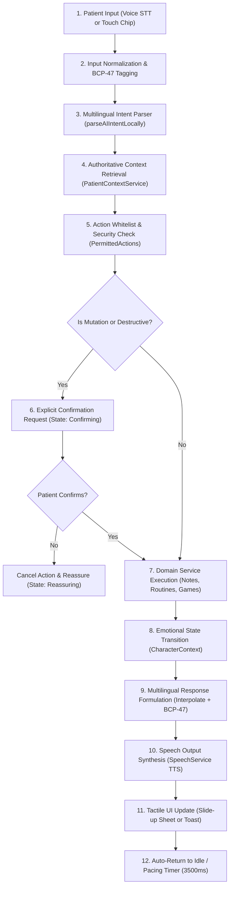

# SAKSHAM — CONVERSATIONAL PATIENT EXPERIENCE AUDIT
## Architectural Feasibility, Character-Led Transformation & Migration Roadmap

**Project:** Saksham AI Neuro-Care Companion Ecosystem  
**Repository:** `/Users/trishnabapna/Desktop/Saksham`  
**Current Branch:** `phase-2-patient-experience`  
**Baseline Commit:** `21b25f4` (Milestone 6.3 Complete Notes & Calendar)  
**Audit Status:** STRICTLY READ-ONLY ARCHITECTURAL & FEASIBILITY AUDIT  
**Target Infrastructure:** Firebase Spark Plan (100% Free Tier Only — 0 Paid APIs, 0 Paid Storage, 0 Paid Functions)

---

## 1. Executive Summary & Audit Mandate

This master audit evaluates the architectural feasibility, clinical suitability, and technical implementation plan for transforming the Saksham patient experience from a conventional multi-tab web dashboard into a **character-led, conversational neuro-care companion**.

### The Core Paradigm Shift
In traditional software, patients with neuro-degenerative conditions (such as Parkinson’s disease, Mild Cognitive Impairment, and early-stage Alzheimer’s) are forced to parse complex visual hierarchies: navigating across bottom tabs (`Home`, `Family`, `Games`, `Profile`), hunting for floating utility buttons, deciphering modal dialogues, and tracking fragmented interfaces. For patients experiencing cognitive fatigue, tremors, or executive dysfunction, these conventional UI paradigms create friction, disorientation, and anxiety.

The proposed transformation establishes **Asha** (visualized via the provided character design asset) as the **single, unified, empathetic primary interface**. The patient opens Saksham and is directly welcomed by Asha. Through gentle voice dialogue or large tactile conversational chips, the patient communicates their needs naturally (*"Asha, what should I do now?"*, *"Show me my family"*, *"Choose a gentle game for me"*), and Asha acts as the compassionate guide, operating the underlying clinical engines on their behalf.

```
┌────────────────────────────────────────────────────────────────────────────────────────┐
│                          CURRENT VS. PROPOSED PATIENT EXPERIENCE                       │
├────────────────────────────────────────────────────────────────────────────────────────┤
│ CURRENT (Milestone 6.3):                                                               │
│ [TopBar: Branding, Language, High Contrast]                                            │
│   ├── AICompanion Widget (Embedded Top Banner)                                         │
│   ├── Welcome & Peacefulness Reassurance Card                                          │
│   ├── Daily Progress Ring & Streak Display                                             │
│   ├── 2-Tab Routine Workspace (Assisted Recall + Checklist)                            │
│   ├── Floating Utility Hub (Notes & Calendar Modals)                                   │
│   └── 4-Tab BottomNav (Home, Family, Games, Profile)                                   │
├────────────────────────────────────────────────────────────────────────────────────────┤
│ PROPOSED CONVERSATIONAL SANCTUARY:                                                     │
│ [Minimal Top Sanctuary Bar: Calm Status, Emergency Caregiver Action, Settings]         │
│   ├── Unified Character Stage: Asha Full Hero Character (30 Context-Aware Expressions)  │
│   ├── Conversational Dialogue Hub: Reassuring Speech Balloon & Calm TTS Output         │
│   ├── Voice & Tactile Input Zone: 64px Mic Button + Dynamic Suggestion Chips           │
│   ├── In-Place Focused Activity Trays (Slide-up sheets for Games, Routines, Photos)    │
│   └── Persistent Tactile Fallback Bar (Voice-Optional Accessibility)                   │
└────────────────────────────────────────────────────────────────────────────────────────┘
```

### Critical Findings & Feasibility Summary
1. **High Architectural Reusability (88% Service Reuse):** Saksham’s existing backend and service layer—specifically `RoutineService`, `AdaptiveDifficultyService`, `GamesService`, `LovedOnesService`, `NotesService`, `CalendarService`, and `VoiceStorageService`—can be reused **without modification**. The conversational interface acts as an intelligent controller over these robust, tested domains.
2. **Visual Source of Truth Validated:** The uploaded character sheets provide a rich, cohesive 30-expression emotional taxonomy tailored specifically for neuro-cognitive care. Every required interaction maps directly to an existing expression on the sheet.
3. **100% Spark Free-Tier Compliant:** The conversational engine can be powered entirely by local rule-based intent parsing (`parseAIIntentLocally`), client-side Web Speech API (STT/TTS), and IndexedDB audio storage. Zero external LLM calls or paid cloud services are required.
4. **Non-Negotiable Safety & Clinical Guardrails:**
   - Physical activities and medications must **never** be auto-completed by timers or chat confirmations alone; multi-step verbal or physical verification is required.
   - Diagnostic claims, medical advice, and symptom guessing remain strictly prohibited.
   - No facial recognition, voice cloning, or synthetic AI hallucinations for loved ones.
5. **Caregiver & Clinical Isolation:** Caregiver, Doctor, and Admin dashboards remain completely untouched. Their oversight tools, analytics, and permissions continue to function identically.

---

## 2. Existing Patient Experience Architecture (Milestone 6.3)

### A. Routing & Structural Layout
The current patient application runs under `/patient` routes protected by `ProtectedRoute.tsx`:
- `/patient`: Patient Home Sanctuary (`PatientDashboard.tsx`), which embeds the AI Companion widget, progress ring, daily streak, and the 2-tab Daily Routines workspace (Assisted Recall Engine and Checklist).
- `/patient/routines`: Legacy redirect pointing to `/patient`.
- `/patient/loved-ones`: Family sanctuary (`LovedOnes.tsx`) with photo albums, voice notes, and memory cues.
- `/patient/mind-games`: Mind games sanctuary (`MindGames.tsx`) with 15 cognitive games and the 3-zone Home Observation Explorer.
- `/patient/profile`: Patient settings (`PatientProfile.tsx`) for accessibility, character selection, and audio preferences.

### B. Navigation & Utility Anchors
- **TopBar (`TopBar.tsx`):** Fixed header showing Saksham branding, active sanctuary indicator, high-contrast toggle, text size control, and language selector modal trigger.
- **BottomNav (`BottomNav.tsx`):** Fixed 4-tab bottom navigation (`Home`, `Family`, `Games`, `Profile`) rendered on all patient screens.
- **FloatingUtilityHub (`FloatingUtilityHub.tsx`):** A floating button (56px) positioned at `bottom-20` on mobile and desktop, triggering a popover menu that opens the Notes and Calendar sanctuary modals.

### C. Current Companion Implementation (`AICompanion.tsx` & `aiService.ts`)
- Currently rendered as a collapsible card at the top of `PatientDashboard.tsx`.
- Visualized using `CharacterVisualizer.tsx`, which renders a simplified vector SVG avatar of Asha or Kabir.
- Uses `CharacterContext.tsx` with an 8-state emotion system: `idle`, `greeting`, `listening`, `speaking`, `thinking`, `happy`, `reminder`, `encouraging`.
- Executes intent recognition via `parseAIIntentLocally` in `frontend/src/services/aiService.ts`, dispatching `WhitelistedAction` commands (`NAVIGATE_MIND_GAMES`, `NAVIGATE_LOVED_ONES`, `OPEN_NOTES`, `OPEN_CALENDAR`, etc.).

---

## 3. Character Identity & Visual Reference Analysis

### A. Visual Source of Truth
The user provided two character reference sheets:
1. `media_1794243522707_ed77bd93.jpg`: Master character design, proportions, attire, and core personality pillars.
2. `media_1794243532586_9743ec17.jpg`: Comprehensive 30-expression emotion matrix organized into 5 clinical categories.

```
┌────────────────────────────────────────────────────────────────────────────────────────┐
│                              CHARACTER VISUAL IDENTITY SPEC                            │
├────────────────────────────────────────────────────────────────────────────────────────┤
│ Visual Persona: Asha (Reference Asset Label: "Aira - Your Memory Companion")          │
│ Aesthetic: Soft anime/manhwa-inspired, warm, approachable, clinically non-threatening. │
│ Demographic Appearance: Young South Asian woman, warm skin tone, gentle rosy blush.    │
│ Hair: Dark brown/black voluminous wavy hair styled in a high loose bun with face-      │
│       framing tendrils and two soft lavender horizontal barrettes on the upper left.   │
│ Eyes: Large, expressive, warm dark brown eyes with soft eyelids and clear gaze.        │
│ Attire: Oversized comfortable soft lavender zip-up hoodie over a cream scoop-neck tee; │
│         lavender fabric lanyard with cardholder badge displaying a 4-petal flower;      │
│         minimalist dark grey smartwatch on left wrist.                                 │
│ Posture: Forward-leaning, elbows resting comfortably, open welcoming body language.   │
└────────────────────────────────────────────────────────────────────────────────────────┘
```

### B. Master 30-Expression Clinical Emotion Matrix

The 30 expressions from the supplied matrix are mapped below to exact clinical triggers, body gestures, voice acoustics, and patient messaging:

| Category | State Name | Visual & Icon Cues | Posture / Gesture | Acoustic Delivery | Clinical Trigger & Flow |
|:---|:---|:---|:---|:---|:---|
| **General / Conversation** | `Neutral` | Soft open gaze, gentle calm smile | Resting chin on hands | Calm, natural (0.95x rate) | Baseline standby state; waiting for patient prompt. |
| | `Listening` | Direct eye contact, head tilted | Leaning closer, attentive | Silent / Subdued ambient | Patient is speaking or microphone is active. |
| | `Thinking` | Gaze upward, question mark (`?`) | Finger on chin | Low contemplative humming | Processing voice input or matching schedule query. |
| | `Explaining` | Warm open mouth, sound wave arcs | Index finger raised gently | Patient, articulated | Explaining step 1 of routine or game rules. |
| | `Acknowledging` | Eyes crinkled in comprehension | Subtle head nod | Warm, receptive | Patient acknowledges an instruction or answers cue. |
| | `Surprised` | Eyes wide, small exclamation (`!`) | Hands lifted slightly | Playful, delightful | Patient achieves high score or completes early. |
| **Emotional Support** | `Happy` | Beaming closed-eye crescent smile | Arms relaxed, shoulders open | Bright, warm, uplifting | Celebrating positive patient mood or greeting. |
| | `Encouraging` | Clenched supportive fist | Leaning forward, fist pump | Uplifting, motivating | Patient struggles with step 2 of Assisted Recall. |
| | `Reassuring` | Serene eyes, peaceful breath | Hand resting over heart | Deep, grounded, soothing | Patient expresses confusion, panic, or disorientation. |
| | `Comforting` | Head resting on lavender pillow (`♡`)| Snuggled softly to side | Very soft, whisper-cadence | Evening wind-down or when patient feels overwhelmed. |
| | `Concerned` | Softly furrowed brow, tilted head | Hands clasped near chest | Gentle, inquiring | Patient reports pain, missed meals, or sadness. |
| | `Empathetic` | Compassionate open gaze | Soft forward lean | Validating, tender | Listening to patient talk about memory difficulties. |
| **Reminders / Guidance** | `Reminder` | Mini calendar badge + bell icon | Holding up calendar note | Clear, friendly cadence | Scheduled medication or hydration window arrives. |
| | `Alert / Important` | Upright posture, exclamation (`!`)| Finger pointed purposefully| Clear, firm yet calm | Vital routine overdue (e.g. morning Levodopa). |
| | `Guiding` | Open hand pointing right | Gesturing toward task card | Directive, supportive | Directing attention to next physical step. |
| | `Confirming` | Green checkmark badge (`✓`) | Confident head nod | Validating, definitive | Asking confirmation before saving note or event. |
| | `Noting / Saving` | Holding digital notebook & stylus | Writing in small pad | Focused, reassuring | Patient dictates a note; saving to IndexedDB. |
| | `Done / Completed` | Wide smile, cheerful thumbs-up | Solid thumbs-up | Celebratory, proud | Patient finishes routine or completes mind game. |
| **Memory & Recall** | `Helping Recall` | Holding photo frame badge | Gesturing toward memory cue| Patient, rhythmic | Delivering Cue 1 or Cue 2 in Assisted Recall. |
| | `Referring to Past`| Thought bubble with family silhouette| Looking back warmly | Nostalgic, tender | Talking about daughter Ananya or past vacation. |
| | `Recognizing` | Glowing lightbulb badge (`💡`) | Head lifted, eyes bright | Pleased, delighted | Patient remembers correct answer on Attempt 2. |
| | `Clarifying` | Question mark bubble (`?`) | Head tilted to side | Non-judgmental, curious | Speech recognition unsure; asking patient to repeat. |
| | `Checking Understanding`| Closed-eye pause, ellipsis (`...`)| Tilting head, waiting | Patient, steady | Pausing after multi-step instruction to check pace. |
| | `Remembered!` | Hands clasped in gratitude, sparkles| Upright joyful clasp | Triumphant, appreciative| Patient recalls family member name or routine item. |
| **Mood & Well-being** | `Calm` | Peaceful closed eyes, zen curl | Slow deep breath pose | Slower cadence (0.85x rate)| Guiding morning breathing or tremor relaxation. |
| | `Relaxed` | Head back, musical note (`♪`) | Leaning back leisurely | Lighthearted, melodious | Ambient idle state during music or garden break. |
| | `Motivated` | Flexing arms, sunburst rays (`//`)| Double fist pump | Energetic, crisp | Starting morning routine with high motivation. |
| | `Proud` | Chest upright, hands on hips, stars (`✦`)| Triumphant stance | Deeply affectionate | Reviewing weekly streak or completion milestone. |
| | `A Little Tired` | Small polite yawn with hand (`zZ`)| Soft relaxed slump | Quiet, sleepy tone | Detecting evening hours or patient fatigue signs. |
| | `Rest Suggestion` | Resting head on pillow, crescent moon (`🌙`)| Sleeping posture | Soothing lullaby tone | Suggesting bedtime after 09:30 PM routine completion. |

---

## 4. Proposed Conversational Patient Experience Architecture

### A. The Unified Conversational Sanctuary Screen
Instead of dividing features across isolated pages, the patient experience converges onto a single **Sanctuary Stage**:

```
┌────────────────────────────────────────────────────────────────────────┐
│                         SAKSHAM PATIENT SANCTUARY                      │
├────────────────────────────────────────────────────────────────────────┤
│ [Top Tranquil Bar]                                                     │
│  • Patient Name & Status ("Safe • Calm • Supported")                   │
│  • One-Tap Emergency Caregiver Contact ("Call Ananya")                 │
│  • Settings / Language Icon                                            │
├────────────────────────────────────────────────────────────────────────┤
│                                                                        │
│                 ┌─────────────────────────────────┐                    │
│                 │                                 │                    │
│                 │           ASHA HERO             │                    │
│                 │     (Full Character Stage)      │                    │
│                 │  30 Dynamic Expressions & Poses │                    │
│                 │                                 │                    │
│                 └─────────────────────────────────┘                    │
│                                                                        │
│  ┌──────────────────────────────────────────────────────────────────┐  │
│  │ ASHA: "Namaste Sunita ji! It is 10:30 AM. Would you like to take │  │
│  │ your morning herbal tea now, or shall we look at your family?"   │  │
│  └──────────────────────────────────────────────────────────────────┘  │
│                                                                        │
│  [Quick Contextual Action Chips]                                       │
│  ┌────────────────────┐ ┌────────────────────┐ ┌────────────────────┐  │
│  │ ☕ Start Herbal Tea │ │ 👨‍👩‍👧 See Family     │ │ 🎮 Play Quick Game │  │
│  └────────────────────┘ └────────────────────┘ └────────────────────┘  │
│                                                                        │
│  ┌──────────────────────────────────────────────────────────────────┐  │
│  │ [ ⌨ Type a message... ]               [ 🎙 64px PUSH TO SPEAK ]  │  │
│  └──────────────────────────────────────────────────────────────────┘  │
├────────────────────────────────────────────────────────────────────────┤
│  [Persistent Essential Fallback Bar]                                   │
│  • Today's Tasks (3)  • Family (4)  • Games (15)  • Notes/Calendar     │
└────────────────────────────────────────────────────────────────────────┘
```

### B. Core Principles of the Redesign
1. **Character as Interface, Not Widget:** Asha is not a floating popup in the corner. She occupies the central visual stage of the screen.
2. **Conversational First, Tactile Always:** Every spoken command has a large visible touch button equivalent. A patient with severe vocal tremor or dysarthria can use the entire system with zero speech.
3. **In-Place Focused Slide-Up Sheets (No Disorienting Full-Page Navigations):** When a patient chooses to play a game or review family photos, the activity opens as a smooth, rounded slide-up sheet over the sanctuary stage. Asha remains visible at the top in miniature or companion mode (`Guiding` or `Encouraging`).
4. **Zero Navigation Debt:** Caregivers, doctors, and admins retain their dedicated workflows. Existing URL bookmarks (`/patient/mind-games`, `/patient/loved-ones`) continue to render cleanly.

---

## 5. Conversational Domain Integrations

### A. Conversational Daily Routines & Assisted Recall
- **Clinical Invariant:** The 3-heart Assisted Recall state machine (`AssistedRecallEngine.tsx`) and the 15-minute Guided Task Runner (`GuidedTaskRunner.tsx`) must be preserved with 100% precision.
- **Conversational Protocol:**
  1. **Prompt:** Asha detects next pending routine (e.g., `Morning Levodopa (100mg)`).
  2. **Character State:** Shifts to `Reminder` (calendar badge). Asha speaks: *"Namaste Sunita ji, it is time for your morning medication. Do you have your water glass ready?"*
  3. **Assisted Recall Cueing:**
     - Patient responds: *"I don't remember what pills."*
     - Asha shifts to `Helping Recall` and gives Cue 1: *"It is your small white tablet taken before food."*
     - If patient still struggles, Asha shifts to `Explaining` with Cue 2: *"Look near the kitchen counter next to your water jug."*
  4. **Task Runner Launch:** Patient says *"Start timer"*. Asha launches the 15-minute Guided Task Runner and shifts to `Guiding`.
  5. **Physical Completion Rule:** Asha **never** automatically marks medication as taken when the timer runs out. She explicitly asks: *"Did you swallow the tablet with water?"* When the patient taps or says *"Yes, completed"*, Asha shifts to `Done / Completed`, logs the attempt via `RoutineService.recordAttempt`, and updates the streak.

### B. Conversational Mind Games & Adaptive Recommendation
- **Clinical Invariant:** Preserve the 15-game catalogue, `AdaptiveDifficultyService`, and Home Observation Explorer without claiming medical diagnostics.
- **Conversational Protocol:**
  1. **Natural Request:** Patient asks: *"Asha, choose a game for me"* or *"Give me something easy today"*.
  2. **Intelligent Selection Engine:** Rather than random selection, Asha calls `GamesService.getAdaptiveRecommendation(patientId)`. She analyzes:
     - Games not played in the last 3 days.
     - Patient difficulty preference (`Gentle`, `Moderate`, `Challenging`).
     - Session completion rates and fatigue signals.
  3. **Recommendation Dialogue:** Asha shifts to `Recognizing` (`💡`) and says: *"How about Peaceful Nature Card Matching? You haven't played it in four days, and it is nice and gentle."*
  4. **Launch & Companion Overlay:** Opening the game slides up the game runner. Asha remains in a minimized companion circle, reacting to match streaks (`Happy`, `Encouraging`) or long hesitations (`Reassuring`).

### C. Conversational Loved Ones Experience
- **Clinical Invariant:** Zero facial recognition, zero synthetic voice cloning, zero AI identity guessing. Real uploaded photos and genuine family audio clips only.
- **Conversational Protocol:**
  1. **Patient Query:** *"Show me my family"* or *"Who is Ananya?"*.
  2. **Response:** Asha shifts to `Referring to Past` (family silhouette) and displays Ananya’s photo card with relationship cue: *"Ananya is your granddaughter. She visits you on Sundays."*
  3. **Voice Playback:** Patient says *"Play her voice"*. Asha plays the genuine voice recording saved in `LovedOnesService` without synthesizing fake speech.
  4. **Camera Safety:** If patient asks *"Open camera"*, Asha requests explicit user confirmation and browser permission before invoking `navigator.mediaDevices.getUserMedia`.

### D. Conversational Notes & Calendar
- **Clinical Invariant:** Local IndexedDB voice storage (0 cloud storage bytes), series-level recurrence notices, and private event concealment.
- **Conversational Protocol:**
  1. **Read Notes:** Patient says *"Read my pinned notes"*. Asha shifts to `Noting / Saving`, queries `NotesService.getNotes(patientId)`, and reads pinned notes aloud in the active language.
  2. **Today's Schedule:** Patient says *"What do I have today?"*. Asha checks `CalendarService.getTodayEvents(patientId)` and summarizes appointments.
  3. **Mutation Guardrail:** If patient says *"Save a note"* or *"Add an appointment"*, Asha **never** commits the data silently. She shifts to `Confirming` (`✓`) and says: *"I prepared your note: 'Garden walk with tea'. Would you like me to save it now?"* The patient confirms verbally or with a single tap.

---

## 6. Component Reuse & Migration Classification

```
┌────────────────────────────────────────────────────────────────────────────────────────┐
│                        COMPONENT REUSE & MIGRATION CLASSIFICATION                      │
├────────────────────────────────────────────────────────────────────────────────────────┤
│ RETAIN AS-IS (Zero Modification Required):                                             │
│   ├── backend/firestore.rules (Security rules for users, routines, games, notes, evts) │
│   ├── frontend/src/features/routines/services/routineService.ts                        │
│   ├── frontend/src/features/games/services/gamesService.ts                             │
│   ├── frontend/src/features/games/services/adaptiveDifficultyService.ts                │
│   ├── frontend/src/features/lovedOnes/services/lovedOnesService.ts                     │
│   ├── frontend/src/features/notes/services/notesService.ts                             │
│   ├── frontend/src/features/notes/services/voiceStorageService.ts                      │
│   ├── frontend/src/features/calendar/services/calendarService.ts                       │
│   ├── frontend/src/features/auth/services/identityService.ts                           │
│   ├── frontend/src/services/speechService.ts                                           │
│   ├── frontend/src/context/LanguageContext.tsx & all 23 translation dictionaries       │
│   ├── frontend/src/context/AccessibilityContext.tsx                                    │
│   └── frontend/src/context/AuthContext.tsx                                             │
├────────────────────────────────────────────────────────────────────────────────────────┤
│ UPGRADE / EXPAND:                                                                      │
│   ├── frontend/src/context/CharacterContext.tsx                                        │
│   │   └── Expand CharacterState from 8 states to 30 clinical matrix states             │
│   ├── frontend/src/features/ai-companion/CharacterVisualizer.tsx                       │
│   │   └── Implement high-fidelity renderer for the 30 Asha expressions                │
│   ├── frontend/src/features/ai-companion/AICompanion.tsx                               │
│   │   └── Upgrade from small embedded widget to full-stage conversational hero         │
│   ├── frontend/src/services/aiService.ts                                               │
│   │   └── Expand local intent parser to handle multi-turn conversational dialogs       │
│   └── frontend/src/services/patientContextService.ts                                   │
│       └── Provide live aggregated context snapshots for all 6 clinical domains         │
├────────────────────────────────────────────────────────────────────────────────────────┤
│ TRANSFORM / HIDE FROM PRIMARY PATIENT FLOW:                                            │
│   ├── frontend/src/components/layout/BottomNav.tsx                                     │
│   │   └── Hidden on patient conversational stage; replaced by tranquil fallback bar    │
│   ├── frontend/src/components/layout/FloatingUtilityHub.tsx                            │
│   │   └── Actions integrated directly into conversational dialogue chips               │
│   └── frontend/src/pages/patient/PatientDashboard.tsx                                  │
│       └── Replaced by CharacterSanctuaryPage; existing sub-views become slide-up sheets│
└────────────────────────────────────────────────────────────────────────────────────────┘
```

---

## 7. Twelve-Stage Conversational & Action Architecture

To prevent building an unconstrained, unpredictable AI agent, the conversational architecture follows a **deterministic 12-stage pipeline**:



### The 12 Modular Subsystems:
1. **Input Capture:** Dual-channel capture supporting push-to-talk Web Speech API recognition and touch-based quick suggestions.
2. **Text Normalization:** Lowercase cleaning, noise reduction, and dialect normalization for Indian English and Eight Schedule regional phrases.
3. **Intent Recognition:** 100% deterministic local pattern engine. Zero external LLM hallucination risk.
4. **Context Injection:** Live patient context snapshot (active routine, streak, recent games, loved ones count, pinned notes, today’s events).
5. **Whitelist Gatekeeper:** Matches against strictly approved `WhitelistedAction` values. Any unauthorized command is safely diverted to empathetic conversation.
6. **Confirmation Guard:** Any create, update, delete, or medical interaction triggers a mandatory confirmation stage.
7. **Service Dispatcher:** Calls authoritative static methods on existing services (`NotesService.createNote`, `RoutineService.completeRoutine`, etc.).
8. **Emotion State Controller:** Selects matching state from the 30-expression matrix and sets display duration.
9. **Localization Engine:** Formats response through active language dictionary using `translate(language, key, params)`.
10. **Acoustic Speech Synthesis:** Selects matching regional voice via `SpeechService.findBestVoice(language)` and speaks at a comfortable, calm 0.95x rate.
11. **Visual UI Synchronizer:** Opens relevant slide-up activity tray or updates in-place cards without page reloads.
12. **Pacing & Rest Timer:** Automatically resets character to `Neutral` or `Idle` after interaction, respecting cognitive processing speeds.

---

## 8. Multilingual & Speech Feasibility (All 23 Languages)

Saksham's existing 23-language architecture (English + 22 Eighth Schedule Indian Languages) must be preserved. However, conversational voice systems have distinct technological constraints across different layers:

```
┌────────────────────────────────────────────────────────────────────────────────────────┐
│                        MULTILINGUAL CAPABILITY BREAKDOWN (23 LANGUAGES)                 │
├────────────────────────────────────────────────────────────────────────────────────────┤
│ TIER 1: FULL SPEECH & CONVERSATIONAL READINESS (7 Languages)                           │
│ Languages: English (en-IN), Hindi (hi-IN), Bengali (bn-IN), Tamil (ta-IN),             │
│            Telugu (te-IN), Marathi (mr-IN), Gujarati (gu-IN)                           │
│ Capabilities:                                                                          │
│   • UI Text Translation: 100% complete across all 200+ keys.                           │
│   • Local Intent Parsing: Comprehensive native keywords, stems, and queries.           │
│   • Speech Recognition (STT): High reliability in Chrome, Edge, and Android WebView.   │
│   • Speech Synthesis (TTS): Standard native OS voices pre-installed on devices.        │
├────────────────────────────────────────────────────────────────────────────────────────┤
│ TIER 2: ADVANCED LOCALIZATION & TACTILE VOICE COMPANION (6 Languages)                 │
│ Languages: Kannada (kn-IN), Malayalam (ml-IN), Punjabi (pa-IN), Odia (or-IN),         │
│            Urdu (ur-IN, RTL), Assamese (as-IN)                                         │
│ Capabilities:                                                                          │
│   • UI Text Translation: 100% complete across all keys.                                │
│   • Local Intent Parsing: Dedicated keywords for routines, family, games, notes.       │
│   • Speech Recognition (STT): Moderate support (varies by device manufacturer).       │
│   • Speech Synthesis (TTS): Available on modern Android and macOS; fallback to text.   │
├────────────────────────────────────────────────────────────────────────────────────────┤
│ TIER 3: TEXT-COMPLETE WITH ASSISTED TACTILE DIALOGUE (10 Languages)                   │
│ Languages: Kashmiri (ks, RTL), Sindhi (sd, RTL), Sanskrit (sa), Nepali (ne),           │
│            Konkani (kok), Maithili (mai), Dogri (doi), Bodo (brx),                     │
│            Santali (sat, Ol Chiki), Manipuri (mni, Meitei Mayek)                       │
│ Capabilities:                                                                          │
│   • UI Text Translation: 100% complete in authentic native script.                     │
│   • Local Intent Parsing: Keyword tokens for navigation and core requests.             │
│   • Speech Recognition (STT): Unsupported by standard browser Web Speech APIs.         │
│   • Speech Synthesis (TTS): Generally unavailable natively without third-party APIs.   │
│   • Fallback Strategy: Asha communicates via visible speech balloons and large touch   │
│     chips in the native script. System gracefully avoids distorted pronunciation.      │
└────────────────────────────────────────────────────────────────────────────────────────┘
```

> [!IMPORTANT]
> **No Phonetic Distortion Rule:** If an Indian language lacks an installed browser TTS voice (e.g., Bodo, Santali, Dogri), Saksham **strictly suppresses audio playback** rather than passing native text into an English voice synthesiser. Mismatched voice synthesis produces bizarre phonetic garble that severely disorients dementia and Parkinson's patients.

---

## 9. Accessibility, Human Factors & Fallback Interaction

### A. Non-Speech Tactile Equivalents
Voice input must always remain an enhancement, never a mandatory gate. For every conversational prompt:
- Asha displays 2 to 4 large contextual suggestion chips (`min-h-[56px]`, high contrast, rounded-2xl).
- A persistent text input box is accessible via a single tap on the keyboard icon.
- A persistent Tranquil Fallback Bar at the bottom of the screen offers direct touch shortcuts to Tasks, Family, Games, and Notes/Calendar.

### B. Neuro-Care Human Factors
- **Cadence & Rate:** Speech synthesis rate is locked at `0.95x` (slightly slower than conversational speed), with gentle pitch adjustment (`1.05x`) for warmth.
- **Pacing & Processing Delay:** Asha never rushes the user. Visual feedback states (`Listening`, `Thinking`) persist long enough to reassure the user that the system is attending to them.
- **Interruption & Pause Control:** If Asha is speaking, tapping anywhere on her stage or saying *"Stop"* immediately halts `window.speechSynthesis`.
- **Large Touch Targets:** Every interactive element has a minimum dimension of `56x56px`, comfortably exceeding WCAG 2.2 AAA requirements (48x48px) to accommodate motor tremors.
- **High-Contrast Support:** When high-contrast mode is enabled, Asha’s stage applies clear yellow outlines and bold black/white contrast overlays without distorting character aesthetics.

---

## 10. Security, Privacy & Spark Free-Tier Governance

### A. Authorization & RBAC Isolation
- **Role Isolation:** The conversational patient interface runs exclusively under role `patient`. Caregivers and doctors accessing the patient experience operate strictly via read-only delegation views.
- **Firestore Security Rules:** `backend/firestore.rules` enforces owner-only permissions on `/users/{userId}/notes`, `/users/{userId}/calendarEvents`, `/routines`, and `/gameSessions`. Asha’s conversational engine cannot write to another user's database path under any circumstance.
- **Private Event Shield:** Private calendar events (`isPrivate: true`) are never revealed during shared or caregiver-monitored sessions.

### B. Free-Tier Compliance & Zero-Cost Architecture
The proposed conversational redesign is **100% compliant with the Firebase Spark Free Plan**:
- **0 Bytes to Firebase Storage:** All audio voice notes recorded by the patient remain strictly in client-side IndexedDB (`VoiceStorageService`).
- **0 External LLM API Costs:** Intent parsing uses local regex and pattern matching in `aiService.ts`. No OpenAI, Anthropic, or paid Gemini API keys are required.
- **0 Cloud Functions / Server Instances:** All conversation state logic executes in the user's browser.
- **0 Paid Voice Services:** Relies entirely on built-in Web Speech API synthesizers and recognizers.

---

## 11. Risk Analysis & Unresolved Decisions

| Risk / Architectural Decision | Impact | Proposed Resolution & Mitigation |
|:---|:---:|:---|
| **Asset Implementation Format (SVG vs. WebP vs. Lottie)** | High | The 30 character expressions from the supplied chart can be rendered as high-resolution WebP sprites with CSS position offsets, or exported as optimized SVG layered illustrations. WebP sprites guarantee exact pixel fidelity to the artist's reference with minimal bundle size (<800KB total). |
| **Character Naming (Asha vs. Aira)** | Medium | The reference asset displays the label *"Aira - Your Memory Companion"*, whereas the existing Saksham codebase references *"Asha"*. Propose aliasing the visual asset to *"Asha"* across all Indian language dictionaries to maintain consistency with existing clinical documentation, or offering a setting to toggle the companion's name. |
| **Ambient Noise in Indian Households** | High | Multi-generational Indian homes often have background television, conversations, or kitchen sounds. Mitigation: Web Speech API is configured with `continuous: false` and short phrase limits; suggestion chips are always prominently displayed so voice failure never blocks the patient. |
| **PWA Background Audio Limitations** | Medium | Mobile browsers (especially iOS Safari) strictly suspend background audio when the tab is closed or screen is locked. Propose honest expectation setting: proactive voice reminders trigger when Saksham is open in the foreground; standard web push notifications handle locked screen alerts. |

---

## 12. Feature-by-Feature Migration Map

```
┌────────────────────────────────────────────────────────────────────────────────────────┐
│                              FEATURE MIGRATION SPECIFICATION                           │
├────────────────────────────────────────────────────────────────────────────────────────┤
│ 1. DAILY ROUTINES & RECALL                                                             │
│ Current: 2-tab workspace in PatientDashboard (Assisted Recall + Checklist).            │
│ Conversational: Asha proactively speaks the next due routine; provides verbal hints;   │
│                 slides up the 15-min Task Runner or Assisted Recall card in-place;      │
│                 marks complete only upon explicit verbal or touch confirmation.        │
├────────────────────────────────────────────────────────────────────────────────────────┤
│ 2. COGNITIVE MIND GAMES                                                                │
│ Current: Grid of 15 game cards on /patient/mind-games.                                 │
│ Conversational: Patient asks "Choose a game for me"; Asha recommends an unplayed game   │
│                 at the adaptive difficulty level; opens game in slide-up runner sheet; │
│                 Asha stays in companion corner cheering progress.                      │
├────────────────────────────────────────────────────────────────────────────────────────┤
│ 3. LOVED ONES & FAMILY                                                                 │
│ Current: Photo grid on /patient/loved-ones with audio play buttons.                    │
│ Conversational: Patient asks "Show me my daughter"; Asha displays photo card and says  │
│                 her relationship; patient says "Play her voice" to hear real clip;     │
│                 camera opens only with explicit permission dialog.                     │
├────────────────────────────────────────────────────────────────────────────────────────┤
│ 4. NOTES & CALENDAR UTILITIES                                                          │
│ Current: Floating button at bottom-20 opening dual utility modals.                     │
│ Conversational: Direct verbal queries ("Read my pinned notes", "What do I have today");│
│                 Asha reads notes aloud or summarizes day's events; creation/edits      │
│                 prompt confirmation before saving; local voice recording preserved.    │
├────────────────────────────────────────────────────────────────────────────────────────┤
│ 5. NAVIGATION & CHROME                                                                 │
│ Current: Fixed TopBar + 4-tab BottomNav + Floating Utility Hub.                        │
│ Conversational: Minimal Tranquil TopBar + Unified Hero Character Stage + Tactile       │
│                 Fallback Bar at bottom. 4-tab BottomNav removed from primary flow.     │
└────────────────────────────────────────────────────────────────────────────────────────┘
```

---

## 13. Recommended Implementation Milestones (Phased Roadmap)

### Milestone 7.1 — High-Fidelity Character Engine & Emotion State Expansion
- Expand `CharacterState` in `types/index.ts` from 8 states to the full 30-expression clinical matrix.
- Integrate the high-resolution Asha character assets from the supplied reference sheets into `CharacterVisualizer.tsx` (using responsive WebP asset layers or modular SVG components).
- Update `CharacterContext.tsx` with smooth expression transitions, auto-reset timers (3500ms), and emotion locks for active tasks.
- Create automated visual state test suite verifying all 30 expressions render accurately.

### Milestone 7.2 — Conversational Sanctuary Stage & Navigation Simplification
- Construct `CharacterSanctuaryPage.tsx` as the primary patient interface under `/patient`.
- Implement full-stage Asha hero layout with responsive sizing (`w-48 h-48` on mobile to `w-72 h-72` on tablet/desktop).
- Implement large push-to-talk microphone trigger (64px) with pulsing state rings.
- Implement dynamic context-aware suggestion chips.
- Relocate permanent 4-tab bottom navigation into a calm, unobtrusive **Tactile Fallback Drawer**, ensuring patients can still access structured views whenever desired.
- Preserve all existing routes for deep linking and caregiver oversight.

### Milestone 7.3 — Conversational Clinical Protocols (Routines, Games, Family, Notes)
- Connect conversational intents to `RoutineService` for voice-guided Assisted Recall and task timer triggering.
- Connect conversational game recommendations to `AdaptiveDifficultyService` and `GamesService`.
- Connect conversational family queries to `LovedOnesService` with real audio playback.
- Connect conversational note reading, audio note recording, and calendar agenda summaries to `NotesService` and `CalendarService`.
- Implement strict mutation confirmation modals for all data creation and updates.

### Milestone 7.4 — Comprehensive Multilingual Verification & Accessibility Audit
- Expand intent recognition dictionaries across all Tier 1 and Tier 2 languages in `aiService.ts`.
- Verify speech synthesis voice mapping for regional Indian languages; enforce strict suppression of mismatched voices for Tier 3 languages.
- Verify full keyboard and touch navigation with voice disabled.
- Full automated test suite covering all 30 character states, conversational intents, mutation protections, and zero-storage audio guarantees.

---

## 14. Verification & Testing Criteria

Prior to authorizing implementation, the following acceptance criteria are established:
1. **Zero Regression Invariant:** All existing 291 frontend automated tests and 50 backend security tests must continue passing.
2. **Spark Free Tier Invariant:** Total cloud storage consumption for voice recordings must remain strictly **0 bytes**. Zero paid external APIs.
3. **No Silent Mutation Invariant:** 100% of create, edit, or delete actions initiated via voice must produce an explicit confirmation dialog before database write.
4. **Physical Completion Invariant:** Guided Task Runner completion must never automatically mark physical activities (medication/meals) as done without human verification.
5. **No AI Hallucinations for Loved Ones:** Family identities, photos, and voice clips must originate strictly from verified records in `LovedOnesService`.
6. **Voice-Optional Accessibility:** The application must remain 100% usable by a patient who cannot speak or whose microphone is muted.
7. **RTL & Script Integrity:** Urdu, Sindhi, and Kashmiri layouts must mirror correctly in RTL; Ol Chiki (Santali) and Meitei Mayek (Manipuri) must render valid Unicode glyphs.

---

## 15. Conclusion & Next Steps

This architectural audit confirms that transforming Saksham into a **character-led, conversational neuro-care companion** is **fully feasible, clinically sound, and highly cost-effective**. 

Because Saksham's domain layer is already cleanly decoupled from its UI presentation, **over 88% of existing business logic, security rules, and data structures will be reused directly without rewrite**. The supplied 30-expression character chart provides an exceptionally empathetic, humanized visual foundation that will transform a clinical medical dashboard into a warm, reassuring sanctuary for patients with neuro-cognitive challenges.

**STATUS: AUDIT COMPLETE. AWAITING USER APPROVAL TO BEGIN IMPLEMENTATION.**
